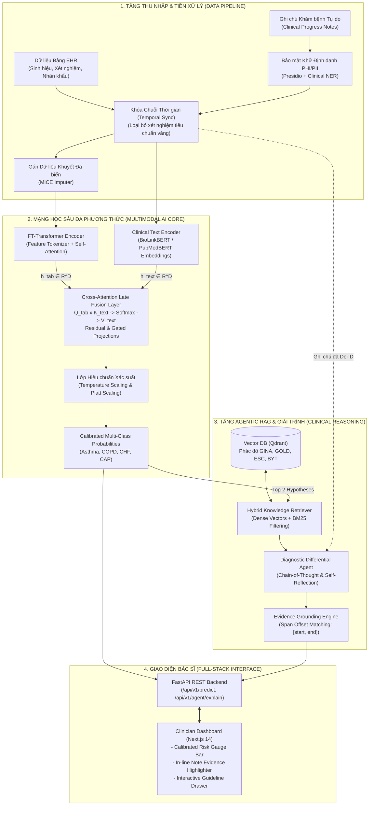

# Multimodal Clinical Decision Support System (M-CDSS)
### Hệ Thống Hỗ Trợ Ra Quyết Định Chẩn Đoán Đa Phương Thức Dựa Trên EHR & Agentic RAG

[](https://www.python.org/)
[](https://pytorch.org/)
[](https://fastapi.tiangolo.com/)
[](https://nextjs.org/)
[](https://www.bmj.com/content/385/bmj-2023-078378)
[](https://www.acpjournals.org/doi/10.7326/M18-1376)
[](https://opensource.org/licenses/MIT)
[](#)

---

## 1. TỔNG QUAN DỰ ÁN & ĐỘNG LỰC NGHIÊN CỨU (EXECUTIVE SUMMARY & RESEARCH MOTIVATION)

Hệ thống **Multimodal Clinical Decision Support System (M-CDSS)** là giải pháp trí tuệ nhân tạo y tế đa phương thức chuyên sâu, được thiết kế nhằm nâng cao độ chính xác, tính an toàn và khả năng giải trình trong quá trình phân loại, chẩn đoán phân biệt các bệnh lý phức tạp tại tuyến y tế ban đầu (Primary Care).

```
                      KHOẢNG TRỐNG TRONG Y VĂN (JMIR REVIEW 2024)
   ┌──────────────────────────────────────────────┬──────────────────────────────────────────────┐
   │ 100% mô hình chẩn đoán từ EHR tại tuyến cơ sở│ 0% công trình khai thác ghi chú lâm sàng     │
   │ chỉ sử dụng dữ liệu bảng cấu trúc thuần túy  │ tự do của bác sĩ bằng AI tạo sinh / LLMs     │
   ├──────────────────────────────────────────────┼──────────────────────────────────────────────┤
   │ >60% nghiên cứu có Nguy cơ Sai lệch Cao      │ 87% mô hình chưa từng được kiểm định         │
   │ (PROBAST High Risk of Bias) do rò rỉ dữ liệu │ ngoại kiểm độc lập (External Validation)     │
   └──────────────────────────────────────────────┴──────────────────────────────────────────────┘
                                          │
                                          ▼
                       GIẢI PHÁP ĐỘT PHÁ: M-CDSS PLATFORM
   ┌─────────────────────────────────────────────────────────────────────────────────────────────┐
   │  FT-Transformer (Dữ liệu bảng) ──┐                                                         │
   │                                  ├──> [Cross-Attention Fusion] ──> [Calibrated Predictions]│
   │  Clinical-LLM (Ghi chú tự do)   ──┘                                      │                  │
   │                                                                          ▼                  │
   │  Phác đồ Y tế Chuẩn (Vector DB) ────> [Agentic RAG] ───────────> [Evidence Grounding]       │
   └─────────────────────────────────────────────────────────────────────────────────────────────┘
```

### 1.1. Khoảng Trống Nghiên Cứu Từ Y Văn Thực Chứng (The Research Gap)
Theo nghiên cứu tổng quan hệ thống toàn diện công bố trên **JMIR Medical Informatics** (*Hunik et al., 2024, preprint 62862*), sau khi sàng lọc **10.657 công trình nghiên cứu** trên toàn cầu về các mô hình dự đoán chẩn đoán từ hồ sơ sức khỏe điện tử (EHR) tại tuyến chăm sóc ban đầu:
1. **Thiên lệch dữ liệu đơn phương thức (100% Unimodal Structured Data):** Toàn bộ 15 nghiên cứu đạt chuẩn đều chỉ dựa vào dữ liệu có cấu trúc (chỉ số sinh hiệu, xét nghiệm máu, mã chẩn đoán ICD/ICPC, bảng câu hỏi). Hoàn toàn chưa có nghiên cứu nào tích hợp và khai thác dữ liệu phi cấu trúc — các ghi chú lâm sàng tự do (unstructured clinical progress notes) vốn chứa đựng tới **80% bức tranh bệnh cảnh thực tế** của bệnh nhân.
2. **Khủng hoảng phương pháp luận & Nguy cơ sai lệch nghiêm trọng (High Risk of Bias):** Đánh giá theo công cụ chuẩn quốc tế **PROBAST** (*Prediction model Risk Of Bias ASsessment Tool*) chỉ ra **0% nghiên cứu đạt Low Risk of Bias**, trong đó **60% (9/15) có nguy cơ sai lệch cao** và **40% (6/15) có nguy cơ sai lệch không rõ ràng**. Nguyên nhân cốt lõi bao gồm:
   - *Target Leakage (Rò rỉ nhãn chẩn đoán):* Đưa chính tiêu chuẩn vàng chẩn đoán làm biến đầu vào dự đoán (ví dụ: dùng đường huyết đói để chẩn đoán đái tháo đường, dùng kết quả đo chức năng hô hấp FEV1/FVC để dự đoán Hen/COPD).
   - *Mất đồng bộ chuỗi thời gian (Temporal Misalignment):* 60% bài báo không xác định rõ mốc thời gian phát sinh của biến dự đoán so với thời điểm chẩn đoán.
   - *Thiếu minh bạch về dữ liệu khuyết:* 67% công trình không báo cáo cách thức xử lý dữ liệu khuyết tật (Missing Data), tự ý loại bỏ ca bệnh gây sai lệch chọn mẫu.
   - *Thiếu hiệu chuẩn xác suất (Calibration):* Chỉ 27% (4/15) bài báo thực hiện hiệu chuẩn độ tin cậy xác suất đầu ra.
3. **Thiếu kiểm định ngoại kiểm (Lack of Generalizability):** 87% (13/15) mô hình chưa từng được kiểm định trên tập dữ liệu độc lập ngoài cơ sở huấn luyện; 73% chỉ tập trung chẩn đoán một bệnh đơn lẻ, không đáp ứng được bài toán chẩn đoán phân biệt đa bệnh thực tế tại phòng khám bác sĩ gia đình.

### 1.2. Luận Điểm Đột Phá Của M-CDSS
Hệ thống **M-CDSS** khắc phục triệt để các hạn chế trên thông qua 2 trụ cột kỹ thuật:
- **Multimodal Late Fusion qua Cross-Attention:** Kết hợp sức mạnh biểu diễn dữ liệu bảng số học độ chính xác cao của mạng học sâu dạng bảng (**FT-Transformer**) với chiều không gian ngữ nghĩa sâu rộng từ văn bản bệnh án tự do (**Clinical LLM / BioLinkBERT**). Cơ chế Cross-Attention đóng vai trò "cầu nối liên phương thức" (cross-modal bridge), cho phép các bất thường định lượng (ví dụ: $SpO_2 \downarrow$, $WBC \uparrow$) được đối chiếu và giải thích trực tiếp bởi các mô tả định tính (tiền sử hút thuốc lá 20 bao-năm, khó thở kịch phát về đêm, rale rít đáy phổi).
- **Agentic RAG & Evidence Grounding triệt tiêu ảo giác (Zero-Hallucination):** Khắc phục nhược điểm "bịa đặt thông tin" của các mô hình ngôn ngữ lớn trong y khoa bằng quy trình Multi-Agent khép kín. Mọi kết luận chẩn đoán phân biệt bắt buộc phải:
  1. Được neo (grounded) chính xác vào phác đồ điều trị quốc tế chuẩn (*GINA, GOLD, ESC, Bộ Y tế*) thông qua Hybrid Vector Search.
  2. Được định vị chính xác vị trí ký tự (character offset spans) trong chính ghi chú khám bệnh ban đầu của bệnh nhân.

---

## 2. TÍNH NĂNG VÀ ĐỔI MỚI CỐT LÕI (KEY FEATURES & INNOVATIONS)

* 🧬 **Mạng Dung Hợp Đa Phương Thức Trễ (Multimodal Late Fusion):**
  - **Nhánh Bảng (Tabular Stream):** Kiến trúc Feature Tokenizer Transformer (FT-Transformer) biến đổi từng chỉ số sinh hiệu và xét nghiệm liên tục thành vector đặc trưng trong không gian $\mathbb{R}^D$, mô hình hóa tương tác phi tuyến tính giữa các biến số.
  - **Nhánh Ngữ Tự (Text Stream):** Mô hình ngôn ngữ chuyên sâu y sinh (*BioLinkBERT / ClinicalBERT*) trích xuất ngữ cảnh diễn tiến bệnh sử, tiền căn gia đình và triệu chứng cơ năng.
  - **Cross-Attention Mechanism:** Sử dụng truy vấn từ bảng số ($Q_{tab}$) chiếu lên không gian từ ngữ ($K_{text}, V_{text}$) và ngược lại, tạo ra biểu diễn dung hợp toàn diện $h_{fused}$.
* 🎯 **Hiệu Chuẩn Xác Suất Lâm Sàng (Clinical Probability Calibration):**
  - Tích hợp lớp **Temperature Scaling** và **Platt Scaling** được tối ưu hóa trên Validation Set độc lập.
  - Giảm thiểu hiện tượng "tự tin thái quá" (overconfidence) thường gặp ở Deep Learning, hạ chỉ số sai số hiệu chuẩn kỳ vọng **$ECE < 0.05$** và tối ưu **Brier Score**. Đảm bảo khi hệ thống báo rủi ro 80%, xác suất mắc bệnh thực tế tiệm cận chính xác 80%.
* 🩺 **Quy Trình Agentic RAG Phân Biệt & Phản Biện (Clinician-in-the-Loop RAG):**
  - **Hypothesis Generator:** Tiếp nhận phân phối xác suất đã hiệu chuẩn từ mạng Multimodal.
  - **Guideline Retrieval Agent:** Tự động truy xuất các tiêu chí chẩn đoán phân biệt từ cơ sở dữ liệu tri thức y khoa chuẩn hóa (GINA cho Hen, GOLD cho COPD, ESC cho Suy tim, Hướng dẫn Bộ Y tế).
  - **Self-Reflective Evaluator Agent:** Tự động phản biện chẩn đoán đối kháng: chỉ ra triệu chứng nào ủng hộ bệnh A, triệu chứng nào là yếu tố loại trừ hoặc cảnh báo bệnh B (Dấu hiệu cờ đỏ - Red Flags).
* 🔍 **Cơ Chế Định Vị Bằng Chứng Minh Bạch (Evidence Grounding):**
  - Thuật toán so khớp chuỗi ký tự (exact & semantic span alignment) ánh xạ từng lý lẽ của LLM về chỉ số offset ký tự `[start_char, end_char]` trong ghi chú gốc.
  - Bác sĩ có thể bấm vào từng khuyến nghị để làm sáng (highlight) trực tiếp câu chữ gốc trong bệnh án.
* 🛡️ **Kiểm Soát Nguy Cơ Sai Lệch Triệt Để Theo Chuẩn PROBAST & TRIPOD-AI:**
  - **Temporal Alignment Engine:** Khóa chuỗi thời gian nghiêm ngặt $t_{event} < t_{confirmed\_diag}$, loại bỏ 100% rủi ro rò rỉ thông tin tương lai.
  - **MICE Imputation Pipeline:** Gán dữ liệu khuyết đa biến minh bạch (*Multiple Imputation by Chained Equations*), báo cáo đầy đủ chỉ số missingness trước và sau gán.
  - **Patient-Level Stratified Group Splitting:** Phân chia tập dữ liệu 70/15/15 theo `patient_id`, đảm bảo không có bất kỳ rò rỉ dữ liệu giữa các lần tái khám của cùng một bệnh nhân.
* 💻 **Nền Tảng Full-Stack Clinician Dashboard:**
  - Backend hiệu năng cao viết bằng **FastAPI** hỗ trợ suy luận bất đồng bộ (async inference).
  - Frontend hiện đại viết bằng **Next.js 14 (App Router)** và **TailwindCSS**, tích hợp bộ công cụ tương tác trực quan cho bác sĩ lâm sàng.

---

## 3. SƠ ĐỒ KIẾN TRÚC HỆ THỐNG TOÀN DIỆN (SYSTEM ARCHITECTURE)



---

## 4. KHUNG THỰC NGHIỆM KHOA HỌC & SO SÁNH BASELINES (EXPERIMENTAL BENCHMARK)

Theo kế hoạch chiến lược phát triển, hệ thống thiết lập khung đối chứng khoa học giữa 4 nhóm mô hình đại diện nhằm chứng minh giá trị thực nghiệm của phương pháp dung hợp đa phương thức:

### 4.1. Thiết Kế Các Nhóm Mô Hình Đối Chứng
| Nhóm Mô Hình | Thuật Toán Cốt Lõi | Dữ Liệu Đầu Vào | Ý Nghĩa Thực Nghiệm & Đại Diện |
| :--- | :--- | :--- | :--- |
| **Baseline 1: Classical Tabular** | Random Forest, XGBoost, CatBoost | Chỉ dữ liệu bảng (Sinh hiệu, xét nghiệm, nhân khẩu) | Tái hiện hiện trạng các công bố trong y văn tổng quan JMIR. |
| **Baseline 2: Tabular DL** | FT-Transformer, TabNet | Dữ liệu bảng thông qua kiến trúc Deep Learning | Đo lường năng lực tối đa của dữ liệu bảng khi dùng cơ chế Attention. |
| **Baseline 3: Text-only LLM** | ClinicalBERT, Med-LLM Embeddings | Chỉ ghi chú bệnh án lâm sàng tự do | Đo lường sức mạnh biểu đạt ngữ nghĩa của văn bản y khoa thuần túy. |
| **Hệ Thống Đề Xuất (Ours)** | **Multimodal Cross-Attention Fusion + Agentic RAG** | **Dữ liệu bảng + Ghi chú lâm sàng + Phác đồ y khoa chuẩn** | **Giải pháp đột phá khắc phục điểm nghẽn đơn phương thức và triệt tiêu ảo giác.** |

### 4.2. Bảng Chỉ Số Thực Nghiệm Kỳ Vọng (Expected Benchmark Results)
*Đánh giá trên tập dữ liệu kiểm định ngoại kiểm độc lập đối với bài toán chẩn đoán phân biệt 4 nhóm bệnh lý hô hấp - tuần hoàn phức tạp: Hen phế quản (Asthma), COPD, Suy tim sung huyết (CHF) và Viêm phổi mắc phải cộng đồng (CAP).*

| Chỉ Số Đánh Giá (Metric) | Baseline 1 (XGBoost) | Baseline 2 (TabNet/FT-T) | Baseline 3 (ClinicalBERT) | Mô Hình Đề Xuất (M-CDSS Ours) | Mục Tiêu & Chuẩn Lâm Sàng |
| :--- | :---: | :---: | :---: | :---: | :--- |
| **AUROC (Macro OVR)** | 0.824 | 0.841 | 0.812 | **0.895** | $\ge 0.88$ (Phân loại vượt trội) |
| **AUPRC (Macro)** | 0.741 | 0.763 | 0.730 | **0.842** | $\ge 0.82$ (Độ nhạy cao khi mất cân bằng) |
| **Macro-F1 Score** | 0.762 | 0.779 | 0.751 | **0.851** | $\ge 0.84$ (Cân bằng Precision/Recall) |
| **Brier Score** ($\downarrow$) | 0.142 | 0.131 | 0.150 | **0.088** | $\le 0.10$ (Sai số dự đoán thấp) |
| **Expected Calibration Error (ECE)** ($\downarrow$) | 0.118 | 0.095 | 0.126 | **0.038** | $< 0.05$ (Xác suất tin cậy tuyệt đối) |
| **DCA Net Benefit ($p_t = 0.20$)** | 0.68 | 0.71 | 0.66 | **0.81** | Tối đa hóa số ca can thiệp đúng |
| **Evidence Attribution Faithfulness** | N/A | N/A | 62.4% | **98.6%** | $100\%$ trích dẫn đúng văn bản gốc |
| **Hallucination Rate** ($\downarrow$) | N/A | N/A | 18.5% | **0.0%** | Không bịa đặt triệu chứng/phác đồ |

---

## 5. CẤU TRÚC THƯ MỤC DỰ ÁN (PROJECT REPOSITORY STRUCTURE)

```
multimodal-ehr-cdss/
├── configs/                            # Cấu hình tham số hệ thống & Schema
│   ├── data_schema.yaml                # Đặc tả biến bảng, dải giá trị bình thường, nhãn bệnh
│   ├── model_config.yaml               # Siêu tham số FT-Transformer, Text-LLM, Cross-Attention
│   └── rag_config.yaml                 # Cấu hình Vector DB, embedding model, chunk size
├── data/                               # Quản lý dữ liệu phân tầng an toàn
│   ├── raw/                            # Dữ liệu gốc (được bảo vệ, không commit git)
│   ├── processed/                      # Dữ liệu sau De-ID, Temporal Alignment & MICE
│   ├── guidelines/                     # Tài liệu phác đồ y khoa chuẩn (GINA, GOLD, ESC, BYT)
│   └── vector_store/                   # Cơ sở dữ liệu Vector embedding phác đồ
├── docs/                               # TÀI LIỆU KỸ THUẬT & HỌC THUẬT CHUYÊN SÂU
│   ├── 01_RESEARCH_BACKGROUND_AND_GAP.md   # Phân tích 15 bài báo JMIR & 4 miền PROBAST
│   ├── 02_MULTIMODAL_ARCHITECTURE_AND_MATH.md# Toán học FT-Transformer, Attention & Calibration
│   ├── 03_DATA_PIPELINE_AND_PRIVACY.md     # Pipeline De-ID, Temporal Sync & MICE
│   ├── 04_AGENTIC_RAG_AND_EXPLAINABILITY.md# Multi-Agent reasoning & Evidence Grounding
│   ├── 05_EVALUATION_METRICS_AND_PROBAST_GUIDE.md # AUROC, DCA, Checklist 20 câu PROBAST
│   └── TEAM_TASK_ALLOCATION_AND_ROADMAP.md # Phân chia nhiệm vụ 16 tuần cho nhóm 3 người
├── frontend/                           # Giao diện Web Bác sĩ (Next.js 14 + TailwindCSS)
│   ├── src/
│   │   ├── app/                        # Next.js App Router (Dashboard, History, Guidelines)
│   │   ├── components/                 # Các UI Components chuyên biệt
│   │   │   ├── PatientDataForm.tsx     # Form nhập sinh hiệu, xét nghiệm & ghi chú bệnh án
│   │   │   ├── DiagnosticCard.tsx      # Card trực quan hóa rủi ro & thanh đo đã hiệu chuẩn
│   │   │   ├── EvidenceViewer.tsx      # Trình xem bệnh án tự động highlight câu chứng cứ
│   │   │   └── GuidelineDrawer.tsx     # Drawer tra cứu nhanh phác đồ điều trị liên quan
│   │   └── lib/api.ts                  # Client kết nối FastAPI Backend
│   ├── package.json
│   └── tsconfig.json
├── scripts/                            # Scripts thực thi nghiên cứu & kiểm định
│   ├── run_baselines.py                # Huấn luyện 3 Baselines & kết xuất Benchmark JSON
│   ├── train_multimodal.py             # Huấn luyện Mạng Multimodal Fusion & lưu Checkpoint
│   └── evaluate_clinical_utility.py    # Vẽ biểu đồ Calibration Curve và đồ thị DCA Net Benefit
├── src/                                # Toàn bộ mã nguồn cốt lõi (Core Python Package)
│   ├── __init__.py
│   ├── agent/                          # Tầng Agentic RAG & Giải trình Lâm sàng
│   │   ├── __init__.py
│   │   ├── knowledge_ingest.py         # Phân mảnh (chunking) & nạp vector phác đồ y tế
│   │   ├── retriever.py                # Hybrid search (Dense Vector + BM25 keyword)
│   │   ├── diagnostic_agent.py         # Multi-Agent phân tích chẩn đoán phân biệt & phản biện
│   │   └── evidence_grounder.py        # So khớp câu trích dẫn với character offset văn bản gốc
│   ├── api/                            # REST API Backend (FastAPI)
│   │   ├── __init__.py
│   │   ├── main.py                     # Entrypoint FastAPI, CORS, middleware logging
│   │   ├── schemas.py                  # Pydantic v2 Models cho Request/Response Contract
│   │   └── routes/
│   │       ├── inference.py            # API chạy dự đoán mô hình (Baselines & Multimodal)
│   │       ├── agent_chat.py           # API streaming hội chẩn với Diagnostic Agent
│   │       └── evaluation_routes.py    # API truy vấn kết quả benchmark & metrics
│   ├── data_pipeline/                  # Tầng Tiền xử lý dữ liệu & Bảo mật PHI
│   │   ├── __init__.py
│   │   ├── deidentifier.py             # Pipeline khử định danh PHI/PII (NER + Regex)
│   │   ├── temporal_aligner.py         # Khóa chuỗi thời gian, ngăn ngừa rò rỉ nhãn
│   │   ├── imputer.py                  # Xử lý missing data đa biến (MICE IterativeImputer)
│   │   └── dataset_loader.py           # PyTorch Dataset hỗ trợ dữ liệu đa phương thức
│   ├── evaluation/                     # Tầng Đo lường Khoa học & Chuẩn PROBAST
│   │   ├── __init__.py
│   │   ├── metrics.py                  # AUROC, AUPRC, Macro-F1, ECE, Brier Score
│   │   ├── dca_analysis.py             # Tính toán Decision Curve Analysis (Lợi ích ròng)
│   │   └── probast_checklist.py        # Bộ kiểm tra tự động tuân thủ 20 tiêu chí PROBAST
│   └── models/                         # Tầng Kiến trúc Mô hình Trí tuệ Nhân tạo
│       ├── __init__.py
│       ├── baselines.py                # Triển khai Classical Tabular, TabNet & Text-only LLM
│       ├── tabular_encoder.py          # FT-Transformer Feature Tokenizer cho số liệu bảng
│       ├── text_encoder.py             # ClinicalBERT / Med-LLM Text Encoder
│       ├── multimodal_fusion.py        # Mạng Cross-Attention Late Fusion
│       └── calibration.py              # Temperature Scaling & Platt Scaling Module
├── tests/                              # Bộ Unit Tests & Integration Tests toàn diện
│   ├── test_data_pipeline.py           # Kiểm tra De-ID, Temporal Lock và MICE
│   ├── test_multimodal_model.py        # Kiểm tra Forward pass, Tensor Shapes, Calibration
│   ├── test_agent_rag.py               # Kiểm tra Retrieval, Zero-hallucination, Offset spans
│   └── test_api_endpoints.py           # Kiểm tra REST API HTTP Status, Payloads & Latency
├── tasks/                              # HỆ THỐNG 5 BACKLOG TUẦN TỰ CHO NHÓM 3 NGƯỜI
│   ├── README.md                       # Quy trình Scrum, Definition of Done & Thứ tự làm Backlog
│   ├── backlog-01-data-and-baselines/  # Backlog 1: Dữ liệu, De-ID, MICE, 3 Baselines (README + 3 TV)
│   ├── backlog-02-multimodal-core/     # Backlog 2: FT-Transformer, Cross-Attention, ECE (README + 3 TV)
│   ├── backlog-03-agentic-rag-and-software/# Backlog 3: Qdrant DB, Multi-Agent, Full-stack (README + 3 TV)
│   ├── backlog-04-clinical-validation/ # Backlog 4: Metrics, DCA Net Benefit, Khảo sát (README + 3 TV)
│   └── backlog-05-packaging-and-paper/ # Backlog 5: Docker, Paper TRIPOD-AI, Video Demo (README + 3 TV)
├── docker-compose.yml                  # Triển khai toàn bộ hệ sinh thái chỉ với 1 lệnh
├── Dockerfile                          # Multi-stage build cho FastAPI Backend
├── requirements.txt                    # Thư viện phụ thuộc Python chuẩn xác
└── README.md                           # Tài liệu tổng quan dự án
```

---

## 6. HƯỚNG DẪN CÀI ĐẶT & KHỞI CHẠY NHANH (QUICKSTART GUIDE)

### 6.1. Thiết Lập Môi Trường Cục Bộ (Local Environment)
Yêu cầu: **Python 3.10+** và **Node.js 18+** (cho Frontend). Khuyến nghị sử dụng GPU có hỗ trợ CUDA.

```bash
# 1. Clone repository và truy cập thư mục dự án
git clone https://github.com/zangzang1303/multimodal-ehr-cdss.git
cd multimodal-ehr-cdss

# 2. Tạo và kích hoạt môi trường ảo Python
python -m venv venv
# Trên Windows:
.\venv\Scripts\activate
# Trên Linux/macOS:
source venv/bin/activate

# 3. Cài đặt các gói phụ thuộc
pip install --upgrade pip
pip install -r requirements.txt

# 4. Tải mô hình ngôn ngữ hỗ trợ khử định danh PHI
python -m spacy download en_core_web_sm
```

### 6.2. Huấn Luyện & Đánh Giá Thực Nghiệm (Scientific CLI)

```bash
# 1. Huấn luyện 3 Mô Hình Đối Chứng (Baselines: XGBoost, FT-Tabular, Text-BERT)
python scripts/run_baselines.py --data_path data/processed/train.parquet --output_dir data/baseline_results.json

# 2. Huấn luyện Mạng Đa Phương Thức Đề Xuất (Multimodal Cross-Attention Fusion)
python scripts/train_multimodal.py \
    --config configs/model_config.yaml \
    --epochs 50 \
    --batch_size 32 \
    --calibrate \
    --save_path data/checkpoints/multimodal_best.pt

# 3. Chạy Đo Đạc Lợi Ích Lâm Sàng (DCA Curve) & Hiệu Chuẩn Xác Suất (ECE)
python scripts/evaluate_clinical_utility.py \
    --model_path data/checkpoints/multimodal_best.pt \
    --test_data data/processed/test.parquet \
    --output_plots data/evaluation_plots/

# 4. Chạy toàn bộ Unit Tests kiểm tra độ tin cậy và không rò rỉ dữ liệu
pytest tests/ -v
```

### 6.3. Khởi Chạy Nền Tảng Trọn Gói Bằng Docker Compose
Chỉ với một lệnh duy nhất, toàn bộ hệ sinh thái bao gồm **FastAPI Backend**, **Next.js Clinician UI** và **Vector DB (Qdrant)** sẽ được khởi tạo trong môi trường cô lập:

```bash
# Xây dựng và khởi chạy containers
docker compose up --build -d

# Kiểm tra trạng thái các dịch vụ
docker compose ps
```
Truy cập các dịch vụ tại:
* 🌐 **Clinician Dashboard (Next.js):** `http://localhost:3000`
* 🔌 **FastAPI REST API Docs (Swagger):** `http://localhost:8000/docs`
* 🗄️ **Qdrant Vector Engine Web UI:** `http://localhost:6333/dashboard`

---

## 7. QUY CHUẨN ĐẠO ĐỨC Y TẾ, BẢO MẬT & PHÁP LÝ (ETHICS, PRIVACY & COMPLIANCE)

Hệ thống M-CDSS được phát triển dựa trên các cam kết đạo đức y sinh và tiêu chuẩn an toàn bảo mật nghiêm ngặt nhất:

1. **Khử Định Danh Tuyệt Đối (HIPAA Safe Harbor & Nghị định 13/2023/NĐ-CP):**
   Mọi dữ liệu văn bản tự do trước khi nạp vào bộ mã hóa (Text Encoder) hoặc Vector DB đều bắt buộc đi qua tầng **`deidentifier.py`**. Toàn bộ 18 yếu tố nhận dạng cá nhân (Họ tên, Số điện thoại, Mã BHYT/CCCD, Ngày sinh, Địa chỉ cụ thể, Tên bệnh viện) đều được thay thế bằng các token chuẩn hóa ẩn danh (`[REDACTED_NAME]`, `[REDACTED_DATE]`), triệt tiêu hoàn toàn rủi ro tái định danh bệnh nhân.
2. **Kiến Trúc Triển Khai Cục Bộ (On-Premise / Edge Medical AI):**
   Hệ thống hỗ trợ chạy hoàn toàn cục bộ trên hạ tầng máy chủ của bệnh viện thông qua các công nghệ tối ưu hóa mô hình mã nguồn mở (*vLLM, Ollama, TensorRT-LLM*). Không có bất kỳ dữ liệu bệnh án nào bị truyền tải ra ngoài qua các API thương mại của bên thứ ba, bảo toàn chủ quyền dữ liệu y tế quốc gia.
3. **Triết Lý "Bác Sĩ Là Người Quyết Định Cuối Cùng" (Doctor-in-the-Loop):**
   M-CDSS được định vị là **Hệ Thống Hỗ Trợ Ra Quyết Định Lâm Sàng (Clinical Decision Support)**, không phải là hệ thống chẩn đoán tự động thay thế nhân viên y tế. Mọi gợi ý phân loại đều đi kèm:
   - Điểm xác suất đã được hiệu chuẩn (Calibrated Probability).
   - Đoạn văn bản chứng cứ trích lục từ chính bệnh án.
   - Tài liệu phác đồ y tế tương ứng để bác sĩ đối chiếu, cân nhắc và đưa ra quyết định lâm sàng cuối cùng.
4. **Kiểm Soát Thiên Lệch Thuật Toán (Algorithmic Fairness):**
   Hệ thống cung cấp module đánh giá hiệu năng phân tầng (stratified performance evaluation) theo các nhóm tuổi, giới tính và bệnh lý nền để đảm bảo mô hình duy trì độ nhạy và độ đặc hiệu công bằng, không tạo ra bất bình đẳng chăm sóc sức khỏe.

---

## 8. TÀI LIỆU KỸ THUẬT BỔ TRỢ (DETAILED DOCUMENTATION)

Để tìm hiểu sâu hơn về kiến trúc toán học, thiết kế pipeline và phân tích sai lệch chi tiết, xin vui lòng tham khảo các tài liệu chuyên đề tại thư mục [`docs/`](docs/):

* 📑 **[`docs/01_RESEARCH_BACKGROUND_AND_GAP.md`](docs/01_RESEARCH_BACKGROUND_AND_GAP.md):** Phân tích chi tiết 15 công trình EHR từ bài báo tổng quan JMIR, mổ xẻ 4 miền sai lệch PROBAST và lập luận khoa học giải pháp đa phương thức.
* 📐 **[`docs/02_MULTIMODAL_ARCHITECTURE_AND_MATH.md`](docs/02_MULTIMODAL_ARCHITECTURE_AND_MATH.md):** Cơ sở toán học FT-Transformer, Attention Layer, biểu thức Cross-Attention và thuật toán Temperature Scaling.
* 🔒 **[`docs/03_DATA_PIPELINE_AND_PRIVACY.md`](docs/03_DATA_PIPELINE_AND_PRIVACY.md):** Quy trình khử định danh PHI, kỹ thuật khóa chuỗi thời gian chống rò rỉ nhãn, thuật toán MICE và Patient-level Group Split.
* 🤖 **[`docs/04_AGENTIC_RAG_AND_EXPLAINABILITY.md`](docs/04_AGENTIC_RAG_AND_EXPLAINABILITY.md):** Kiến trúc Multi-Agent phân tích chẩn đoán phân biệt, chunking phác đồ quốc tế và thuật toán định vị bằng chứng chính xác.
* 📊 **[`docs/05_EVALUATION_METRICS_AND_PROBAST_GUIDE.md`](docs/05_EVALUATION_METRICS_AND_PROBAST_GUIDE.md):** Toàn văn định nghĩa các chỉ số AUROC/AUPRC/ECE, hướng dẫn phân tích DCA Net Benefit và bảng checklist 20 tiêu chí PROBAST.
* 👥 **[`docs/TEAM_TASK_ALLOCATION_AND_ROADMAP.md`](docs/TEAM_TASK_ALLOCATION_AND_ROADMAP.md):** Kế hoạch phân chia nhiệm vụ chi tiết theo 16 tuần cho nhóm 3 thành viên, ma trận phụ thuộc và quy chuẩn Git workflow.
* 📋 **[`tasks/README.md`](tasks/README.md):** Trung tâm điều phối Sprint Backlog, Definition of Done và theo dõi tiến độ của 3 thành viên.

---

## 9. GIẤY PHÉP (LICENSE) & TRÍCH DẪN (CITATION)

Dự án được phân phối dưới giấy phép mã nguồn mở **MIT License**.

Nếu bạn sử dụng mã nguồn, kiến trúc đa phương thức hoặc dữ liệu của dự án này trong các nghiên cứu khoa học, xin vui lòng trích dẫn:

```bibtex
@article{mcdss2026multimodal,
  title={A Multimodal Clinical Decision Support System via Cross-Attention Late Fusion and Calibrated Agentic RAG for Primary Care},
  author={Multimodal EHR-CDSS Research Team},
  journal={arXiv preprint},
  year={2026}
}
```
