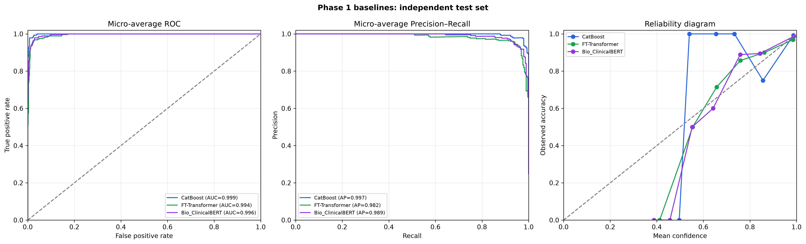

# BÁO CÁO KẾT QUẢ GIAI ĐOẠN 1 HỆ THỐNG M-CDSS

**Bản hiệu chỉnh theo artefact thực tế trong kho mã nguồn**  
**Ngày đối chiếu:** 27/10/2026  
**Phạm vi:** dữ liệu tổng hợp, pipeline tiền xử lý và ba baseline đơn phương thức

## 1. Tóm tắt điều hành

Giai đoạn 1 đã xây dựng được pipeline dữ liệu đa phương thức và đánh giá ba baseline trên bài toán phân loại bốn nhóm bệnh: hen phế quản (`ASTHMA`), bệnh phổi tắc nghẽn mạn tính (`COPD`), suy tim (`HEART_FAILURE`) và viêm phổi (`PNEUMONIA`).

Kết quả được ghi trong `data/baseline_results.json` cho thấy CatBoost là mô hình có độ chính xác kiểm thử cao nhất, đạt **97,5524%** trên **286** bệnh nhân. FT-Transformer đạt **94,4056%** và Bio_ClinicalBERT đạt **93,7063%**. Cả ba mô hình có ECE dưới 0,05 trên tập kiểm thử tổng hợp.

Các kết quả này **không phải bằng chứng về hiệu quả lâm sàng ngoài thực tế**. Tập dữ liệu có độ phân tách rất cao, ghi chú thường chứa trực tiếp tên bệnh đích, và kiểm toán phát hiện một số vấn đề về gán khuyết cũng như ghép nối giữa dữ liệu bảng và văn bản. Vì vậy, kết luận phù hợp của Giai đoạn 1 là: pipeline và quy trình benchmark đã hoạt động, nhưng cần sửa chất lượng dữ liệu và thực hiện ngoại kiểm trước khi diễn giải hiệu năng theo hướng lâm sàng.

## 2. Dữ liệu và thiết kế đánh giá

### 2.1. Quy mô dữ liệu thực tế

Tập dữ liệu đã xử lý gồm **2.000 bệnh nhân**, mỗi bệnh nhân có một bản ghi:

| Tập dữ liệu | Số bệnh nhân | Tỷ lệ | ASTHMA | COPD | HEART_FAILURE | PNEUMONIA |
|---|---:|---:|---:|---:|---:|---:|
| Huấn luyện | 1.428 | 71,4% | 356 | 357 | 358 | 357 |
| Xác thực | 286 | 14,3% | 72 | 71 | 71 | 72 |
| Kiểm thử | 286 | 14,3% | 72 | 72 | 71 | 71 |
| **Tổng** | **2.000** | **100%** | **500** | **500** | **500** | **500** |

Phép kiểm tra theo `patient_id` không phát hiện bệnh nhân trùng giữa train/validation/test: **0** trùng train–validation, **0** trùng train–test và **0** trùng validation–test.

### 2.2. Nguồn và phương thức dữ liệu

- Dữ liệu bảng gồm 9 biến liên tục: tuổi, huyết áp tâm thu, huyết áp tâm trương, nhịp tim, nhịp thở, SpO2, nhiệt độ, WBC và CRP.
- Bốn biến phân loại gồm giới tính, tình trạng hút thuốc, tiền sử tăng huyết áp và tiền sử đái tháo đường.
- Dữ liệu văn bản là ghi chú lâm sàng đã khử định danh, được tổng hợp từ cấu trúc EHR mô phỏng và các đoạn chép bệnh án.
- Nhãn mục tiêu gồm bốn lớp cân bằng, mỗi lớp đúng **500** bệnh nhân.

### 2.3. Dữ liệu khuyết và gán khuyết

Trước gán khuyết, WBC thiếu ở **19,30%** bản ghi và CRP thiếu ở **21,85%** bản ghi. Các trường còn lại có cờ thiếu bằng 0 trong artefact đã xử lý.

Sau gán khuyết, kiểm toán phát hiện **59/2.000** giá trị CRP âm, tương đương **2,95%** toàn bộ dữ liệu. CRP về mặt sinh học không thể âm; do đó cần chặn miền giá trị hoặc dùng phép biến đổi phù hợp sau MICE trước khi tái huấn luyện.

## 3. Ba baseline được đánh giá

### 3.1. Baseline 1: mô hình bảng cổ điển

Hai ứng viên XGBoost và CatBoost được so sánh theo macro AUROC trên tập validation:

| Ứng viên | Validation macro AUROC |
|---|---:|
| XGBoost | 0,999526 |
| CatBoost | **0,999771** |

CatBoost được chọn làm Baseline 1 chính thức. Vì vậy, việc gọi Baseline 1 là XGBoost trong báo cáo cũ không phản ánh artefact benchmark hiện tại.

### 3.2. Baseline 2: FT-Transformer

FT-Transformer được huấn luyện **20 epoch** trên dữ liệu bảng. Mô hình sử dụng chín biến số liên tục trong luồng huấn luyện được ghi nhận bởi script benchmark hiện tại.

### 3.3. Baseline 3: Bio_ClinicalBERT

Bio_ClinicalBERT sử dụng ghi chú lâm sàng đã khử định danh, chiều dài tối đa **512 token**, learning rate **2 × 10⁻⁵**, huấn luyện **5 epoch**; block encoder cuối và classification head được fine-tune.

## 4. Kết quả định lượng trên tập kiểm thử

| Mô hình | Phương thức | Macro AUROC | Macro AUPRC | Macro F1 | Accuracy | Brier score | ECE |
|---|---|---:|---:|---:|---:|---:|---:|
| **CatBoost** | Bảng có cấu trúc | **0,998766** | **0,996335** | **0,975568** | **0,975524** | **0,044971** | 0,026451 |
| FT-Transformer | Bảng có cấu trúc | 0,990263 | 0,972376 | 0,943586 | 0,944056 | 0,087843 | 0,022285 |
| Bio_ClinicalBERT | Ghi chú lâm sàng | 0,996036 | 0,989071 | 0,936311 | 0,937063 | 0,078921 | **0,018084** |

Các điểm chính:

- CatBoost có macro AUROC, macro AUPRC, macro F1, accuracy và Brier score tốt nhất.
- Bio_ClinicalBERT có ECE thấp nhất, nhưng accuracy và macro F1 thấp nhất trong ba mô hình.
- FT-Transformer không vượt CatBoost trên tập dữ liệu này.
- ECE dưới 0,05 chỉ cho thấy hiệu chuẩn tốt trên hold-out tổng hợp hiện tại; chưa thể suy rộng sang dữ liệu bệnh viện.

## 5. Phân tích ma trận nhầm lẫn

### 5.1. CatBoost

CatBoost dự đoán đúng **279/286** bệnh nhân và sai **7** bệnh nhân.

| Nhãn thật | Đúng / tổng | Recall | Các nhầm lẫn |
|---|---:|---:|---|
| ASTHMA | 68/72 | 94,44% | 4 ca sang COPD |
| COPD | 69/72 | 95,83% | 2 ca sang HEART_FAILURE; 1 ca sang PNEUMONIA |
| HEART_FAILURE | 71/71 | 100% | Không có |
| PNEUMONIA | 71/71 | 100% | Không có |

### 5.2. FT-Transformer

FT-Transformer dự đoán đúng **270/286** bệnh nhân và sai **16** bệnh nhân. Sai số tập trung ở COPD: chỉ **60/72** ca đúng, gồm 1 ca nhầm ASTHMA, 10 ca nhầm HEART_FAILURE và 1 ca nhầm PNEUMONIA.

### 5.3. Bio_ClinicalBERT

Bio_ClinicalBERT dự đoán đúng **268/286** bệnh nhân và sai **18** bệnh nhân. Trong 72 ca COPD, mô hình dự đoán đúng **60**, nhầm 4 ca sang ASTHMA, 6 ca sang HEART_FAILURE và 2 ca sang PNEUMONIA.

Mô hình văn bản cũng nhầm 4/72 ca ASTHMA sang COPD, 1/71 ca HEART_FAILURE sang ASTHMA và 1/71 ca PNEUMONIA sang COPD.

## 6. Hai case study lấy trực tiếp từ error analysis

Các case dưới đây thay thế `PT-0089` và `PT-0126` trong báo cáo cũ. Những chỉ số và xác suất cũ của hai ca đó không khớp với dữ liệu đã xử lý hoặc kết quả benchmark hiện lưu trong repository.

### 6.1. Case 1: mô hình bảng sai, mô hình văn bản đúng

**Bệnh nhân:** `PT-0763`  
**Đợt khám:** `ENC-0763`  
**Nhãn thật:** ASTHMA

| Mô hình | Dự đoán | Độ tin cậy | Kết quả |
|---|---|---:|---|
| CatBoost | COPD | 84,4594% | Sai |
| Bio_ClinicalBERT | ASTHMA | 88,9194% | Đúng |

Dữ liệu bảng của ca này:

| Biến | Giá trị |
|---|---:|
| Tuổi | 65 |
| Huyết áp | 116,3/81,9 mmHg |
| Nhịp tim | 87,9 bpm |
| Nhịp thở | 16 lần/phút |
| SpO2 | 94,7% |
| Nhiệt độ | 36,8°C |
| WBC | 4,32 × 10⁹/L |
| CRP | 2,33 mg/L |
| Giới tính | Nữ |
| Hút thuốc | Đã từng hút |
| Tăng huyết áp / đái tháo đường | 0 / 0 |

Các biến “65 tuổi”, “đã từng hút thuốc” và SpO2 94,7% có thể khiến mô hình bảng nghiêng về COPD. Trong ghi chú, tiền sử có đề cập hen và sử dụng albuterol khi cần; mô hình văn bản dự đoán đúng ASTHMA. Đây là ví dụ thực sự về thông tin bổ sung giữa hai phương thức trong file kết quả.

### 6.2. Case 2: mô hình bảng đúng, mô hình văn bản sai

**Bệnh nhân:** `PT-0319`  
**Đợt khám:** `ENC-0319`  
**Nhãn thật:** COPD

| Mô hình | Dự đoán | Độ tin cậy | Kết quả |
|---|---|---:|---|
| CatBoost | COPD | 91,1861% | Đúng |
| Bio_ClinicalBERT | HEART_FAILURE | 45,5734% | Sai |

Dữ liệu bảng của ca này:

| Biến | Giá trị |
|---|---:|
| Tuổi | 24 |
| Huyết áp | 146,7/94,1 mmHg |
| Nhịp tim | 79 bpm |
| Nhịp thở | 16 lần/phút |
| SpO2 | 85,4% |
| Nhiệt độ | 37,2°C |
| WBC | 5,90 × 10⁹/L |
| CRP | 4,88 mg/L |
| Giới tính | Nam |
| Hút thuốc | Chưa từng hút |
| Tăng huyết áp / đái tháo đường | 1 / 0 |

Ghi chú của ca này mô tả một phụ nữ 84 tuổi có tăng huyết áp, hở van ba lá nặng, tăng áp phổi nhẹ, hẹp van động mạch chủ và rối loạn nhịp nhĩ. Nội dung tim mạch giải thích vì sao mô hình văn bản nghiêng về HEART_FAILURE.

Tuy nhiên, dữ liệu bảng lại ghi nam 24 tuổi. Sự mâu thuẫn này cho thấy đây không chỉ là “điểm mù của mô hình văn bản”, mà còn là **lỗi chất lượng ghép nối đa phương thức**. Case này không nên được dùng để suy luận cơ chế bệnh học trước khi sửa dữ liệu.

## 7. Kiểm toán nguy cơ sai lệch

### 7.1. Tên bệnh đích xuất hiện trong ghi chú

Kiểm tra chuỗi ký tự cho thấy tên bệnh đích hoặc từ viết tắt tương ứng xuất hiện trong ghi chú của:

| Nhãn thật | Số ghi chú có từ khóa đích | Tỷ lệ |
|---|---:|---:|
| ASTHMA | 459/500 | 91,8% |
| COPD | 321/500 | 64,2% |
| HEART_FAILURE | 350/500 | 70,0% |
| PNEUMONIA | 472/500 | 94,4% |

Đây là phép kiểm tra sự xuất hiện từ khóa, không tự nó chứng minh rò rỉ nhãn vì từ khóa có thể nằm trong tiền sử, phủ định hoặc chẩn đoán phân biệt. Dù vậy, tỷ lệ rất cao tạo nguy cơ mô hình học trực tiếp tên bệnh thay vì suy luận từ bằng chứng trước chẩn đoán. Cần cắt ghi chú theo mốc thời gian và loại các phần “discharge diagnosis”, “assessment” hoặc thông tin được tạo sau khi chẩn đoán xác nhận.

### 7.2. Hiệu năng cao trên dữ liệu tổng hợp

Macro AUROC 0,998766 của CatBoost phản ánh tập hold-out hiện tại, không phản ánh độ tổng quát trên bệnh viện khác. Dữ liệu bốn lớp cân bằng hoàn toàn và các đặc trưng được tạo tổng hợp có thể làm bài toán dễ hơn thực tế.

### 7.3. Dashboard hiện tại là mock inference

Endpoint `/api/v1/predict/baseline` đang dùng luật thủ công, không tải ba checkpoint đã benchmark. Các xác suất 0,76; 0,74; 0,71… trong dashboard là hằng số theo nhánh luật và không phải xác suất do CatBoost, FT-Transformer hay Bio_ClinicalBERT thật sinh ra. Vì vậy không được dùng ảnh dashboard hiện tại làm bằng chứng cho kết quả benchmark trong báo cáo khoa học.

## 8. Kết luận và đề xuất Giai đoạn 2

Giai đoạn 1 đã chứng minh repository có thể tạo dữ liệu, chia tập theo bệnh nhân, huấn luyện và đo lường ba baseline. Trên 286 bệnh nhân kiểm thử tổng hợp, CatBoost đạt kết quả tốt nhất với accuracy **97,5524%** và macro AUROC **0,998766**.

Trước khi phát triển mô hình hợp nhất đa phương thức, cần ưu tiên:

1. Sửa hậu xử lý MICE để CRP không âm và chạy lại toàn bộ benchmark.
2. Kiểm tra ghép nối giữa dữ liệu bảng và nội dung ghi chú theo `patient_id`/`encounter_id`.
3. Khóa thời gian nghiêm ngặt, loại nội dung chứa chẩn đoán xác nhận hoặc thông tin sau thời điểm dự đoán.
4. Lưu prediction từng bệnh nhân cho cả ba mô hình, thay vì chỉ lưu một số ví dụ lỗi.
5. Thay endpoint mock bằng suy luận từ checkpoint thật trước khi dùng dashboard để trình diễn kết quả.
6. Đánh giá trên dữ liệu bệnh viện độc lập và báo cáo khoảng tin cậy trước khi đưa ra tuyên bố lâm sàng.

## 9. Nguồn số liệu có thể tái kiểm tra

- `data/baseline_results.json`: metric validation/test, cấu hình rút gọn và bốn ca trong error analysis.
- `data/processed/train.parquet`, `val.parquet`, `test.parquet`: quy mô, phân bố lớp, dữ liệu case study và kiểm toán chất lượng.
- `data/confusion_matrices_baselines.png`: số lượng dự đoán đúng/sai theo lớp.
- `data/baseline_curves.png`: ROC, precision-recall và calibration.
- `scripts/run_baselines.py`: quy trình huấn luyện và lựa chọn mô hình.
- `src/api/routes/inference.py`: logic mock inference đang phục vụ dashboard.

