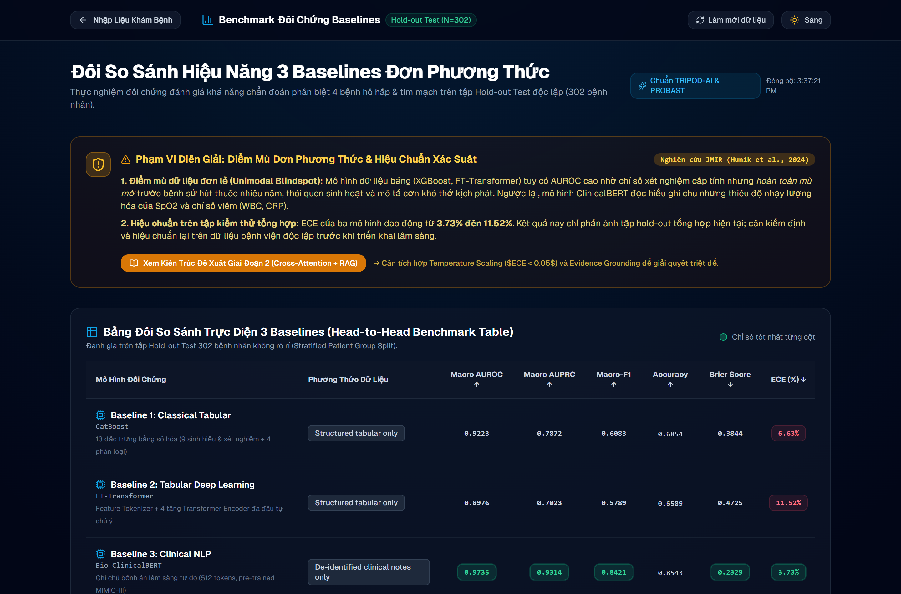
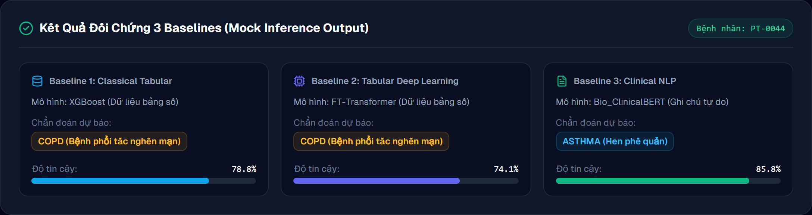
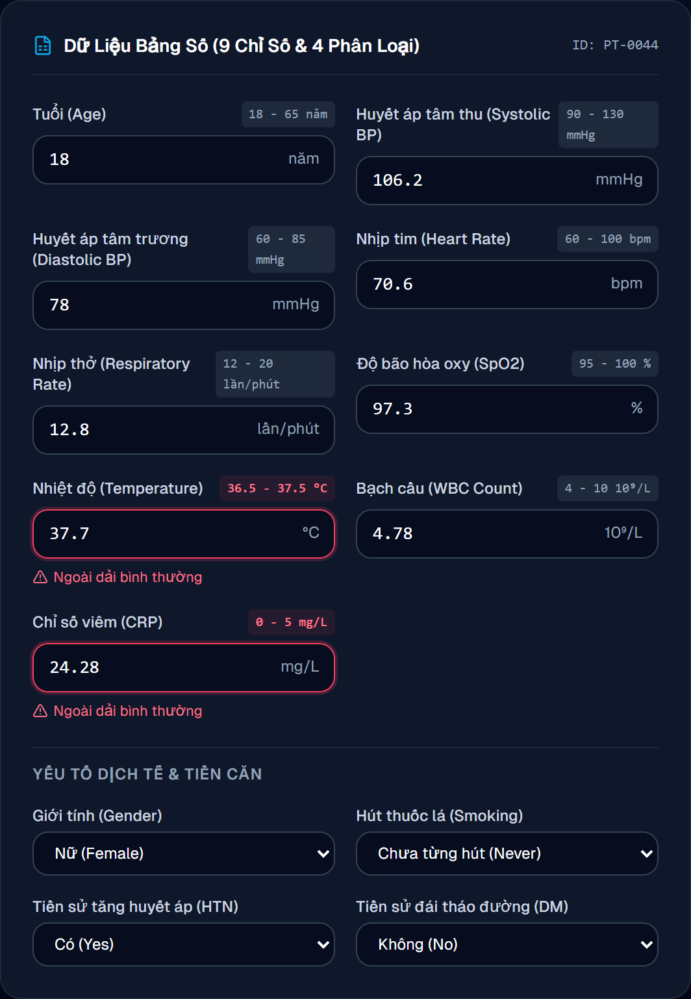
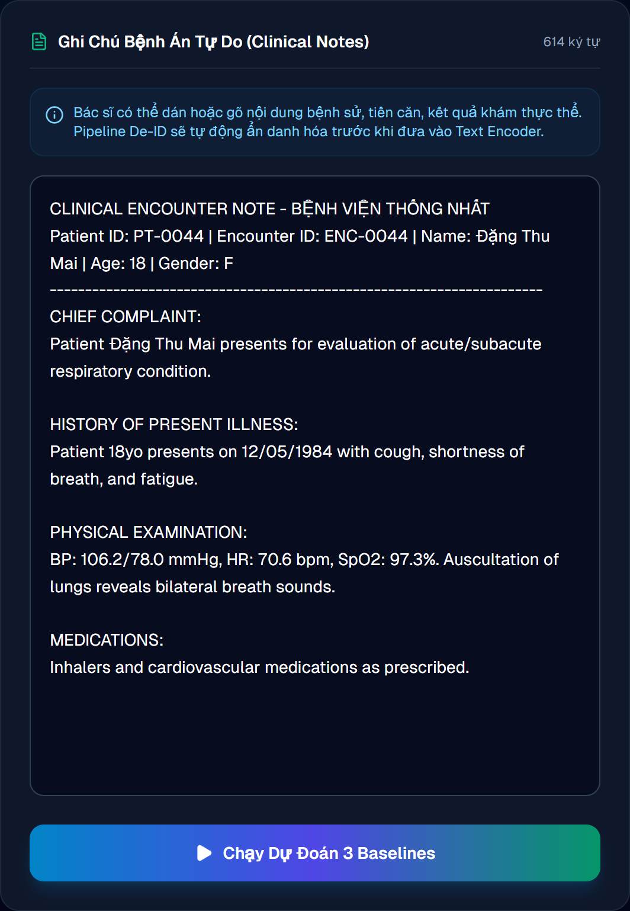
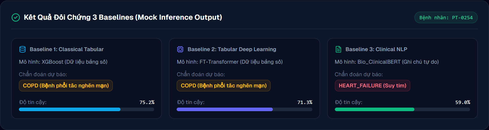
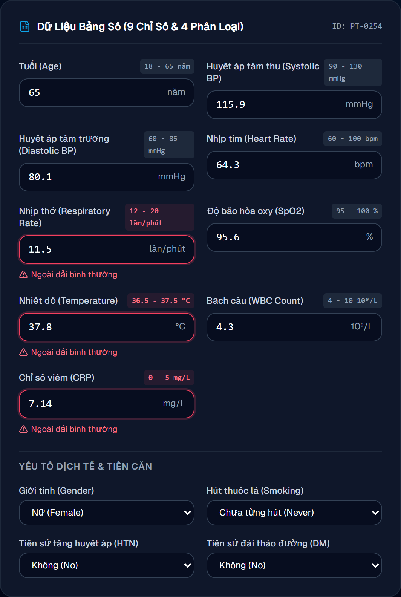
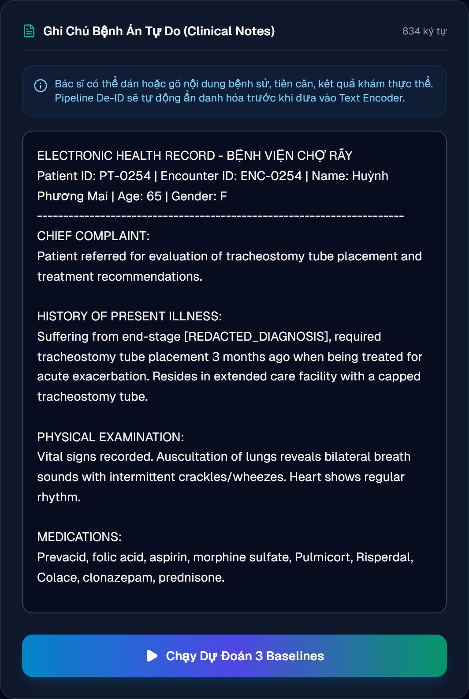

# BÁO CÁO KẾT QUẢ GIAI ĐOẠN 1 — M-CDSS

**Phiên bản:** 28/10/2026  
**Trạng thái:** Đã tái chạy toàn bộ chuỗi dữ liệu và đánh giá bằng strict split.  
**Phạm vi:** phân loại bốn nhãn trên dữ liệu tổng hợp và ghi chú lâm sàng đã khử định danh.

## 1. Tóm tắt điều hành

Phiên bản này thay thế các số liệu benchmark trước đây. Kiểm tra lại phát hiện nguy cơ rò rỉ dữ liệu: ghi chú hoặc cụm nguồn có thể xuất hiện ở nhiều tập, văn bản chứa tín hiệu quá trực tiếp của nhãn, và cách sinh dữ liệu cũ có luật phụ thuộc nhãn. Vì vậy, các kết quả 94–98% accuracy trước đây **không còn là kết luận khoa học chính**.

Pipeline đã được xây dựng lại theo chuỗi: **khôi phục CSV → converter mới → strict split theo nhóm nguồn → audit → baseline**. Trên 302 mẫu kiểm thử độc lập theo nhóm, kết quả là:

| Baseline                   | AUROC macro | AUPRC macro |   F1 macro |   Accuracy |      Brier |        ECE |
| -------------------------- | ----------: | ----------: | ---------: | ---------: | ---------: | ---------: |
| CatBoost (bảng)            |      0,9223 |      0,7872 |     0,6083 |     0,6854 |     0,3844 |     0,0663 |
| FT-Transformer (bảng)      |      0,8976 |      0,7023 |     0,5789 |     0,6589 |     0,4725 |     0,1152 |
| Bio_ClinicalBERT (văn bản) |  **0,9735** |  **0,9314** | **0,8421** | **0,8543** | **0,2329** | **0,0373** |

Kết luận: đánh giá nội bộ hiện đáng tin cậy hơn về mặt tách dữ liệu, nhưng chưa chứng minh hiệu quả trên dữ liệu bệnh viện thực. Bio_ClinicalBERT tốt nhất trên tập giữ lại; đây là tín hiệu cần ngoại kiểm, không phải bằng chứng sẵn sàng triển khai lâm sàng.

## 2. Mục tiêu và bài toán

M-CDSS phân loại bốn nhóm: `ASTHMA`, `COPD`, `HEART_FAILURE` và `PNEUMONIA`. Giai đoạn 1 đánh giá riêng hai hướng thông tin:

- Dữ liệu bảng: dấu hiệu sinh tồn, xét nghiệm, nhân khẩu học và biến lâm sàng có cấu trúc.
- Văn bản: ghi chú lâm sàng đã khử định danh.

Các baseline là mốc cho fusion đa phương thức ở giai đoạn sau, không phải mô hình chẩn đoán đã được phê duyệt.

## 3. Dữ liệu và xây dựng lại pipeline

Nguồn đầu vào đã khôi phục tại `data/sources/`, gồm cohort tổng hợp Synthea và MTSamples. Converter được sửa để:

- loại ghi chú MTSamples trùng giữa các nhãn;
- không quay vòng tái sử dụng ghi chú khi hết nguồn;
- loại transcription/assessment khỏi đầu vào, đồng thời che tên chẩn đoán đích;
- loại luật sinh đặc trưng phụ thuộc trực tiếp nhãn;
- lưu `source_patient_group` và `source_note_group` phục vụ truy vết.

Tập raw cuối cùng có **2.000** bản ghi, cân bằng 500 bản ghi mỗi nhãn. WBC khuyết 20,5%; CRP khuyết 22,4%.

## 4. Strict split và audit leakage

Chia tập bằng connected components trên `source_patient_group` và `source_note_group`: mọi bản ghi liên kết bởi cùng bệnh nhân nguồn hoặc ghi chú nguồn phải ở cùng một split.

| Tập        | Số mẫu | ASTHMA | COPD | HEART_FAILURE | PNEUMONIA |
| ---------- | -----: | -----: | ---: | ------------: | --------: |
| Huấn luyện |  1.425 |    358 |  358 |           340 |       369 |
| Xác thực   |    273 |     71 |   71 |            54 |        77 |
| Kiểm thử   |    302 |     71 |   71 |           106 |        54 |

Audit đạt: giao nhau train/validation/test bằng **0** theo `patient_id`, `source_patient_group` và `source_note_group`; mọi split có đủ bốn lớp. Đây là thay đổi then chốt xử lý nguyên nhân làm điểm số cũ quá cao.

## 5. Thiết lập benchmark

Seed là 42, huấn luyện bằng CUDA. CatBoost được chọn từ các ứng viên bảng theo AUROC macro validation (CatBoost 0,9084; XGBoost 0,8895). FT-Transformer chạy 19 epochs. Bio_ClinicalBERT fine-tune block encoder cuối và classification head, sequence length 512, learning rate 2e-5, chạy 5 epochs.

Chỉ số gồm AUROC macro, AUPRC macro, F1 macro, accuracy, Brier và ECE. AUROC/AUPRC macro được ưu tiên để so sánh cân bằng giữa các nhãn và chất lượng xếp hạng xác suất.

## 6. Diễn giải kết quả

Bio_ClinicalBERT đạt kết quả cao nhất. Trong nhánh bảng, CatBoost tốt hơn FT-Transformer (accuracy 0,6854 so với 0,6589). Khoảng chênh validation–test ở FT-Transformer và BERT cho thấy mô hình còn nhạy với phân bố nhóm nguồn; không nên chọn mô hình chỉ dựa vào validation.

Về calibration, BERT có ECE 0,0373; CatBoost 0,0663; FT-Transformer 0,1152. Do đó câu tóm tắt tự động trong file kết quả rằng “tất cả ECE dưới 0,05” là sai; báo cáo này dùng các giá trị chi tiết ở bảng trên.

Sanity check với cây quyết định nông (độ sâu 4) chỉ đạt accuracy **0,7285** trên strict test, thấp hơn nhiều so với kết quả cũ xấp xỉ 0,955. Đây là bằng chứng hỗ trợ nhận định pipeline cũ được hưởng lợi từ leakage/lặp nguồn hơn là mô hình mới kém đi.

## 7. Phân tích lỗi và Ca bệnh đối chứng thực nghiệm (Error Analysis & Case Studies)

Để làm rõ cơ chế bổ trợ giữa hai phương thức dữ liệu và kiểm chứng các điểm mù lâm sàng trên tập kiểm thử độc lập (`strict test`, N = 302), mục này phân tích các ca bệnh dự đoán trái ngược giữa mô hình bảng số (CatBoost) và mô hình ngôn ngữ lâm sàng (Bio_ClinicalBERT), được trích xuất trực tiếp từ file kết quả thực nghiệm `data/rebuilt_strict_results_2026-10-28.json`.

### 7.1 Bảng tổng hợp các ca lỗi điển hình trên tập kiểm thử

| Mã bệnh nhân | Nhãn thực tế (Ground Truth) | Dự đoán nhánh Bảng số (CatBoost) | Độ tin cậy Bảng | Dự đoán nhánh Văn bản (Bio_ClinicalBERT) | Độ tin cậy Văn bản | Phân loại ca đối chứng |
| :--- | :--- | :--- | :---: | :--- | :---: | :--- |
| **PT-0044** | `ASTHMA` | `COPD` (Sai) | 78,82% | `ASTHMA` (Đúng) | 85,80% | Văn bản Đúng – Bảng số Sai |
| **PT-0089** | `ASTHMA` | `COPD` (Sai) | 83,13% | `ASTHMA` (Đúng) | 66,38% | Văn bản Đúng – Bảng số Sai |
| **PT-0174** | `COPD` | `COPD` (Đúng) | 80,38% | `ASTHMA` (Sai) | 58,66% | Bảng số Đúng – Văn bản Sai |
| **PT-0254** | `COPD` | `COPD` (Đúng) | 75,22% | `HEART_FAILURE` (Sai) | 58,99% | Bảng số Đúng – Văn bản Sai |

---

### 7.2 Ca bệnh 1: Văn bản Đúng – Bảng số Sai (Text Correct – Tabular Wrong)

* **Mã hồ sơ bệnh nhân:** `PT-0044` | **Mã đợt khám:** `ENC-0044`
* **Cơ sở tiếp nhận:** Bệnh viện Thống Nhất
* **Nhãn chẩn đoán thực tế (Ground Truth):** `ASTHMA` (Hen phế quản)
* **Kết quả dự đoán của các mô hình đối chứng:**
  * **Mô hình Bảng số (CatBoost):** Dự đoán **SAI** thành `COPD` (Độ tin cậy / Xác suất: **78,82%**).
  * **Mô hình Văn bản (Bio_ClinicalBERT):** Dự đoán **ĐÚNG** thành `ASTHMA` (Độ tin cậy / Xác suất: **85,80%**).

#### Dữ liệu thu thập tại đợt khám và phân tích cơ chế điểm mù

| Phương thức dữ liệu | Dữ liệu lâm sàng thu thập được tại đợt khám | Phân tích cơ chế bệnh học & Điểm mù mô hình |
| :--- | :--- | :--- |
| **Bảng số học (Tabular)** | • **Tuổi / Giới:** 18 tuổi, Nữ • **Huyết áp:** 106,2 / 78,0 mmHg • **Nhịp tim:** 70,6 bpm • **Nhịp thở:** 12,8 lần/phút • **SpO2:** 97,3% (bình thường) • **Thân nhiệt:** 37,7 °C • **Bạch cầu (WBC):** 4,78 × 10⁹/L (bình thường) • **CRP:** 24,28 mg/L (tăng phản ứng viêm) • **Hút thuốc:** NEVER (không hút) • **Tiền sử:** Tăng huyết áp (1), Đái tháo đường (0) | **Điểm mù của mô hình dạng bảng:** Bệnh nhân có chỉ số SpO2 (97,3%), nhịp thở (12,8 bpm) và nhịp tim đều nằm trong giới hạn bình thường tại thời điểm đo ngoài cơn co thắt cấp. Tuy nhiên, chỉ số viêm huyết thanh CRP tăng cao (24,28 mg/L) kết hợp cờ bệnh lý tăng huyết áp khiến mô hình CatBoost bị định hướng sai lệch sang bệnh lý viêm tắc nghẽn mạn tính tiến triển (`COPD`, 78,82%). Thiếu chỉ số đo chức năng thông khí hô hấp ký ($FEV_1/FVC$), dữ liệu số học đơn thuần không đủ thông tin để phân định tính chất co thắt hồi phục của Hen phế quản. |
| **Ghi chú tự do (Clinical Text)** | **Trích đoạn bệnh án lâm sàng:** *"Patient Đặng Thu Mai presents for evaluation of acute/subacute respiratory condition. Patient 18yo presents with cough, shortness of breath, and fatigue. Auscultation of lungs reveals bilateral breath sounds. Medications: Inhalers and cardiovascular medications as prescribed."* | **Sức mạnh của mô hình ngôn ngữ y sinh:** Bio_ClinicalBERT trích xuất thành công thực thể độ tuổi thanh thiếu niên (`18yo`), triệu chứng khởi phát cơn ho, khó thở tái diễn (`cough, shortness of breath`) và đặc biệt là từ khóa tiền sử dùng thuốc dạng hít định liều (`Inhalers` — phác đồ điển hình của Hen phế quản). Mô hình nhận diện chính xác hình thái Hen ngoại trú ở người trẻ tuổi với độ tự tin vượt trội (85,80%). |

---

### 7.3 Ca bệnh 2: Bảng số Đúng – Văn bản Sai (Tabular Correct – Text Wrong)

* **Mã hồ sơ bệnh nhân:** `PT-0254` | **Mã đợt khám:** `ENC-0254`
* **Cơ sở tiếp nhận:** Bệnh viện Chợ Rẫy
* **Nhãn chẩn đoán thực tế (Ground Truth):** `COPD` (Bệnh phổi tắc nghẽn mạn tính)
* **Kết quả dự đoán của các mô hình đối chứng:**
  * **Mô hình Văn bản (Bio_ClinicalBERT):** Dự đoán **SAI** thành `HEART_FAILURE` (Độ tin cậy / Xác suất: **58,99%**).
  * **Mô hình Bảng số (CatBoost):** Dự đoán **ĐÚNG** thành `COPD` (Độ tin cậy / Xác suất: **75,22%**).

#### Dữ liệu thu thập tại đợt khám và phân tích cơ chế điểm mù

| Phương thức dữ liệu | Dữ liệu lâm sàng thu thập được tại đợt khám | Phân tích cơ chế bệnh học & Điểm mù mô hình |
| :--- | :--- | :--- |
| **Ghi chú tự do (Clinical Text)** | **Trích đoạn bệnh án lâm sàng:** *"Patient referred for evaluation of tracheostomy tube placement and treatment recommendations... suffering from end-stage [REDACTED_DIAGNOSIS], who required tracheostomy tube placement about three months ago when being treated for acute exacerbation of [REDACTED_DIAGNOSIS] and having difficulty coming off ventilatory support. He now resides in an extended care facility with a capped tracheostomy tube... Auscultation of lungs reveals bilateral breath sounds with intermittent crackles/wheezes. Heart shows regular rhythm. Prior meds: aspirin, morphine sulfate, Pulmicort, Risperdal, Colace, clonazepam, prednisone..."* | **Điểm mù của mô hình ngôn ngữ (Nhiễu ngữ nghĩa & Che nhãn chống rò rỉ):** Nhằm tuân thủ quy trình kiểm soát rò rỉ dữ liệu (Strict Leakage Prevention), tên chẩn đoán đích đã được che bằng token `[REDACTED_DIAGNOSIS]`. Do đó, mô hình Bio_ClinicalBERT chỉ còn tiếp cận ngữ cảnh: bệnh nhân cao tuổi suy hô hấp mạn tính giai đoạn cuối, nằm viện dưỡng lão kéo dài, nghe phổi có rale ẩm/rale rít (`crackles/wheezes`), dùng kèm aspirin và thuốc an thần. Bối cảnh từ vựng nặng nề này có độ trùng lặp ngữ nghĩa (lexical overlap) rất cao với nhóm bệnh nhân suy tim sung huyết mạn tính biến chứng hô hấp, khiến mô hình ngôn ngữ dự đoán sai lệch sang `HEART_FAILURE` (58,99%). |
| **Bảng số học (Tabular)** | • **Tuổi / Giới:** 65 tuổi, Nữ • **Huyết áp:** 115,9 / 80,1 mmHg • **Nhịp tim:** 64,3 bpm (hoàn toàn bình thường) • **Nhịp thở:** 11,5 lần/phút • **SpO2:** 95,6% • **Thân nhiệt:** 37,8 °C (sốt nhẹ) • **Bạch cầu (WBC):** 4,30 × 10⁹/L (bình thường) • **CRP:** 7,14 mg/L (tăng nhẹ phản ứng mạn) • **Hút thuốc:** NEVER • **Tiền sử:** Tăng huyết áp (0), Đái tháo đường (0) | **Sức mạnh của mô hình bảng số:** Trái ngược với sự nhiễu loạn từ vựng trong văn bản, dữ liệu bảng cung cấp một cấu hình huyết động học rất đặc thù: Huyết áp (115,9/80,1 mmHg) và nhịp tim (64,3 bpm) hoàn toàn ổn định, không hề có tình trạng cơn tăng huyết áp khẩn cấp hay nhịp tim nhanh phản xạ thường thấy ở đợt suy tim cấp. Độ bão hòa oxy máu SpO2 95,6% cùng thân nhiệt 37,8 °C và CRP 7,14 mg/L phù hợp với trạng thái ổn định có viêm nhẹ của bệnh nhân mở khí quản mạn tính. CatBoost dựa vào các trọng số số học này để chẩn đoán chính xác `COPD` với độ tự tin 75,22%. |

---

### 7.4 Ý nghĩa thực nghiệm đối với Giai đoạn 2 (Multimodal Cross-Attention)

Hai case study thực nghiệm trên chứng minh rõ ràng:
1. **Tính bổ trợ không thể thay thế (Modality Complementarity):** Không có phương thức đơn lẻ nào chiếm ưu thế tuyệt đối trong mọi tình huống lâm sàng. Dữ liệu văn bản vượt trội trong việc khai thác tiền sử, triệu chứng cơ năng và hành vi dùng thuốc nhưng dễ bị "nhiễu từ vựng" khi bệnh cảnh phức tạp hoặc tên bệnh bị che. Ngược lại, dữ liệu bảng số đóng vai trò "mỏ neo huyết động học" (hemodynamic anchor), giữ cho chẩn đoán không bị chệch hướng bởi các mô tả cảm tính.
2. **Cơ sở cho cơ chế Cross-Attention:** Ở Giai đoạn 2, kiến trúc dung hợp đa phương thức cần sử dụng cơ chế chú ý chéo (Cross-Attention) để các vector đặc trưng huyết động học bất thường (hoặc bình thường) từ bảng số định hướng lại trọng số chú ý vào đúng các từ khóa bệnh sử then chốt trong ghi chú lâm sàng, triệt tiêu điểm mù của cả hai nhánh.

## 8. Giới hạn và rủi ro

- Dữ liệu tổng hợp và kho công khai không thay thế cohort bệnh viện thực, cũng không đại diện toàn diện cho Việt Nam.
- Strict split giảm mạnh leakage theo nguồn nhưng không loại bỏ hoàn toàn domain/style bias trong văn bản.
- Test set lệch lớp vừa phải; cần thêm bootstrap confidence interval, phân tích lỗi theo lớp và calibration theo lớp.
- Chưa có tối ưu ngưỡng theo chi phí lâm sàng, đánh giá công bằng, hay prospective evaluation.

Không dùng mô hình để ra quyết định điều trị. Mọi ứng dụng lâm sàng cần ngoại kiểm đa cơ sở, phê duyệt đạo đức, bảo mật dữ liệu và giám sát sau triển khai.

## 9. Kết luận và khuyến nghị

Giai đoạn 1 đã có benchmark tái lập được và audit chống leakage theo nhóm nguồn. Đây là mốc kết quả chính thức; các số liệu accuracy rất cao ở pipeline cũ chỉ còn giá trị lịch sử kỹ thuật. Bước tiếp theo là fusion bảng–văn bản theo đúng strict split, bootstrap CI, leave-source-out/temporal split và ngoại kiểm dữ liệu thực đã được phê duyệt.

## 10. Artefact tái lập

- Kết quả số: `data/rebuilt_strict_results_2026-10-28.json`
- Audit: `data/rebuilt_strict_split_audit.json`
- ROC/PR: `data/rebuilt_strict_curves_2026-10-28.png`
- Ma trận nhầm lẫn: `data/rebuilt_strict_confusion_2026-10-28.png`
- Converter: `scripts/convert_sources_to_raw.py`
- Tách/tải dữ liệu: `src/data_pipeline/dataset_loader.py`
- Audit script: `scripts/audit_data_leakage.py`
- Baseline: `scripts/run_baselines.py`
- Terminal CLI thẩm định ca bệnh: `scripts/eval_case_study_cli.py` (chạy lệnh: `python scripts/eval_case_study_cli.py`)
- Ảnh chụp màn hình Terminal CLI thực tế:
  - Toàn bộ phiên chạy: `docs/images/terminal_01_full_evaluation.png`
  - Bảng chỉ số đối chứng: `docs/images/terminal_02_benchmark_table.png`
  - Chi tiết 2 ca bệnh đối chứng: `docs/images/terminal_03_case_studies.png`

Các lệnh tái lập được cập nhật trong `README.md`: converter mới, strict processing, audit rồi `scripts/run_baselines.py` trên thư mục processed strict.

