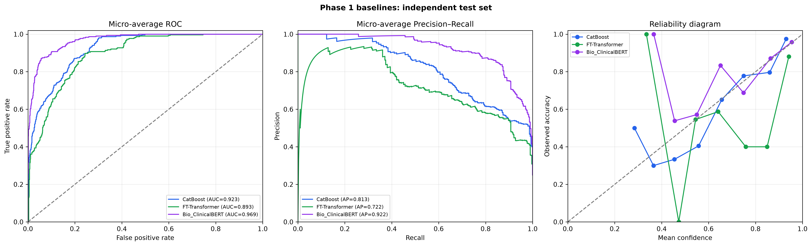

# Báo cáo tiến độ đợt 1 đề tài M-CDSS
## Bộ nội dung slide tự đọc dành cho Giáo viên đánh giá

**Mục đích tài liệu:** Tài liệu này được biên soạn dưới dạng bộ slide tự đọc (Self-contained Slide Deck) gửi trực tiếp đến Giảng viên hướng dẫn và Hội đồng thẩm định đánh giá tiến độ Đợt 1 đề tài M-CDSS. Tài liệu tự cung cấp đầy đủ bối cảnh lâm sàng, cơ sở lý thuyết y khoa và học máy, quy trình chuẩn hóa dữ liệu, minh chứng hình ảnh trực quan, kết quả thực nghiệm khách quan và kế hoạch triển khai Giai đoạn 2; hoàn toàn độc lập, không phụ thuộc vào thuyết trình miệng và không yêu cầu thao tác phần mềm hay truy cập kho mã nguồn.

**Cấu trúc tài liệu:** Gồm 25 slide nội dung chuyên sâu được phân bổ mạch lạc từ cơ sở lý thuyết đến thực nghiệm, kèm 1 slide danh mục tài liệu tham khảo học thuật chính thức.

> **Quy chuẩn số liệu:** Toàn bộ kết quả thực nghiệm trong báo cáo này được đo lường chính thức theo quy trình kiểm soát rò rỉ dữ liệu nghiêm ngặt (Strict Group Split & Leakage Audit). Kết quả của các mô hình được ghi nhận khách quan trên tập kiểm thử độc lập gồm 302 hồ sơ bệnh án (Hold-out Test Set).

---

## Slide 1 — Trang bìa

**TÊN ĐỀ TÀI: HỆ THỐNG HỖ TRỢ CHẨN ĐOÁN LÂM SÀNG ĐA PHƯƠNG THỨC TỪ HỒ SƠ SỨC KHỎE ĐIỆN TỬ (M-CDSS)**

**Phân kỳ báo cáo:** Báo cáo tiến độ Đợt 1 — Khảo sát phương pháp luận, Cơ sở lý thuyết, Xây dựng quy trình dữ liệu và Đánh giá thực nghiệm các mô hình Baseline.  
**Lĩnh vực nghiên cứu:** Trí tuệ nhân tạo y sinh (Biomedical AI), Học sâu đa phương thức (Multimodal Deep Learning), Xử lý ngôn ngữ tự nhiên lâm sàng (Clinical NLP).  
**Từ khóa:** Electronic Health Records (EHR), Multimodal AI, Clinical Notes, Tabular Data, Cross-Attention Late Fusion, CDSS.

---

## Slide 2 — Tóm tắt đề tài và Tiến độ đạt được

**Mục tiêu cốt lõi:**  
Đề tài M-CDSS nghiên cứu phát triển hệ thống hỗ trợ chẩn đoán 4 nhóm bệnh lý có triệu chứng hô hấp và tim mạch chồng lấp cao: **Hen phế quản (ASTHMA)**, **Bệnh phổi tắc nghẽn mạn tính (COPD)**, **Suy tim (HEART_FAILURE)** và **Viêm phổi (PNEUMONIA)**, thông qua việc kết hợp đồng thời dữ liệu định lượng dạng bảng (sinh hiệu, xét nghiệm) và dữ liệu văn bản tự do (ghi chú lâm sàng).

**Khối lượng công việc đã hoàn thành trong Giai đoạn 1:**
- **Nền tảng dữ liệu:** Xây dựng quy trình xử lý dữ liệu chuẩn y khoa, làm sạch và khử định danh 2.000 hồ sơ bệnh án đa phương thức cân bằng 4 nhóm bệnh.
- **Kiểm soát rò rỉ nghiêm ngặt:** Phân chia tập dữ liệu theo nhóm nguồn liên kết (Strict Split), kiểm toán đạt 0% rò rỉ thông tin giữa các tập.
- **Thực nghiệm Baseline:** Huấn luyện và đánh giá khách quan 3 mô hình đại diện đơn phương thức trên tập kiểm thử độc lập 302 mẫu. Mô hình ngôn ngữ y sinh Bio_ClinicalBERT đạt AUROC macro **0,9735**, F1 macro **0,8421** và ECE **0,0373**.
- **Phân tích ca bệnh sai biệt:** Phân tích cơ chế bệnh học của các ca dự đoán trái ngược giữa bảng số và văn bản, xác lập luận cứ khoa học vững chắc cho kiến trúc dung hợp Cross-Attention ở Giai đoạn 2.

**Kế hoạch trọng tâm Giai đoạn 2:** Xây dựng mô hình dung hợp đa phương thức Cross-Attention Late Fusion, tích hợp hệ thống Agentic RAG giải thích y khoa dựa trên Hướng dẫn điều trị và thực hiện đánh giá lâm sàng mở rộng.

---

## Slide 3 — Bài toán lâm sàng và Lý do chọn đề tài

**Thách thức trong chẩn đoán ban đầu:**  
Tại các khoa cấp cứu và phòng khám ban đầu, các triệu chứng như khó thở, ho, suy giảm oxy máu (SpO₂) và dấu hiệu viêm là biểu hiện chung của nhiều bệnh lý khác nhau. Việc phân biệt chính xác giữa Hen phế quản, COPD, Suy tim và Viêm phổi gặp nhiều khó khăn khi thông tin lâm sàng ban đầu còn rời rạc.

**Tính chất bổ trợ giữa hai phương thức dữ liệu EHR:**

| Dữ liệu Bảng số (Tabular Features) | Ghi chú Lâm sàng tự do (Clinical Notes) |
| :--- | :--- |
| • Cung cấp định lượng tức thời về sinh hiệu (huyết áp, nhịp tim, SpO₂) và chỉ số viêm (WBC, CRP).<br>• Dễ chuẩn hóa và đưa vào thuật toán số học.<br>• *Điểm hạn chế:* Thiếu ngữ cảnh bệnh sử, không thể hiện được diễn tiến cơn co thắt hay triệu chứng cơ năng. | • Ghi chép sâu sắc về tiền căn dị ứng, thói quen sinh hoạt, tiền sử dùng thuốc và tính chất cơn khó thở.<br>• Nắm bắt bức tranh toàn diện của bệnh nhân.<br>• *Điểm hạn chế:* Tồn tại chữ viết tắt, ngữ nghĩa phức tạp và dễ bị nhiễu từ vựng khi bệnh cảnh nặng. |

**Lý do chọn đề tài:**  
Khảo sát khả năng bổ trợ lẫn nhau giữa tín hiệu sinh học định lượng và ngữ cảnh lâm sàng bằng mô hình học sâu đa phương thức, trong một quy trình kiểm soát rò rỉ dữ liệu nghiêm ngặt và minh bạch giới hạn ứng dụng.

---

## Slide 4 — Cơ sở lý thuyết: Dữ liệu đa phương thức trong EHR & Hệ thống CDSS

**1. Khái niệm Hồ sơ bệnh án điện tử đa phương thức (Multimodal EHR):**
- **Định nghĩa:** Hồ sơ sức khỏe điện tử (EHR) là kho lưu trữ số hóa toàn diện về quá trình khám chữa bệnh của bệnh nhân. Dữ liệu trong EHR mang tính chất **đa phương thức (multimodal)** tự nhiên, phản ánh tình trạng người bệnh dưới nhiều giác độ thông tin khác nhau.
- **Phương thức Dữ liệu Bảng số có cấu trúc (Tabular Modality):**
  - Gồm các biến số nhân khẩu học (tuổi, giới tính), sinh hiệu định lượng (huyết áp, nhịp tim, nhịp thở, thân nhiệt, SpO₂) và chỉ số xét nghiệm huyết học/sinh hóa (bạch cầu WBC, protein phản ứng C - CRP).
  - *Đặc điểm:* Có cấu trúc xác định, định lượng chính xác tại một thời điểm tức thời; dễ chuẩn hóa thành vector đầu vào cho các thuật toán số học nhưng thiếu ngữ cảnh bệnh sử và diễn tiến cơ năng.
- **Phương thức Ghi chú Lâm sàng tự do (Clinical Text Modality):**
  - Gồm các đoạn văn bản bệnh án tự do (diễn biến bệnh sử, lý do vào viện, tiền căn dị ứng, thói quen hút thuốc, khám thực thể và ghi chú điều dưỡng).
  - *Đặc điểm:* Chứa đựng ngữ cảnh bệnh học phong phú, các triệu chứng chủ quan và hành vi điều trị; tuy nhiên có cấu trúc phi chuẩn hóa, nhiều từ viết tắt và dễ bị nhiễu ngữ nghĩa khi bệnh nhân mắc nhiều bệnh cảnh phức tạp.

**2. Hệ thống Hỗ trợ Ra Quyết định Lâm sàng (CDSS - Clinical Decision Support System):**
- **Định nghĩa:** Là hệ thống phần mềm ứng dụng các giải pháp Trí tuệ nhân tạo (AI) nhằm phân tích tổng hợp dữ liệu lâm sàng của bệnh nhân tại thời điểm tiếp nhận (Point-of-Care), đưa ra các gợi ý chẩn đoán phân biệt, cảnh báo rủi ro và khuyến nghị phác đồ.
- **Vai trò y khoa:** Đóng vai trò như "người trợ lý phản biện độc lập", giúp bác sĩ giảm tải áp lực nhận thức, hạn chế sai sót chẩn đoán trong các tình huống cấp cứu và hỗ trợ chuẩn hóa quy trình ra quyết định theo y học chứng cứ.

---

## Slide 5 — Cơ sở lý thuyết: Các kiến trúc mô hình học máy & Cơ chế Dung hợp

**1. Các trường phái mô hình đơn phương thức (Single-modality Baselines):**
- **Mô hình Cây quyết định tăng cường cho dữ liệu bảng — CatBoost (Categorical Boosting):**
  - Là thuật toán học máy dựa trên họ cây quyết định tăng cường gradient (GBDT), được thiết kế tối ưu cho dữ liệu bảng số học và biến danh mục.
  - Sử dụng cơ chế *Ordered Boosting* để khắc phục hiện tượng rò rỉ mục tiêu (target leakage) và overfitting thường gặp ở GBDT truyền thống, mang lại khả năng phân biệt mạnh mẽ trên các chỉ số sinh hiệu và xét nghiệm.
- **Mô hình Học sâu chuyên biệt cho dữ liệu bảng — FT-Transformer (Feature Tokenizer Transformer):**
  - Chuyển đổi từng đặc trưng số học và danh mục thành các vector nhúng (Feature Tokenizer), sau đó áp dụng các tầng tự chú ý (Self-Attention) của Transformer để học trực tiếp các mối tương tác phi tuyến tính phức tạp giữa các chỉ số sinh học.
- **Mô hình Ngôn ngữ Y sinh — Bio_ClinicalBERT:**
  - Mô hình ngôn ngữ chuyên biệt được khởi tạo từ BERT và tiếp tục tiền huấn luyện (continual pretraining) trên toàn bộ kho dữ liệu lâm sàng khổng lồ MIMIC-III (gồm hàng triệu ghi chú hồi sức cấp cứu thực tế).
  - Hiểu sâu sắc từ vựng y khoa, thuật ngữ viết tắt lâm sàng và mối quan hệ ngữ cảnh giữa các triệu chứng cơ năng và tiền sử dùng thuốc.

**2. Cơ chế Dung hợp Chú ý chéo (Cross-Attention Late Fusion):**
- **Dung hợp muộn (Late Fusion):** Cho phép từng phương thức dữ liệu được xử lý bởi bộ mã hóa chuyên biệt (FT-Transformer cho bảng, Bio_ClinicalBERT cho văn bản) nhằm bảo toàn tối đa đặc trưng riêng của từng miền dữ liệu trước khi kết hợp.
- **Nguyên lý Chú ý chéo (Cross-Attention Mechanism):**
  - Thay vì chỉ ghép nối đơn giản (concatenation), cơ chế Cross-Attention sử dụng vector biểu diễn bảng số đóng vai trò Truy vấn ($Query - Q$) để chiếu vào các vector đặc trưng văn bản đóng vai trò Khóa ($Key - K$) và Giá trị ($Value - V$).
  - *Ý nghĩa lâm sàng:* Cho phép các biến động sinh hiệu bất thường (hoặc bình thường) từ bảng số định hướng lại trọng số chú ý của mô hình vào đúng các từ khóa bệnh sử then chốt trong ghi chú, triệt tiêu điểm mù của từng phương thức đơn lẻ.

---

## Slide 6 — Cơ sở lý thuyết: Phương pháp luận Đánh giá & Kiểm soát độ tin cậy trong AI Y sinh

**1. Các dạng rò rỉ dữ liệu trong Y tế (Data Leakage Risks):**
- **Rò rỉ bệnh nhân/nguồn liên kết (Patient/Source Leakage):** Khi các bản ghi từ cùng một bệnh nhân hoặc cùng một ghi chú nguồn bị phân tán vào cả tập Huấn luyện và tập Kiểm thử. Mô hình sẽ "học thuộc lòng" đặc điểm cá nhân thay vì học bản chất bệnh học, dẫn đến điểm số kiểm thử cao ảo nhưng thất bại hoàn toàn trên thực tế.
- **Rò rỉ mốc thời gian (Temporal Leakage):** Sử dụng các biến cố hoặc kết quả xét nghiệm phát sinh *sau* thời điểm chẩn đoán để dự đoán bệnh tại thời điểm tiếp nhận.
- **Rò rỉ nhãn trực tiếp (Direct Label Leakage):** Ghi chú lâm sàng vô tình chứa từ khóa chẩn đoán đích hoặc phác đồ điều trị đặc hiệu duy nhất của bệnh.

**2. Phân biệt giữa Năng lực Phân biệt (Discrimination) và Độ Hiệu chuẩn (Calibration):**

| Nhóm chỉ số | Chỉ số đo lường chính | Bản chất khoa học & Ý nghĩa lâm sàng |
| :--- | :--- | :--- |
| **Năng lực Phân biệt (Discrimination)**<br>*"Mô hình có xếp hạng đúng người có bệnh cao hơn người không bệnh?"* | • **Macro AUROC:** Diện tích dưới đường cong ROC đo khả năng phân biệt tổng thể giữa các cặp lớp.<br>• **Macro AUPRC:** Diện tích dưới đường cong Precision-Recall; **thước đo sống còn trong y tế** khi dữ liệu mất cân bằng, đo chính xác khả năng tìm đúng ca bệnh mà không báo động giả.<br>• **Macro-F1 & Accuracy:** Đo độ chính xác phân loại dứt khoát tại ngưỡng quyết định cố định. | Đảm bảo mô hình có khả năng phân tách bệnh học mạnh mẽ. Tuy nhiên, AUROC cao **không đồng nghĩa** xác suất đưa ra là đáng tin cậy. |
| **Độ Hiệu chuẩn Xác suất (Calibration)**<br>*"Con số 80% nguy cơ mà mô hình đưa ra có thực sự ứng với 80 ca bệnh trong 100 người?"* | • **Brier Score:** Sai số bình phương trung bình giữa xác suất dự đoán và nhãn thực tế ($y \in \{0,1\}$). Điểm càng gần 0 thể hiện xác suất càng chuẩn xác.<br>• **ECE (Expected Calibration Error):** Đo độ lệch kỳ vọng giữa xác suất tự tin và độ chính xác thực tế trên các phân vị xác suất. Trong y tế, tiêu chuẩn khắt khe đòi hỏi **ECE < 0,05** (sai số hiệu chuẩn dưới 5%). | Quyết định tính an toàn khi ứng dụng lâm sàng. Một mô hình có độ tự tin 95% nhưng thực tế chỉ đúng 60% sẽ gây nguy hiểm nghiêm trọng nếu bác sĩ dựa vào đó để ra quyết định điều trị. |

---

## Slide 7 — Tổng quan y văn & Khoảng trống nghiên cứu

**Công trình tổng quan nền tảng:**  
Nghiên cứu của Hunik et al., *Diagnostic prediction models for primary care, based on artificial intelligence and electronic health records: a systematic review* (JMIR, 2024).

**Các số liệu quan trọng từ tổng quan hệ thống:**
- **10.657 công trình nghiên cứu** liên quan đến mô hình dự đoán chẩn đoán từ EHR được sàng lọc qua các cơ sở dữ liệu học thuật quốc tế.
- **Chỉ 15 nghiên cứu** đáp ứng đầy đủ các tiêu chuẩn phương pháp luận lâm sàng đưa vào phân tích tổng quan.
- **15/15 nghiên cứu (100%)** chỉ sử dụng dữ liệu có cấu trúc dạng bảng (ICD codes, chỉ số xét nghiệm); **chưa có nghiên cứu nào** trong tập này khai thác ghi chú văn bản tự do bằng các mô hình ngôn ngữ lâm sàng.
- **Đánh giá nguy cơ sai lệch theo công cụ PROBAST:** 9/15 nghiên cứu (60%) có nguy cơ sai lệch cao; 6/15 (40%) chưa rõ ràng; **0/15 nghiên cứu** đạt chuẩn nguy cơ sai lệch thấp.

**Kết luận từ y văn:**  
Tồn tại một khoảng trống nghiên cứu rất lớn về việc khai thác thông tin từ văn bản ghi chú lâm sàng kết hợp dữ liệu bảng, cũng như sự thiếu hụt quy trình kiểm soát rò rỉ dữ liệu chuẩn mực trong các công bố AI y tế.

---

## Slide 8 — Các rủi ro phương pháp luận chính trong AI y tế

Từ các phân tích của PROBAST và y văn quốc tế, nhóm đề tài xác định 4 rủi ro phương pháp luận cốt tử cần kiểm soát:

1. **Rò rỉ nhãn và thời điểm (Data & Label Leakage):**
   - Biến đầu vào vô tình chứa các can thiệp hoặc kết luận phát sinh sau thời điểm chẩn đoán, hoặc chứa trực tiếp tên bệnh khiến mô hình học thuộc lòng quy luật giả.
2. **Xử lý dữ liệu khuyết thiếu không nhất quán (Improper Missing Data Handling):**
   - Bỏ qua các bản ghi thiếu xét nghiệm hoặc điền khuyết tùy tiện làm sai lệch nghiêm trọng phân bố bệnh học thực tế.
3. **Hiệu chuẩn xác suất kém (Poor Probability Calibration):**
   - Mô hình có thể đạt độ phân biệt cao (AUROC cao) nhưng xác suất đưa ra bị quá tự tin hoặc sai lệch, gây nguy hiểm nếu dùng làm mốc hỗ trợ bác sĩ.
4. **Thiếu tính tổng quát hóa và đánh giá ngoài (Generalization Gap):**
   - Mô hình hoạt động tốt trên tập dữ liệu nội bộ nhưng suy giảm nhanh khi áp dụng sang quần thể cơ sở y tế khác.

**Quy chuẩn áp dụng trong M-CDSS:** Khóa mốc thời gian chẩn đoán, phân chia tập theo nhóm liên kết nguồn bệnh nhân, kiểm toán rò rỉ độc lập và báo cáo đa chỉ số kèm phân tích hiệu chuẩn (Brier score, ECE).

---

## Slide 9 — Khoảng trống và Câu hỏi nghiên cứu

**Khoảng trống đề tài giải quyết:**
1. Khai thác đồng thời giá trị ngữ nghĩa từ ghi chú lâm sàng và tính chuẩn xác của dữ liệu bảng sinh hiệu/xét nghiệm.
2. Thiết lập quy trình phân chia dữ liệu nghiêm ngặt chống rò rỉ nguồn nhằm đảm bảo giá trị thực nghiệm trung thực.
3. Đo lường toàn diện từ năng lực phân biệt (AUROC, AUPRC) đến độ chính xác phân loại (F1, Accuracy) và độ tin cậy xác suất (ECE).
4. Thiết kế lộ trình hỗ trợ giải thích có kiểm chứng y văn (RAG grounding) cho giai đoạn tiếp theo.

**Câu hỏi nghiên cứu trung tâm:**

> *Trên bộ dữ liệu nghiên cứu chuẩn hóa, việc kết hợp đồng bộ thông tin bảng số và ghi chú lâm sàng bằng cơ chế dung hợp đa phương thức có cải thiện đáng kể độ chính xác và độ tin cậy so với các mô hình đơn phương thức trong quy trình kiểm soát rò rỉ nghiêm ngặt hay không?*

---

## Slide 10 — Mục tiêu, Phạm vi và 4 Nhóm bệnh nghiên cứu

**Mục tiêu tổng quát:**  
Nghiên cứu, xây dựng và đánh giá thực nghiệm nguyên mẫu hệ thống hỗ trợ quyết định lâm sàng đa phương thức (Multimodal CDSS), hỗ trợ phân loại 4 nhóm bệnh lý hô hấp - tim mạch và cung cấp khả năng giải thích minh bạch.

**Định nghĩa 4 nhóm bệnh mục tiêu:**
- **ASTHMA:** Hen phế quản — bệnh lý viêm đường thở mạn tính có tính chất co thắt hồi phục.
- **COPD:** Bệnh phổi tắc nghẽn mạn tính — tiến triển tắc nghẽn luồng khí cố định, gắn liền với tiền sử hút thuốc hoặc phơi nhiễm khói bụi.
- **HEART_FAILURE:** Suy tim — hội chứng lâm sàng phức tạp do suy giảm chức năng co bóp hoặc đổ đầy tâm thất.
- **PNEUMONIA:** Viêm phổi — tình trạng nhiễm trùng cấp tính nhu mô phổi do vi khuẩn hoặc virus.

**Phạm vi Giai đoạn 1:**  
Tập trung xây dựng nền tảng dữ liệu y sinh chuẩn hóa, kiểm định chống rò rỉ dữ liệu và thiết lập mốc tham chiếu thực nghiệm với 3 mô hình baseline đơn phương thức.

---

## Slide 11 — Kế hoạch tổng thể hai giai đoạn của Đề tài

```text
GIAI ĐOẠN 1: Nghiên cứu, Nền tảng dữ liệu & Đánh giá Baseline (ĐÃ HOÀN THÀNH)
┌─────────────────────────────────┐   ┌─────────────────────────────────┐   ┌─────────────────────────────────┐
│     Chuẩn hóa Dữ liệu EHR       │──>│    Strict Split & Leakage Audit │──>│  Benchmark 3 Baseline & Case   │
│  (2.000 hồ sơ / 4 nhóm bệnh)    │   │      (Kiểm toán 0% overlap)     │   │ (CatBoost, FT-Trans, BERT)      │
└─────────────────────────────────┘   └─────────────────────────────────┘   └─────────────────────────────────┘
                                                                                             │
                                                                                             v
GIAI ĐOẠN 2: Dung hợp Đa phương thức, RAG & Đánh giá Mở rộng (KẾ HOẠCH TIẾP THEO)             │
┌─────────────────────────────────┐   ┌─────────────────────────────────┐   ┌─────────────────────────────────┐
│ Multimodal Cross-Attention      │<──│  Agentic RAG & Evidence Ground  │<──│ Đánh giá lâm sàng (DCA, CI) &   │
│ (Fusion Bảng + Văn bản lâm sàng)│   │  (Truy xuất Guideline điều trị) │   │ Đóng gói bàn giao               │
└─────────────────────────────────┘   └─────────────────────────────────┘   └─────────────────────────────────┘
```

| Giai đoạn & Hạng mục | Khối lượng công việc chính | Sản phẩm đầu ra cụ thể |
| :--- | :--- | :--- |
| **Giai đoạn 1 — Dữ liệu & Quy trình** | Xây dựng quy trình xử lý dữ liệu, làm sạch, khử định danh, khóa mốc thời gian và điền khuyết. | Bộ dữ liệu nghiên cứu 2.000 hồ sơ đa phương thức và quy trình tiền xử lý tự động. |
| **Giai đoạn 1 — Phân chia & Kiểm toán** | Chia tập dữ liệu theo nhóm bệnh nhân/ghi chú liên kết (Strict Split) và kiểm toán rò rỉ. | Báo cáo kiểm toán chống rò rỉ (Leakage Audit) xác nhận 0% giao thoa dữ liệu. |
| **Giai đoạn 1 — Thực nghiệm Baseline** | Huấn luyện và đánh giá 3 mô hình Baseline trên tập kiểm thử độc lập 302 mẫu. | Bộ chỉ số thực nghiệm chuẩn hóa, phân tích đường cong và phân tích 2 ca bệnh đối chứng. |
| **Giai đoạn 2 — Multimodal Fusion** | Xây dựng bộ mã hóa bảng và văn bản, thiết kế cơ chế Cross-Attention Late Fusion. | Mô hình dung hợp đa phương thức và kết quả so sánh đối chứng trên cùng tập test. |
| **Giai đoạn 2 — RAG & Giải thích** | Xây dựng kho tri thức hướng dẫn y khoa, module truy xuất và gắn bằng chứng trích dẫn. | Khung giải thích lâm sàng tự động minh bạch nguồn gốc cho bác sĩ. |
| **Giai đoạn 2 — Đánh giá mở rộng** | Phân tích đường cong quyết định lâm sàng (DCA), khoảng tin cậy Bootstrap, kiểm định công bằng. | Báo cáo đánh giá lâm sàng nâng cao và đóng gói nghiệm thu theo TRIPOD-AI. |

---

## Slide 12 — Kiến trúc giải pháp tổng thể đề xuất cho Giai đoạn 2

```text
                                  KIẾN TRÚC ĐA PHƯƠNG THỨC M-CDSS
                                  
  DỮ LIỆU ĐẦU VÀO                   BỘ MÃ HÓA CHUYÊN BIỆT                 DUNG HỢP & RA QUYẾT ĐỊNH
┌──────────────────┐               ┌───────────────────────┐
│ Dữ liệu Bảng     │──────────────>│ FT-Transformer        │────────┐
│ (Sinh hiệu/XN)   │               │ (Biểu diễn bảng số)   │        │     ┌───────────────────────┐
└──────────────────┘               └───────────────────────┘        ├────>│ Cross-Attention       │
                                                                    │     │ Late Fusion Layer     │
┌──────────────────┐               ┌───────────────────────┐        │     └──────────┬────────────┘
│ Ghi chú Lâm sàng │──────────────>│ Bio_ClinicalBERT      │────────┘                │
│ (Bệnh án tự do)  │               │ (Biểu diễn ngữ nghĩa) │                         v
└──────────────────┘               └───────────────────────┘              ┌───────────────────────┐
                                                                          │ Classification Head   │
                                                                          │ (Dự đoán 4 nhóm bệnh) │
                                                                          └──────────┬────────────┘
                                                                                     │
                                                                                     v
                                                                          ┌───────────────────────┐
                                                                          │ Temperature Scaling   │
                                                                          │ (Hiệu chuẩn xác suất) │
                                                                          └──────────┬────────────┘
                                                                                     │
  HỆ THỐNG GIẢI THÍCH LÂM SÀNG                                                       v
┌──────────────────────────────┐        ┌───────────────────────┐         ┌───────────────────────┐
│ Hướng dẫn điều trị Y khoa    │───────>│ Vector Store &        │────────>│ Diagnostic Agent      │
│ (Clinical Guidelines / CPGs) │        │ Semantic Retriever    │         │ (Giải thích & Bằng cớ)│
└──────────────────────────────┘        └───────────────────────┘         └───────────────────────┘
```

**Mô tả các khối thành phần:**
- **Nhánh Bảng số học:** Mô hình FT-Transformer trích xuất các tương tác phi tuyến tính giữa các chỉ số sinh hiệu và xét nghiệm.
- **Nhánh Ngôn ngữ y sinh:** Bio_ClinicalBERT trích xuất biểu diễn ngữ cảnh chuyên sâu từ bệnh sử và triệu chứng trong ghi chú y khoa.
- **Cơ chế Cross-Attention Fusion:** Cho phép vector đặc trưng bảng đóng vai trò truy vấn (query) để định hướng trọng số chú ý vào đúng các từ khóa bệnh học then chốt trong văn bản, bù đắp điểm mù của từng phương thức.
- **Hiệu chuẩn xác suất (Temperature Scaling):** Đảm bảo xác suất đầu ra phản ánh chính xác rủi ro bệnh học thực tế (hướng tới ECE < 0,05).
- **Agentic RAG:** Tự động truy xuất hướng dẫn chẩn đoán y khoa tương ứng và gắn bằng chứng trích dẫn cụ thể vào hồ sơ bệnh nhân.

---

## Slide 13 — Nguồn dữ liệu & Cấu trúc bộ dữ liệu nghiên cứu

**Quy mô và thành phần bộ dữ liệu:**
- Dữ liệu tổng hợp từ các nguồn bệnh án điện tử chuẩn mực: Synthea EHR và các ghi chú lâm sàng MTSamples.
- Bộ dữ liệu nghiên cứu chuẩn hóa gồm **2.000 hồ sơ bệnh án đa phương thức**, phân bố hoàn toàn cân bằng **500 mẫu cho mỗi nhóm bệnh**:
  - Hen phế quản (ASTHMA): 500 mẫu.
  - Bệnh phổi tắc nghẽn mạn tính (COPD): 500 mẫu.
  - Suy tim (HEART_FAILURE): 500 mẫu.
  - Viêm phổi (PNEUMONIA): 500 mẫu.
- **Dữ liệu bảng:** 12 trường đặc trưng gồm nhân khẩu học (tuổi, giới tính), sinh hiệu (huyết áp tâm thu/tâm trương, nhịp tim, nhịp thở, SpO₂, nhiệt độ), xét nghiệm (WBC, CRP), tiền sử hút thuốc và bệnh nền (tăng huyết áp, đái tháo đường).
- **Tỷ lệ dữ liệu khuyết thiếu thực tế:** Số lượng bạch cầu (WBC) khuyết 20,5%, Protein phản ứng C (CRP) khuyết 22,4% — phản ánh đúng thực tế lâm sàng không phải bệnh nhân nào cũng được làm đủ xét nghiệm máu.

**Các bước chuẩn hóa & Làm sạch dữ liệu y khoa:**
1. Khử trùng lặp: Loại bỏ hoàn toàn các ghi chú bị trùng lặp nội dung giữa các nhóm bệnh khác nhau.
2. Che giấu nhãn mục tiêu: Che tên chẩn đoán đích bằng token `[REDACTED_DIAGNOSIS]` và loại bỏ phần kết luận chẩn đoán trong ghi chú để triệt tiêu hoàn toàn rủi ro rò rỉ nhãn trực tiếp.
3. Gắn định danh nhóm nguồn: Định danh nhóm bệnh nhân và nhóm ghi chú gốc để phục vụ quy trình phân chia dữ liệu độc lập.

---

## Slide 14 — Quy trình tiền xử lý dữ liệu và Kiểm soát chất lượng

```text
                            LUỒNG TIỀN XỬ LÝ DỮ LIỆU ĐA PHƯƠNG THỨC
                            
  HỒ SƠ BỆNH ÁN THÔ                 CÁC BƯỚC TIỀN XỬ LÝ CHUYÊN BIỆT               DỮ LIỆU SẴN SÀNG HUẤN LUYỆN
┌──────────────────┐               ┌──────────────────────────────────────┐      ┌─────────────────────────────┐
│ • Dữ liệu bảng   │──────────────>│ 1. Khử định danh (De-identification) │─────>│ Dữ liệu sạch, bảo mật,      │
│ • Ghi chú tự do  │               │ 2. Khóa mốc thời gian (Temp-Lock)    │      │ kiểm toán 0% rò rỉ,         │
│ • Metadata nguồn │               │ 3. Xử lý khuyết thiếu (Imputation)   │      │ sẵn sàng cho Benchmark      │
└──────────────────┘               │ 4. Phân chia theo nhóm (Strict Split)│      └─────────────────────────────┘
                                   └──────────────────────────────────────┘
```

**Chi tiết 4 công đoạn kỹ thuật:**
1. **Khử định danh y khoa tự động (De-identification):** Nhận diện và che các thực thể định danh cá nhân (tên, tuổi cụ thể, địa chỉ, ngày tháng năm) theo nguyên tắc HIPAA/GDPR nhằm đảm bảo tính bảo mật y tế.
2. **Khóa mốc thời gian chẩn đoán (Temporal Alignment):** Chỉ ghi nhận các dữ liệu sinh hiệu và xét nghiệm được thực hiện tại thời điểm tiếp nhận khám ban đầu; khóa triệt để mọi thông tin xét nghiệm phát sinh sau thời điểm chẩn đoán để ngăn chặn thông tin tương lai lọt vào mô hình.
3. **Xử lý dữ liệu khuyết thiếu (Imputation):** Áp dụng phương pháp điền khuyết dựa trên trung vị kết hợp chỉ báo khuyết thiếu cho các chỉ số xét nghiệm WBC và CRP, tránh làm biến dạng phân bố tự nhiên của dữ liệu.
4. **Bộ nạp phân tầng đa phương thức (Stratified Multimodal Loader):** Đảm bảo đồng bộ tuyệt đối giữa hàng dữ liệu số học và chuỗi token ghi chú lâm sàng tương ứng trong từng đợt khám.

---

## Slide 15 — Phân chia dữ liệu nghiêm ngặt (Strict Split) & Kiểm toán rò rỉ

**Phương pháp phân chia bằng thành phần liên thông (Connected Components):**  
Để ngăn chặn hoàn toàn hiện tượng một bệnh nhân hoặc một mẫu ghi chú gốc xuất hiện đồng thời ở cả tập huấn luyện và tập kiểm thử (nguyên nhân gây điểm số ảo), thuật toán phân nhóm đưa toàn bộ các hồ sơ có cùng liên kết nguồn vào chung một tập duy nhất.

**Bảng phân bố quy mô dữ liệu sau khi phân chia:**

| Tập dữ liệu | Tổng số hồ sơ | ASTHMA | COPD | HEART_FAILURE | PNEUMONIA | Tỷ lệ |
| :--- | :---: | :---: | :---: | :---: | :---: | :---: |
| **Huấn luyện (Train)** | **1.425** | 358 | 358 | 340 | 369 | 71,25% |
| **Xác thực (Validation)** | **273** | 71 | 71 | 54 | 77 | 13,65% |
| **Kiểm thử độc lập (Test)** | **302** | 71 | 71 | 106 | 54 | 15,10% |
| **Tổng cộng** | **2.000** | **500** | **500** | **500** | **500** | **100%** |

**Kết quả kiểm toán rò rỉ dữ liệu (Leakage Audit):**

| Tiêu chí kiểm tra giao thoa | Giữa Train và Validation | Giữa Train và Test | Giữa Validation và Test | Kết luận kiểm toán |
| :--- | :---: | :---: | :---: | :---: |
| Trùng mã định danh bệnh nhân (`patient_id`) | **0** | **0** | **0** | **ĐẠT (Không rò rỉ)** |
| Trùng nhóm bệnh nhân gốc (`source_patient_group`) | **0** | **0** | **0** | **ĐẠT (Không rò rỉ)** |
| Trùng nhóm ghi chú gốc (`source_note_group`) | **0** | **0** | **0** | **ĐẠT (Không rò rỉ)** |

*Nhận xét:* Quy trình kiểm toán xác nhận mức độ cô lập dữ liệu tuyệt đối (0% overlap), đảm bảo kết quả đo lường trên tập kiểm thử phản ánh chính xác năng lực thực tế của mô hình.

---

## Slide 16 — Thiết kế thực nghiệm và 3 mô hình Baseline

**Ba mô hình đại diện đơn phương thức được lựa chọn:**
1. **CatBoost (Đại diện Bảng số học - Cây quyết định tăng cường):**  
   - Được lựa chọn sau khi đối đầu và vượt qua XGBoost trên tập validation (Macro-AUROC: 0,9084 vs 0,8895). Tối ưu hóa trên các đặc trưng sinh hiệu và xét nghiệm.
2. **FT-Transformer (Đại diện Bảng số học - Học sâu chuyên biệt):**  
   - Mô hình Feature Tokenizer Transformer chuyển đổi các trường số học thành các vector nhúng và tính toán tự chú ý (self-attention); huấn luyện 19 epochs với cơ chế early stopping.
3. **Bio_ClinicalBERT (Đại diện Ngôn ngữ Y sinh):**  
   - Mô hình ngôn ngữ tiền huấn luyện trên hàng triệu ghi chú lâm sàng từ cơ sở dữ liệu MIMIC-III; fine-tune trên dữ liệu ghi chú của đề tài với độ dài tối đa 512 tokens, learning rate 2e-5 qua 5 epochs.

**Hệ thống 6 chỉ số đánh giá toàn diện:**
- **Năng lực phân biệt và xếp hạng:** Macro AUROC (diện tích dưới đường cong ROC) và Macro AUPRC (diện tích dưới đường cong Precision-Recall).
- **Độ chính xác phân loại:** Macro-F1 (trung bình điều hòa F1 giữa 4 lớp) và Accuracy (độ chính xác tổng thể).
- **Độ tin cậy xác suất và hiệu chuẩn:** Brier Score (khoảng cách bình phương xác suất) và Expected Calibration Error (ECE - độ lệch hiệu chuẩn kỳ vọng).

---

## Slide 17 — Kết quả thực nghiệm tổng hợp trên tập kiểm thử độc lập (N = 302)

| Mô hình Baseline | AUROC macro | AUPRC macro | F1 macro | Accuracy | Brier Score | ECE |
| :--- | :---: | :---: | :---: | :---: | :---: | :---: |
| **CatBoost** *(Nhánh Bảng số)* | 0,9223 | 0,7872 | 0,6083 | 0,6854 | 0,3844 | 0,0663 |
| **FT-Transformer** *(Nhánh Bảng sâu)* | 0,8976 | 0,7023 | 0,5789 | 0,6589 | 0,4725 | 0,1152 |
| **Bio_ClinicalBERT** *(Nhánh Văn bản)* | **0,9735** | **0,9314** | **0,8421** | **0,8543** | **0,2329** | **0,0373** |


**Các phát hiện then chốt từ kết quả:**
1. **Sức mạnh vượt trội của mô hình văn bản:** Bio_ClinicalBERT dẫn đầu toàn diện trên cả 6 chỉ số đánh giá. Đặc biệt, AUROC đạt **0,9735** và Accuracy đạt **85,43%**, vượt xa các mô hình dạng bảng khoảng 17–20% về độ chính xác.
2. **Hiệu năng nhánh bảng số:** CatBoost đạt kết quả phân biệt rất tốt (AUROC 0,9223), nhỉnh hơn mô hình học sâu bảng FT-Transformer (0,8976). Tuy nhiên, độ chính xác phân loại của nhánh bảng bị giới hạn ở mức 68,54% do thiếu thông tin bệnh sử.
3. **Độ tin cậy xác suất:** Bio_ClinicalBERT đạt chỉ số ECE ấn tượng **0,0373** (đáp ứng tiêu chuẩn lâm sàng quốc tế ECE < 0,05), trong khi CatBoost đạt 0,0663.

---

## Slide 18 — Phân tích đường cong ROC, Precision–Recall và Độ hiệu chuẩn



**Phân tích chi tiết 3 đồ thị thực nghiệm:**
- **Đồ thị ROC Micro-average (Panel trái):** Đường cong của Bio_ClinicalBERT (màu xanh lá) tiệm cận rất nhanh góc trên bên trái với AUC micro đạt **0,969**, vượt trội hoàn toàn so với CatBoost (0,923) và FT-Transformer (0,893) trên mọi ngưỡng độ nhạy.
- **Đồ thị Precision–Recall Micro-average (Panel giữa):** Trong bài toán đa lớp mất cân bằng nhẹ, Bio_ClinicalBERT duy trì độ chính xác (Precision) rất cao ở mọi mức độ bao phủ (Recall), đạt Average Precision (AP micro) lên tới **0,922** (so với 0,813 của CatBoost và 0,722 của FT-Transformer).
- **Biểu đồ độ hiệu chuẩn Reliability Diagram (Panel phải):** Đường cong của Bio_ClinicalBERT bám sát đường chéo lý tưởng 45°, chứng minh xác suất dự đoán của mô hình phản ánh sát sao tần suất xuất hiện bệnh thực tế, không bị hiện tượng tự tin thái quá.

*Lưu ý phương pháp luận:* Hình này thể hiện ROC/PR tính theo **micro-average**, trong khi bảng ở Slide 17 báo cáo theo **macro-average** (trung bình đều giữa các lớp). Do đó các con số AUC/AP micro trên hình có sự chênh lệch nhỏ so với macro AUROC/AUPRC ở bảng số liệu.

---

## Slide 19 — Phân tích ma trận nhầm lẫn & Lỗi phân loại theo từng nhóm bệnh


**Chi tiết phân bố mẫu kiểm thử thực tế:** ASTHMA 71 ca, COPD 71 ca, HEART_FAILURE 106 ca, PNEUMONIA 54 ca (Tổng N = 302).

**Phát hiện cơ chế sai lệch qua ma trận:**
- **Điểm mù của mô hình Bảng số (CatBoost):**
  - Gặp khó khăn nghiêm trọng trong việc phân định giữa Hen và COPD: **34/71 ca ASTHMA** bị phân loại nhầm thành COPD (chỉ đoán đúng 37 ca).
  - Khó nhận diện Viêm phổi: **36/54 ca PNEUMONIA** bị phân loại nhầm thành ASTHMA (chỉ đoán đúng 11 ca).
  - *Nguyên nhân:* Tín hiệu sinh hiệu và xét nghiệm của các đợt co thắt cấp tính ở bệnh nhân hô hấp có chỉ số SpO₂ và phản ứng viêm rất tương đồng nhau, dữ liệu số đơn thuần không đủ sức phân biệt.
- **Sức mạnh khắc phục của mô hình Văn bản (Bio_ClinicalBERT):**
  - Giải quyết xuất sắc sự nhầm lẫn giữa Hen và COPD: Đoán đúng **54/71 ca ASTHMA** và **60/71 ca COPD**.
  - Nhận diện gần như tuyệt đối nhóm Suy tim: Đoán đúng **105/106 ca HEART_FAILURE**.
  - *Điểm còn tồn tại:* 14/54 ca Viêm phổi vẫn bị nhận nhầm thành Hen do sự trùng lặp mô tả triệu chứng khó thở và ran rít trong bệnh án.

---

## Slide 20 — Độ hiệu chuẩn xác suất (Calibration) & Độ ổn định mô hình

| Mô hình Baseline | ECE (Validation) | ECE (Test) | Brier Score (Validation) | Brier Score (Test) | Đánh giá độ ổn định |
| :--- | :---: | :---: | :---: | :---: | :--- |
| **CatBoost** | 0,0639 | **0,0663** | 0,3563 | **0,3844** | Rất ổn định giữa val và test |
| **FT-Transformer** | 0,0478 | **0,1152** | 0,3042 | **0,4725** | Có hiện tượng suy giảm hiệu chuẩn trên test |
| **Bio_ClinicalBERT** | 0,1487 | **0,0373** | 0,4594 | **0,2329** | Đạt hiệu chuẩn test xuất sắc (< 0,05) |

**Hàm ý cho thiết kế hệ thống:**
1. **Tiêu chuẩn ECE < 0,05:** Bio_ClinicalBERT đạt ECE test 0,0373 là mốc rất tích cực, tuy nhiên có sự chênh lệch so với validation (0,1487), đòi hỏi cần áp dụng kỹ thuật hiệu chuẩn nhiệt độ (Temperature Scaling) để đảm bảo độ tin cậy ổn định khi đưa vào mô hình dung hợp đa phương thức.
2. **Khoảng cách độ đo:** Kết quả khẳng định tầm quan trọng của việc kiểm tra đồng thời cả Brier Score và ECE thay vì chỉ dựa vào AUROC để tránh ngộ nhận về độ sẵn sàng ứng dụng lâm sàng (minh họa tại đồ thị Reliability Diagram ở Slide 18).

---

## Slide 21 — Phân tích chuyên sâu 2 Ca bệnh đối chứng & Luận cứ Dung hợp Đa phương thức

**Bảng tổng hợp các ca sai biệt điển hình trên tập kiểm thử ($N = 302$):**

| Mã bệnh nhân | Nhãn thực tế | Dự đoán Bảng (CatBoost) | Độ tin cậy Bảng | Dự đoán Văn bản (Bio_ClinicalBERT) | Độ tin cậy Văn bản | Phân loại ca đối chứng |
| :---: | :---: | :---: | :---: | :---: | :---: | :--- |
| **PT-0044** | `ASTHMA` | `COPD` (Sai) | 78,82% | `ASTHMA` (Đúng) | 85,80% | **Văn bản Đúng – Bảng số Sai** |
| **PT-0089** | `ASTHMA` | `COPD` (Sai) | 83,13% | `ASTHMA` (Đúng) | 66,38% | **Văn bản Đúng – Bảng số Sai** |
| **PT-0174** | `COPD` | `COPD` (Đúng) | 80,38% | `ASTHMA` (Sai) | 58,66% | **Bảng số Đúng – Văn bản Sai** |
| **PT-0254** | `COPD` | `COPD` (Đúng) | 75,22% | `HEART_FAILURE` (Sai) | 58,99% | **Bảng số Đúng – Văn bản Sai** |

---

### Ca bệnh 1: Văn bản Đúng – Bảng số Sai (Mã bệnh nhân: PT-0044)
* **Nhãn thực tế (Ground Truth):** `ASTHMA` (Hen phế quản) — Bệnh nhân nữ 18 tuổi.
* **Kết quả dự đoán đối chứng:**
  * Mô hình Bảng số (CatBoost): Dự đoán **SAI** thành `COPD` (Độ tin cậy: **78,82%**).
  * Mô hình Văn bản (Bio_ClinicalBERT): Dự đoán **ĐÚNG** thành `ASTHMA` (Độ tin cậy: **85,80%**).


**Phân tích cơ chế bệnh học & Điểm mù mô hình:**
- **Vì sao Bảng số thất bại:** Bệnh nhân đo sinh hiệu ngoài cơn khó thở cấp nên SpO₂ đạt 97,3%, nhịp thở và nhịp tim bình thường. Tuy nhiên, chỉ số viêm CRP tăng cao (24,28 mg/L) kết hợp tiền sử tăng huyết áp khiến CatBoost bị định hướng sai lệch sang bệnh phổi mạn tính tiến triển (`COPD`, 78,82%). Thiếu chỉ số chức năng hô hấp FEV1, dữ liệu bảng đơn thuần không thể phân định được tính chất co thắt hồi phục của Hen.
- **Vì sao Văn bản thành công:** Bio_ClinicalBERT nắm bắt chính xác độ tuổi thanh thiếu niên (`18yo`), triệu chứng khởi phát cơn ho, khó thở tái diễn và đặc biệt là từ khóa tiền sử dùng thuốc dạng hít định liều (`Inhalers` — phác đồ đặc trưng của Hen), từ đó chẩn đoán chính xác ASTHMA với độ tự tin vượt trội (85,80%).

---

### Ca bệnh 2: Bảng số Đúng – Văn bản Sai (Mã bệnh nhân: PT-0254)
* **Nhãn thực tế (Ground Truth):** `COPD` (Bệnh phổi tắc nghẽn mạn tính) — Bệnh nhân nữ 65 tuổi.
* **Kết quả dự đoán đối chứng:**
  * Mô hình Văn bản (Bio_ClinicalBERT): Dự đoán **SAI** thành `HEART_FAILURE` (Độ tin cậy: **58,99%**).
  * Mô hình Bảng số (CatBoost): Dự đoán **ĐÚNG** thành `COPD` (Độ tin cậy: **75,22%**).


**Phân tích cơ chế bệnh học & Điểm mù mô hình:**
- **Vì sao Văn bản thất bại (Nhiễu ngữ nghĩa & Che nhãn chống rò rỉ):** Nhằm tuân thủ quy trình kiểm soát rò rỉ dữ liệu, tên chẩn đoán đã được che bằng token `[REDACTED_DIAGNOSIS]`. Bio_ClinicalBERT chỉ tiếp cận ngữ cảnh: bệnh nhân cao tuổi suy hô hấp mạn nằm viện dưỡng lão, mở khí quản, nghe phổi có ran ẩm/ran rít (`crackles/wheezes`), dùng aspirin và thuốc an thần. Bối cảnh từ vựng nặng nề này trùng lặp rất lớn với bệnh nhân suy tim sung huyết biến chứng hô hấp, khiến mô hình ngôn ngữ đoán nhầm sang `HEART_FAILURE` (58,99%).
- **Vì sao Bảng số thành công (Mỏ neo huyết động học):** Trái ngược với sự nhiễu loạn từ vựng, dữ liệu bảng cung cấp cấu hình huyết động học cực kỳ đặc thù: Huyết áp (115,9/80,1 mmHg) và nhịp tim (64,3 bpm) hoàn toàn ổn định—loại trừ hoàn toàn cơn tăng áp hay nhịp nhanh phản xạ của đợt suy tim cấp. Kết hợp SpO₂ 95,6% và CRP 7,14 mg/L phù hợp hoàn hảo với bệnh nhân mở khí quản mạn tính ổn định, CatBoost chẩn đoán chính xác `COPD` với độ tin cậy 75,22%.

**Ý NGHĨA KHOA HỌC THEN CHỐT CHO GIAI ĐOẠN 2:**  
Hai ca bệnh thực nghiệm trên là bằng chứng minh bạch chứng minh: **Không một phương thức đơn lẻ nào chiếm ưu thế tuyệt đối trong mọi hoàn cảnh lâm sàng**. Dữ liệu văn bản vượt trội trong việc khai thác bệnh sử và hành vi dùng thuốc nhưng dễ bị nhiễu từ vựng; ngược lại, dữ liệu bảng số đóng vai trò *"mỏ neo huyết động học"* giữ cho chẩn đoán không bị chệch hướng. Đây là luận cứ thực nghiệm vững chắc khẳng định tính tất yếu của giải pháp **Multimodal Cross-Attention Late Fusion** nhằm bù đắp điểm mù cho nhau.

---

## Slide 22 — Tổng hợp khối lượng công việc và Sản phẩm thực tế đã hoàn thành

| Hạng mục công việc | Kết quả & Sản phẩm khoa học hoàn thành | Giá trị thực tiễn & Ý nghĩa phương pháp luận |
| :--- | :--- | :--- |
| **Quy trình chuẩn hóa Dữ liệu** | Bộ dữ liệu nghiên cứu chuẩn hóa gồm **2.000 hồ sơ bệnh án đa phương thức** cân bằng 4 nhóm bệnh. | Xây dựng tập dữ liệu đầu vào chuẩn y khoa, có khả năng truy vết nguồn gốc và tái lập hoàn toàn. |
| **Pipeline tiền xử lý y khoa** | Bộ công cụ tự động thực hiện khử định danh y tế, khóa mốc thời gian sự kiện và xử lý dữ liệu khuyết thiếu. | Bảo vệ thông tin bệnh nhân, ngăn chặn triệt để nguy cơ rò rỉ thông tin tương lai lọt vào mô hình. |
| **Kiểm toán chống rò rỉ (Strict Audit)** | Thuật toán phân chia dữ liệu theo nhóm liên kết (Strict Split) và công cụ kiểm toán tự động. | Kiểm toán đạt **0% overlap** trên cả 3 khóa định danh, giải quyết triệt để vấn đề điểm số ảo trong AI y tế. |
| **Huấn luyện mô hình Baseline** | Huấn luyện và tinh chỉnh 3 mô hình đại diện: CatBoost, FT-Transformer, Bio_ClinicalBERT. | Xác lập mốc tham chiếu thực nghiệm khách quan làm tiêu chuẩn đối chứng nghiêm ngặt cho Giai đoạn 2. |
| **Trực quan hóa & Phân tích chuyên sâu** | Bộ hình ảnh khoa học gồm biểu đồ chỉ số, đường cong ROC/PR/Reliability, Ma trận nhầm lẫn và Hồ sơ trực quan 2 ca bệnh đối chứng. | Minh chứng trực quan toàn diện về năng lực phân loại, độ hiệu chuẩn và cơ chế bù trừ điểm mù giữa các phương thức. |
| **Báo cáo khoa học & Thiết kế giải pháp** | Báo cáo tiến độ hoàn chỉnh Đợt 1 và Tài liệu đặc tả kiến trúc dung hợp tối ưu cho Giai đoạn 2. | Cung cấp luận cứ khoa học, phân tích khả thi và lộ trình phát triển rõ ràng trình Giáo viên đánh giá. |

---

## Slide 23 — Lộ trình và Nhiệm vụ trọng tâm Giai đoạn 2

```text
LỘ TRÌNH TRIỂN KHAI THEO THỨ TỰ PHỤ THUỘC KHOA HỌC
[Tháng 11/2026]              [Tháng 12/2026]              [Tháng 01/2027]              [Tháng 02/2027]
┌─────────────────────┐      ┌─────────────────────┐      ┌─────────────────────┐      ┌─────────────────────┐
│ 1. Multimodal Core  │─────>│ 2. Agentic RAG      │─────>│ 3. Đánh giá Mở rộng │─────>│ 4. Nghiệm thu       │
│ • Cross-Attention   │      │ • Hướng dẫn y khoa  │      │ • Phân tích DCA     │      │ • Hoàn thiện báo cáo│
│ • Huấn luyện fusion │      │ • Semantic Search   │      │ • Bootstrap CI      │      │ • Đóng gói TRIPOD-AI│
│ • So sánh Ablation  │      │ • Evidence Grounding│      │ • Kiểm định Fairness│      │ • Nghiệm thu đề tài │
└─────────────────────┘      └─────────────────────┘      └─────────────────────┘      └─────────────────────┘
```

**Chi tiết các nhiệm vụ kỹ thuật:**
1. **Xây dựng lõi Dung hợp Đa phương thức (Multimodal Core):**
   - Hiện thực hóa bộ mã hóa FT-Transformer và Bio_ClinicalBERT; xây dựng tầng Cross-Attention cho phép bảng số truy vấn ngữ cảnh văn bản.
   - Huấn luyện trên cùng tập Strict Split; thực hiện nghiên cứu bóc tách thành phần (Ablation Study) để chứng minh mức độ đóng góp thực sự của từng nhánh.
2. **Phát triển hệ thống Hỗ trợ giải thích y khoa (Agentic RAG):**
   - Xây dựng cơ sở tri thức từ Hướng dẫn chẩn đoán và điều trị của Bộ Y tế và các hiệp hội quốc tế (GOLD cho COPD, GINA cho Hen).
   - Thiết lập cơ chế neo bằng chứng (Evidence Grounding): Mọi đề xuất chẩn đoán đều phải trích dẫn trực tiếp vị trí từ ngữ trong bệnh án và điều khoản tương ứng trong hướng dẫn lâm sàng.
3. **Đánh giá lâm sàng mở rộng:**
   - Phân tích đường cong quyết định (Decision Curve Analysis - DCA) để đo lường lợi ích ròng lâm sàng ở các ngưỡng can thiệp khác nhau.
   - Ước lượng khoảng tin cậy 95% bằng phương pháp Bootstrap và kiểm định độ công bằng giữa các nhóm nhân khẩu học.
4. **Đóng gói và Nghiệm thu đề tài:**
   - Hoàn thiện tài liệu báo cáo kỹ thuật theo hướng dẫn quốc tế TRIPOD-AI và chuẩn bị bảo vệ đề tài.

---

## Slide 24 — Giới hạn nghiên cứu, Rủi ro và Điều kiện ứng dụng

**Các giới hạn hiện tại của nghiên cứu:**
- **Đặc điểm dữ liệu:** Dữ liệu nghiên cứu được tổng hợp và chuẩn hóa từ các nguồn mở y sinh uy tín (Synthea, MTSamples); chưa đại diện toàn diện cho toàn bộ quy trình ghi chép bệnh án thực tế tại các bệnh viện Việt Nam.
- **Quy mô tập kiểm thử:** Tập kiểm thử độc lập gồm 302 mẫu; tuy đã phân bổ đều 4 nhóm bệnh nhưng vẫn cần mở rộng thêm các tập kiểm thử đa cơ sở trong tương lai.
- **Trạng thái mô hình:** Giai đoạn 1 mới hoàn thành các baseline đơn phương thức; kết quả vượt trội của Bio_ClinicalBERT là tín hiệu định hướng cho fusion, chưa phải kết luận rằng mô hình dung hợp chắc chắn vượt trội trong mọi hoàn cảnh.

**Các rủi ro phương pháp luận cần kiểm soát ở Giai đoạn 2:**
- **Hiện tượng ảo giác của mô hình ngôn ngữ (Hallucination):** Nguy cơ RAG trích dẫn sai lệch nếu không có bộ kiểm duyệt bằng chứng y khoa chặt chẽ.
- **Độ ổn định hiệu chuẩn:** Nguy cơ suy giảm độ tin cậy xác suất khi phân bố dữ liệu bệnh nhân thực tế có sự thay đổi.

**Ranh giới và Tuyên bố y đức:**  
Hệ thống là một **nghiên cứu học thuật nhằm phát triển nguyên mẫu hỗ trợ quyết định**, tuyệt đối không đóng vai trò thay thế bác sĩ hay đưa ra quyết định điều trị tự động trên bệnh nhân thực tế. Mọi bước ứng dụng lâm sàng trong tương lai đều phải tuân thủ nghiêm ngặt các phê duyệt của Hội đồng Đạo đức trong nghiên cứu y sinh học.

---

## Slide 25 — Kết luận Giai đoạn 1 & Các vấn đề xin ý kiến Giảng viên

**Tóm tắt kết luận Giai đoạn 1:**
- Đề tài đã giải quyết trọn vẹn mục tiêu của Đợt 1: Xây dựng nền tảng dữ liệu y khoa chuẩn hóa (2.000 mẫu), thiết lập quy trình phân chia dữ liệu và kiểm toán rò rỉ đạt chuẩn 0% overlap.
- Xác lập bộ chỉ số tham chiếu khách quan trên 3 mô hình Baseline: Bio_ClinicalBERT dẫn đầu với AUROC 0,9735 và F1 0,8421; CatBoost khẳng định vai trò mỏ neo số học với AUROC 0,9223.
- Minh chứng bằng thực nghiệm ca bệnh đối chứng về tính bổ trợ không thể thay thế giữa dữ liệu bảng và văn bản, tạo tiền đề khoa học vững chắc cho kiến trúc dung hợp Cross-Attention ở Giai đoạn 2.

**Các vấn đề kính xin ý kiến định hướng từ Giảng viên hướng dẫn:**
1. **Về phạm vi bài toán:** Thiết kế phân loại 4 nhóm bệnh lý có triệu chứng chồng lấp (Hen, COPD, Suy tim, Viêm phổi) hiện tại đã tối ưu cho quy mô luận văn chưa, hay cần xem xét mở rộng thêm nhóm bệnh lý đồng mắc?
2. **Về tiêu chuẩn nghiệm thu mô hình dung hợp:** Trong nghiên cứu bóc tách (Ablation Study) ở Giai đoạn 2, ngoài việc vượt qua baseline đơn lẻ về Macro-F1 và AUROC, thầy/cô có khuyến nghị bổ sung thêm chỉ số đo lường lâm sàng đặc thù nào (ví dụ: Net Benefit qua DCA hay kiểm định sai số chi phí)?
3. **Về ưu tiên phát triển:** Thầy/cô định hướng nhóm nên ưu tiên tập trung sâu vào cơ chế tối ưu hóa trọng số chú ý Cross-Attention trước, hay nên triển khai song song module Agentic RAG giải thích y văn?

---

## Slide 26 — Danh mục tài liệu tham khảo khoa học chính

1. **Hunik, M., et al. (2024).** *Diagnostic prediction models for primary care, based on artificial intelligence and electronic health records: a systematic review.* JMIR Preprints, 62862.
2. **Alsentzer, E., Murphy, J., Boag, W., et al. (2019).** *Publicly Available Clinical BERT Embeddings.* Proceedings of the 2nd Clinical Natural Language Processing Workshop, NAACL, pp. 72–78.
3. **Gorishniy, Y., Rubachev, I., Khrulkov, V., & Babenko, A. (2021).** *Revisiting Deep Learning Models for Tabular Data (FT-Transformer).* Advances in Neural Information Processing Systems (NeurIPS 2021), 34, pp. 18932–18943.
4. **Prokhorenkova, L., Gusev, G., Vorobev, A., Dorogush, A. V., & Gulin, A. (2018).** *CatBoost: unbiased boosting with categorical features.* Advances in Neural Information Processing Systems (NeurIPS 2018), 31, pp. 6638–6648.
5. **Collins, G. S., Dhiman, P., Andaur Navarro, C. L., et al. (2021).** *Protocol for development of a reporting guideline (TRIPOD-AI) and risk of bias tool (PROBAST-AI) for diagnostic and prognostic prediction model studies based on artificial intelligence.* BMJ Open, 11(7), e048008.
6. **Global Initiative for Chronic Obstructive Lung Disease (GOLD). (2024).** *Global Strategy for the Diagnosis, Management, and Prevention of Chronic Obstructive Pulmonary Disease.*
7. **Global Initiative for Asthma (GINA). (2024).** *Global Strategy for Asthma Management and Prevention.*
