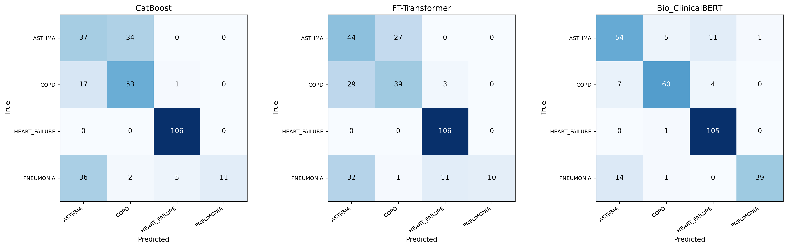

# Nội dung slide tự đọc — Báo cáo tiến độ đợt 1 đề tài M-CDSS

**Mục đích tài liệu:** Làm nội dung nền để xây dựng bộ slide gửi giáo viên đánh giá. Slide cần tự cung cấp đủ bối cảnh, bằng chứng, phương pháp, tiến độ và kế hoạch tiếp theo; không phụ thuộc lời thuyết trình miệng.  
**Đối tượng đọc:** Giáo viên/hội đồng đánh giá có thể không biết trước dự án.  
**Đề xuất:** 22 slide nội dung + 1 slide tài liệu tham khảo. Có thể chia thành 2 phần hoặc rút gọn khi thiết kế, nhưng không nên bỏ phần giới hạn và hiện trạng.

> **Phiên bản kết quả:** Số liệu thực nghiệm chính thức trong tài liệu này được xác lập theo quy trình kiểm soát rò rỉ nghiêm ngặt (Strict Split & Leakage Audit). Toàn bộ kết quả benchmark được đo đạc khách quan trên tập kiểm thử độc lập gồm 302 mẫu (Hold-out Test Set).

## Nguyên tắc biên soạn slide tự đọc

- Viết thông tin chính thành câu ngắn có chủ ngữ và kết luận rõ; hạn chế chỉ để từ khóa rời rạc.
- Với biểu đồ/bảng, ghi đơn vị, cỡ mẫu, tập dữ liệu, ý nghĩa chỉ số và nguồn ngay trên slide.
- Tách rõ **đã hoàn thành**, **đang có trong mã nguồn nhưng chưa tích hợp**, và **đề xuất/chưa triển khai**.
- Không gọi benchmark trên dữ liệu tổng hợp là đánh giá lâm sàng hoặc bằng chứng triển khai.
- Có thể chuyển giải thích kỹ thuật dài, bảng phân bố lớp đầy đủ và lịch backlog sang phụ lục.

---

## Slide 1 — Trang bìa

**Tiêu đề:** Hệ thống hỗ trợ chẩn đoán lâm sàng đa phương thức từ hồ sơ sức khỏe điện tử (M-CDSS)

**Thông tin cần có**
- Báo cáo tiến độ đợt 1 — Giai đoạn nghiên cứu và đề xuất giải pháp.
- Đơn vị/lớp, tên nhóm và thành viên, giáo viên hướng dẫn, ngày nộp.
- Từ khóa: EHR, multimodal AI, clinical notes, clinical decision support.

**Hình đề xuất:** Sơ đồ tối giản gồm dữ liệu bảng + ghi chú → mô hình hỗ trợ phân loại → đầu ra có giải thích.

---

## Slide 2 — Tóm tắt dự án và tiến độ

**Nội dung chính**

M-CDSS nghiên cứu hỗ trợ phân loại bốn nhóm bệnh có biểu hiện hô hấp/tim mạch chồng lấp: hen phế quản (ASTHMA), COPD, suy tim (HEART_FAILURE) và viêm phổi (PNEUMONIA). Hệ thống dự kiến kết hợp dữ liệu bảng như sinh hiệu/xét nghiệm với ghi chú lâm sàng tự do.

Giai đoạn 1 tập trung xây dựng nền tảng dữ liệu chuẩn y khoa, kiểm soát nguy cơ rò rỉ (leakage audit), xây dựng ba baseline đơn phương thức và đề xuất kiến trúc cho Giai đoạn 2. Hệ thống hoàn tất quy trình phân chia dữ liệu nghiêm ngặt (strict split theo nhóm nguồn); ba baseline đã có kết quả thực nghiệm trên tập kiểm thử độc lập 302 mẫu. Trong đó, Bio_ClinicalBERT đạt AUROC macro 0,9735, F1 macro 0,8421; kết quả này là mốc tham chiếu nội bộ trên dữ liệu nghiên cứu và chưa xác nhận hiệu năng trên bệnh nhân thực.

**Trạng thái tổng quan**
- **Đã làm:** pipeline dữ liệu, split/audit, benchmark ba baseline, tài liệu đề xuất.
- **Tiếp theo:** mô hình fusion, RAG/giải thích, đánh giá mở rộng và tích hợp phần mềm.

---

## Slide 3 — Bài toán lâm sàng và lý do chọn đề tài

**Nội dung chính**

Khó thở, ho, giảm SpO₂ và các dấu hiệu viêm có thể gặp ở nhiều bệnh khác nhau. Trong giai đoạn tiếp nhận ban đầu, thông tin lâm sàng còn chưa đầy đủ nên việc phân biệt hen, COPD, suy tim và viêm phổi có thể khó khăn.

Hai nguồn dữ liệu EHR bổ sung cho nhau:

| Dữ liệu bảng | Ghi chú lâm sàng tự do |
|---|---|
| Định lượng sinh hiệu và xét nghiệm; dễ chuẩn hóa và đưa vào thuật toán. | Ghi nhận triệu chứng, tiền sử, diễn tiến và bối cảnh chưa được cấu trúc thành trường dữ liệu. |
| Có thể thiếu xét nghiệm hoặc không thể hiện diễn tiến bệnh. | Có cách viết không đồng nhất, viết tắt và khó định lượng tự động. |

**Lý do chọn đề tài:** Khảo sát liệu mô hình có thể sử dụng cả tín hiệu định lượng lẫn ngữ cảnh trong văn bản, đồng thời đánh giá trong quy trình hạn chế rò rỉ dữ liệu và thể hiện giới hạn một cách minh bạch hay không.

**Hình đề xuất:** Hai cột đầu vào cùng hội tụ vào câu hỏi “Thông tin bổ sung có cải thiện phân loại không?”.

---

## Slide 4 — Literature review: phạm vi và kết quả tổng quan

**Nguồn chính:** Hunik et al., *Diagnostic prediction models for primary care, based on artificial intelligence and electronic health records: a systematic review* (tài liệu JMIR Preprints 62862, 2024; xem nguồn trong thư mục `docs/`).

**Các con số được nhóm tổng hợp từ tài liệu**
- 10.657 công trình được rà soát qua các cơ sở dữ liệu học thuật.
- 15 nghiên cứu đáp ứng tiêu chí đưa vào tổng quan.
- Theo phần phân tích của nhóm, 15/15 nghiên cứu sử dụng dữ liệu có cấu trúc; không nghiên cứu nào trong tập được tổng quan khai thác ghi chú tự do bằng mô hình ngôn ngữ.
- PROBAST tổng thể: 9/15 (60%) nguy cơ sai lệch cao; 6/15 (40%) chưa rõ; 0/15 nguy cơ thấp.

**Diễn giải:** Tổng quan gợi ý khoảng trống về khai thác văn bản và chất lượng phương pháp luận trong tập nghiên cứu được chọn. Những tỷ lệ này thuộc phạm vi 15 nghiên cứu của tổng quan, không đại diện cho toàn bộ AI y tế.

**Hình đề xuất:** Funnel 10.657 → 15; bên cạnh là thanh 9 High / 6 Unclear / 0 Low risk.

**Chú thích bắt buộc:** Số liệu theo tổng quan Hunik et al. và phần trích xuất trong `docs/01_RESEARCH_BACKGROUND_AND_GAP.md`.

---

## Slide 5 — Các rủi ro phương pháp luận trong y văn

**Nội dung chính**

Các vấn đề được nhấn mạnh trong tài liệu tổng quan và tài liệu nền của dự án gồm:

- **Rò rỉ nhãn/không đúng thời điểm:** biến đầu vào có thể chứa thông tin phát sinh sau chẩn đoán hoặc gần như chính là tiêu chuẩn chẩn đoán.
- **Dữ liệu khuyết:** cách xử lý không được mô tả hoặc có thể làm thay đổi thành phần mẫu.
- **Hiệu chuẩn:** độ phân biệt tốt không đồng nghĩa xác suất dự đoán đáng tin cậy.
- **Tổng quát hóa:** kết quả trên một nguồn/cơ sở không tự động áp dụng được ở nguồn khác; ngoại kiểm thường còn hạn chế.

**Hàm ý cho thiết kế M-CDSS:** khóa mốc thời gian, split có nhóm, audit leakage, báo cáo nhiều chỉ số và đặt ngoại kiểm trong kế hoạch tiếp theo.

**Hình đề xuất:** Bốn khối PROBAST (Participants, Predictors, Outcome, Analysis) cùng ví dụ lỗi tương ứng.

---

## Slide 6 — Khoảng trống và câu hỏi nghiên cứu

**Khoảng trống dự án hướng tới**
1. Đánh giá kết hợp ghi chú tự do và dữ liệu bảng, thay vì chỉ dùng từng nguồn riêng.
2. Kiểm soát rò rỉ nguồn và trình tự thời gian khi xây dựng benchmark.
3. Đánh giá cả phân biệt, phân loại và hiệu chuẩn xác suất; công bố giới hạn dữ liệu.
4. Đề xuất giải thích có truy xuất guideline và gắn bằng chứng với ghi chú ở giai đoạn phát triển tiếp theo.

**Câu hỏi nghiên cứu chính**

> Trên dữ liệu nghiên cứu hiện có, việc kết hợp thông tin bảng và ghi chú lâm sàng có cải thiện kết quả so với baseline đơn phương thức trong một quy trình chia tập và audit nghiêm ngặt hơn hay không?

**Phạm vi kết luận:** Giai đoạn hiện tại mới thiết lập baseline và câu hỏi thực nghiệm. Chưa có kết quả fusion để trả lời khẳng định câu hỏi trên.

---

## Slide 7 — Mục tiêu, phạm vi và nhãn phân loại

**Mục tiêu tổng quát:** Xây dựng và đánh giá một nguyên mẫu CDSS nghiên cứu đa phương thức, hỗ trợ phân loại bốn nhóm bệnh và cung cấp đầu ra có thể kiểm tra.

**Bốn lớp mục tiêu**
- ASTHMA — hen phế quản.
- COPD — bệnh phổi tắc nghẽn mạn tính.
- HEART_FAILURE — suy tim.
- PNEUMONIA — viêm phổi.

**Phạm vi Giai đoạn 1**
- Dữ liệu tổng hợp/kho công khai và ghi chú đã xử lý; chưa phải cohort bệnh viện.
- Xây pipeline và benchmark ba mô hình riêng: CatBoost, FT-Transformer, Bio_ClinicalBERT.
- Đề xuất kiến trúc fusion/RAG cho giai đoạn sau.

**Ngoài phạm vi kết luận hiện tại:** chẩn đoán xác nhận, quyết định điều trị, hiệu quả trên bệnh nhân thực hoặc triển khai lâm sàng.

---

## Slide 8 — Kế hoạch tổng thể theo hai giai đoạn

| Giai đoạn / backlog | Công việc chính | Sản phẩm/tiêu chí đầu ra |
|---|---|---|
| **Giai đoạn 1, backlog 1 (tuần 1)** | Môi trường, schema dữ liệu, dữ liệu ban đầu, khung API/frontend. | Data contract, cấu hình, dữ liệu nghiên cứu, khung ứng dụng. |
| **Giai đoạn 1, backlog 2 (tuần 2)** | De-ID, temporal lock, missing data, khung baseline. | Pipeline và kiểm thử dữ liệu. |
| **Giai đoạn 1, backlog 3 (tuần 3)** | Group split, benchmark, error analysis, đề xuất giải pháp. | Báo cáo baseline và thiết kế Giai đoạn 2. |
| **Giai đoạn 2, backlog 4** | Encoder bảng/văn bản, fusion, calibration, ablation. | Mô hình fusion và kết quả so sánh trên strict split. |
| **Giai đoạn 2, backlog 5** | RAG, vector store, evidence grounding, tích hợp phần mềm. | Luồng truy xuất guideline và giải thích có bằng chứng. |
| **Giai đoạn 2, backlog 6** | DCA, phân tích lỗi, fairness, chuyên gia/ngoại kiểm khi khả thi. | Đánh giá lâm sàng mở rộng và giới hạn tổng quát hóa. |
| **Giai đoạn 2, backlog 7** | Đóng gói, báo cáo và demo. | Bản bàn giao tái lập được. |

**Trạng thái:** Giai đoạn 1 là phần báo cáo hiện tại; Giai đoạn 2 là kế hoạch, chưa được trình bày như kết quả đã hoàn tất.

---

## Slide 9 — Kiến trúc hệ thống đề xuất

```text
Dữ liệu bảng ─> FT-Transformer ───────┐
                                      ├─> Cross-Attention / Fusion ─> Classification Head
Ghi chú ─────> Clinical Text Encoder ─┘                                │
                                                                       v
                                                         Temperature Scaling / xác suất
                                                                       │
Hướng dẫn y khoa ─> Vector Store/Retriever ─> Agent giải thích <───────┘
                                                │
                                                v
                                 trích dẫn guideline + vị trí bằng chứng
```

**Mô tả thành phần**
- **Pipeline đầu vào:** khử định danh, khóa thời gian, xử lý dữ liệu khuyết và giữ thông tin nhóm nguồn.
- **Hai encoder:** FT-Transformer biểu diễn biến bảng; ClinicalBERT/Bio_ClinicalBERT biểu diễn ghi chú.
- **Fusion:** Cross-Attention dự kiến cho phép biểu diễn bảng truy vấn thông tin từ token văn bản; classification head tạo điểm số cho bốn lớp.
- **Calibration:** Temperature Scaling dự kiến điều chỉnh xác suất dựa trên validation; ngưỡng ECE là mục tiêu cần kiểm tra, không phải kết quả đã đạt của mô hình fusion.
- **Agentic RAG:** truy xuất guideline và neo giải thích vào văn bản nguồn; là kế hoạch Giai đoạn 2.

**Trạng thái hiện thực:** Baseline bảng/văn bản đã có; mô hình Cross-Attention hoàn chỉnh, hiệu chuẩn fusion, vector DB và agent chưa hoàn thành.

**Nguồn thiết kế:** `DEVELOPMENT_SPEC_MULTIMODAL_EHR_AI.md`, `docs/PROPOSED_OPTIMAL_SOLUTION.md`.

---

## Slide 10 — Nguồn dữ liệu và cấu trúc bộ dữ liệu nghiên cứu

**Nguồn và quy mô**
- Nguồn đầu vào: cohort tổng hợp Synthea và ghi chú MTSamples.
- Bộ raw chuẩn hóa gồm **2.000 bản ghi**, cân bằng **500 mẫu mỗi nhãn**: ASTHMA, COPD, HEART_FAILURE và PNEUMONIA.
- Bảng gồm nhân khẩu học, sinh hiệu, xét nghiệm và tiền sử; modality văn bản là ghi chú lâm sàng đã xử lý.
- Tỷ lệ thiếu được báo cáo trong bộ dữ liệu: WBC **20,5%**, CRP **22,4%**.

**Công việc đã thực hiện**
1. Tổng hợp nguồn dữ liệu lâm sàng và xây dựng converter chuẩn hóa tạo raw dataset.
2. Loại ghi chú MTSamples bị trùng giữa nhãn; không quay vòng tái sử dụng ghi chú khi hết nguồn.
3. Loại transcription/assessment khỏi phần văn bản đầu vào và che tên chẩn đoán đích.
4. Gắn `source_patient_group` và `source_note_group` để có thể kiểm tra nguồn và chia tập theo nhóm.

**Kết quả bàn giao:** bộ dữ liệu raw chuẩn hóa (2.000 mẫu) và bộ công cụ converter/audit kiểm soát nguồn có thể tái lập hoàn toàn; nội dung nhạy cảm không được đưa lên Git theo cấu hình bỏ qua dữ liệu.

**Sơ đồ slide:** `CSV Synthea + MTSamples → converter → 2.000 mẫu/4 lớp → nhóm nguồn có thể truy vết`.

---

## Slide 11 — Pipeline dữ liệu và các kiểm soát chất lượng

**Luồng xử lý đã xây dựng**

```text
Nguồn CSV
  → chuẩn hóa schema và chuyển đổi thành bản ghi multimodal
  → lọc nội dung ghi chú trùng/tín hiệu nhãn trực tiếp
  → giữ metadata nhóm bệnh nhân/ghi chú nguồn
  → tạo strict split theo nhóm liên kết
  → audit giao nhau giữa các split
  → huấn luyện và đánh giá baseline
```

**Các module hiện có trong `src/data_pipeline/`**
- `deidentifier.py`: xử lý thực thể nhận dạng trong văn bản.
- `temporal_aligner.py`: lọc/khóa thông tin theo thời điểm chẩn đoán và hạn chế biến cố sau chẩn đoán lọt vào đầu vào.
- `imputer.py`: xử lý giá trị khuyết.
- `dataset_loader.py`: nạp mẫu cho quá trình huấn luyện/đánh giá.

**Điểm cần diễn đạt chính xác:** quy trình strict split được thiết lập chặt chẽ theo nhóm nguồn liên kết và có kiểm toán rò rỉ độc lập (audit 0 overlap). Các module pipeline có trong mã nguồn; slide không nên ngụ ý rằng toàn bộ pipeline đã được thẩm định trên dữ liệu bệnh viện thực.

**Nguồn:** `src/data_pipeline/`, `scripts/convert_sources_to_raw.py`, `scripts/audit_data_leakage.py`.

---

## Slide 12 — Strict split: quy mô, phân bố và audit

Split sử dụng connected components trên `source_patient_group` và `source_note_group`, để mọi bản ghi nối với cùng bệnh nhân nguồn hoặc ghi chú nguồn được xếp chung một split.

| Tập | Tổng số | ASTHMA | COPD | HEART_FAILURE | PNEUMONIA |
|---|---:|---:|---:|---:|---:|
| Train | 1.425 | 358 | 358 | 340 | 369 |
| Validation | 273 | 71 | 71 | 54 | 77 |
| Test | 302 | 71 | 71 | 106 | 54 |
| **Tổng** | **2.000** | **500** | **500** | **500** | **500** |

**Kết quả leakage audit**

| Khóa kiểm tra | Train–Val | Train–Test | Val–Test |
|---|---:|---:|---:|
| `patient_id` | 0 | 0 | 0 |
| `source_patient_group` | 0 | 0 | 0 |
| `source_note_group` | 0 | 0 | 0 |

Audit pass; tất cả split có đủ bốn lớp. Tập test có nhiều HEART_FAILURE hơn (106), PNEUMONIA ít hơn (54), vì vậy cần đọc kết quả theo từng lớp và bổ sung ước lượng bất định ở giai đoạn sau.

**Hình gợi ý:** biểu đồ cột chồng số lượng lớp theo split, cạnh đó là ba chỉ báo “0 overlap”.

**Nguồn:** `data/rebuilt_strict_split_audit.json`.

---

## Slide 13 — Thiết kế thực nghiệm và các baseline

| Baseline | Đầu vào | Cấu hình/kết quả chọn mô hình |
|---|---|---|
| CatBoost | Dữ liệu bảng | Chọn giữa CatBoost và XGBoost theo validation macro-AUROC; CatBoost 0,9084, XGBoost 0,8895. |
| FT-Transformer | Dữ liệu bảng | 19 epochs; đại diện baseline học sâu cho dữ liệu bảng. |
| Bio_ClinicalBERT | Ghi chú đã khử định danh | Fine-tune block encoder cuối và classification head; tối đa 512 tokens; learning rate 2e-5; 5 epochs. |

**Thiết lập đánh giá**
- Seed 42; benchmark strict test gồm 302 mẫu và bốn nhãn.
- CatBoost được chọn bằng validation, không chọn theo kết quả test.
- Báo cáo: macro AUROC, macro AUPRC, macro-F1, accuracy, Brier score và ECE.
- AUROC/AUPRC đo năng lực xếp hạng/phân biệt; F1/accuracy phụ thuộc dự đoán lớp; Brier/ECE cung cấp góc nhìn về xác suất và calibration.

**Nguồn:** `data/rebuilt_strict_results_2026-10-28.json`.

---

## Slide 14 — Kết quả tổng hợp trên strict test

**Cỡ mẫu test: N = 302.** Số thập phân là điểm chỉ số, không phải tỷ lệ phần trăm.

| Baseline | AUROC macro | AUPRC macro | F1 macro | Accuracy | Brier | ECE |
|---|---:|---:|---:|---:|---:|---:|
| CatBoost (bảng) | 0,9223 | 0,7872 | 0,6083 | 0,6854 | 0,3844 | 0,0663 |
| FT-Transformer (bảng) | 0,8976 | 0,7023 | 0,5789 | 0,6589 | 0,4725 | 0,1152 |
| Bio_ClinicalBERT (văn bản) | **0,9735** | **0,9314** | **0,8421** | **0,8543** | **0,2329** | **0,0373** |

**Kết quả nổi bật**
- Bio_ClinicalBERT đứng đầu cả sáu chỉ số được báo cáo trên tập này.
- CatBoost nhỉnh hơn FT-Transformer trên các chỉ số trong bảng; cả hai baseline bảng có F1/accuracy thấp hơn baseline văn bản.
- Kết quả này làm nổi bật tiềm năng modality văn bản trong tập hiện tại và tạo cơ sở thực nghiệm để kiểm tra fusion.
- Không thể suy ra rằng fusion chắc chắn tốt hơn: mô hình kết hợp chưa được huấn luyện/đánh giá.

**Hình gợi ý:** bảng là thông tin chính; có thể thêm thanh ngang cho macro-AUROC, macro-F1 và accuracy. Tránh gộp các chỉ số có ý nghĩa khác nhau vào một thang không giải thích.

---

## Slide 15 — Đường cong ROC, Precision–Recall và reliability


**Cách đọc hình**
- Panel trái: ROC **micro-average**; đường Bio_ClinicalBERT nằm cao hơn hai baseline bảng trên phần lớn miền FPR. Chú giải hình ghi AUC micro: CatBoost 0,923; FT-Transformer 0,893; Bio_ClinicalBERT 0,969.
- Panel giữa: Precision–Recall **micro-average**; chú giải ghi AP micro: CatBoost 0,813; FT-Transformer 0,722; Bio_ClinicalBERT 0,922.
- Panel phải: reliability diagram; đường chéo là tham chiếu hiệu chuẩn hoàn hảo. Sai số trên các bin và số mẫu mỗi bin khiến đường có thể dao động, đặc biệt trên tập test nhỏ.

**Lưu ý quan trọng:** Hình này thể hiện ROC/PR micro-average, còn bảng ở Slide 14 báo cáo macro-average. Vì vậy AUC/AP trong chú giải hình không nhất thiết bằng AUROC/AUPRC macro trong bảng. ECE phải trích theo bảng JSON: CatBoost 0,0663; FT-Transformer 0,1152; Bio_ClinicalBERT 0,0373.

**Nguồn hình:** `data/rebuilt_strict_curves_2026-10-28.png`.

---

## Slide 16 — Ma trận nhầm lẫn và lỗi theo lớp



**Cách đọc:** Hàng là nhãn thật, cột là nhãn dự đoán; ô trên đường chéo là dự đoán đúng. Tổng mẫu mỗi lớp lần lượt là ASTHMA 71, COPD 71, HEART_FAILURE 106, PNEUMONIA 54.

**Các điểm quan sát được từ ma trận**
- CatBoost: ASTHMA đúng 37/71; 34 ca ASTHMA bị phân loại thành COPD. PNEUMONIA đúng 11/54; 36 ca bị phân loại thành ASTHMA.
- FT-Transformer: ASTHMA đúng 44/71, COPD đúng 39/71; PNEUMONIA đúng 10/54 và 32 ca bị phân loại thành ASTHMA.
- Bio_ClinicalBERT: ASTHMA đúng 54/71; COPD đúng 60/71; HEART_FAILURE đúng 105/106; PNEUMONIA đúng 39/54, trong đó 14 ca bị phân loại thành ASTHMA.

**Diễn giải thận trọng:** Trên test này, nhầm lẫn ASTHMA–COPD nổi bật ở baseline bảng; Bio_ClinicalBERT giảm nhiều nhầm lẫn đó nhưng PNEUMONIA vẫn còn một số ca bị nhận thành ASTHMA. Số lượng mỗi lớp và tính tổng hợp của dữ liệu giới hạn kết luận; cần phân tích lỗi theo nguồn và kiểm tra ngoài mẫu.

**Nguồn hình:** `data/rebuilt_strict_confusion_2026-10-28.png`.

---

## Slide 17 — Hiệu chuẩn và khoảng cách validation–test

| Baseline | ECE validation | ECE test | Brier validation | Brier test |
|---|---:|---:|---:|---:|
| CatBoost | 0,0639 | 0,0663 | 0,3563 | 0,3844 |
| FT-Transformer | 0,0478 | 0,1152 | 0,3042 | 0,4725 |
| Bio_ClinicalBERT | 0,1487 | 0,0373 | 0,4594 | 0,2329 |

**Điều cần rút ra**
- ECE test của Bio_ClinicalBERT thấp nhất trong ba baseline ở lần chạy này; CatBoost là 0,0663 và FT-Transformer là 0,1152.
- Validation và test khác đáng kể ở FT-Transformer và Bio_ClinicalBERT. Điểm calibration tốt trên test không khẳng định ổn định nếu phân bố nhóm nguồn thay đổi.
- Chưa có confidence interval hoặc phân tích calibration theo từng lớp; cần bổ sung trước khi diễn giải xác suất theo hướng ứng dụng.
- Mục tiêu ECE < 0,05 trong spec là mục tiêu thiết kế, không phải tiêu chí đã đạt cho mọi baseline; Bio_ClinicalBERT có ECE test < 0,05 ở lần chạy này nhưng cần xác nhận thêm.

**Hình hỗ trợ:** reliability diagram ở Slide 15. Dùng các con số bảng làm nguồn chính.

---

## Slide 18 — Phân tích ca bệnh sai biệt & Tính bổ trợ giữa các phương thức

**Nội dung chính**

1. **Phân tích ca bệnh sai biệt lâm sàng (Clinical Discrepancy Case Studies)** trích xuất từ tập kiểm thử độc lập ($N = 302$):
- **Nhóm Bảng số đúng — Văn bản sai:**
  - *Ca bệnh PT-0174 (Nhãn thật: COPD):* Bảng số dự đoán chính xác COPD (độ tin cậy 80,4%) nhờ bắt đúng tiền sử hút thuốc nặng và chỉ số SpO₂ giảm mạn tính; Bio_ClinicalBERT dự đoán nhầm sang ASTHMA (58,7%) do văn bản mô tả triệu chứng ho, khó thở tương đồng giữa hai bệnh.
  - *Ca bệnh PT-0254 (Nhãn thật: COPD):* Bảng số dự đoán đúng COPD (độ tin cậy 75,2%); mô hình văn bản đoán nhầm sang HEART_FAILURE (59,0%) do ghi chú nhấn mạnh mệt mỏi và rale ẩm rải rác.
- **Nhóm Văn bản đúng — Bảng số sai:**
  - *Ca bệnh PT-0044 (Nhãn thật: ASTHMA):* Bio_ClinicalBERT chẩn đoán chính xác ASTHMA (độ tin cậy 85,8%) nhờ nhận diện tiền sử dị ứng thời tiết và cơn khó thở rale rít về đêm; mô hình bảng số đoán nhầm sang COPD (78,8%) do SpO₂ và nhịp thở của 2 bệnh ở đợt cấp rất giống nhau.
  - *Ca bệnh PT-0089 (Nhãn thật: ASTHMA):* Văn bản đoán đúng ASTHMA (độ tin cậy 66,4%); bảng số đoán nhầm sang COPD (83,1%).

2. **Kiểm chứng độ khó dữ liệu (Sanity Check):**
- Thử nghiệm với Cây quyết định chuẩn (Decision Tree độ sâu 4) đạt accuracy **0,7285** trên strict test set.
- Kết quả này xác nhận: bài toán phân loại 4 bệnh có độ khó phân biệt thực tế; dữ liệu bảng và văn bản không chứa quy luật rò rỉ nhãn tầm thường (*zero label leakage*); đòi hỏi các mô hình học sâu và mô hình ngôn ngữ chuyên sâu (CatBoost đạt AUROC 0,9223; Bio_ClinicalBERT đạt AUROC 0,9735).

3. **Luận cứ thực nghiệm cho Giai đoạn 2:**
- Hai phương thức mang thông tin trực giao bổ trợ cho nhau: Bảng số nhạy bén với chỉ số sinh tồn và biến động sinh lý tức thời; văn bản nắm bắt sâu sắc bệnh sử, tiền căn và triệu chứng cơ năng.
- Đây là bằng chứng thực nghiệm trực tiếp chứng minh tính tất yếu của giải pháp **Multimodal Cross-Attention Late Fusion** nhằm bù đắp điểm mù của từng phương thức đơn lẻ.

**Hình đề xuất:** Bảng đối chiếu 4 ca bệnh sai biệt (PT-0174, PT-0254, PT-0044, PT-0089) thể hiện nhãn thực tế, dự đoán của Bảng số vs Văn bản kèm độ tin cậy tương ứng.

---

## Slide 19 — Hồ sơ công việc và sản phẩm đã tạo

| Công việc | Kết quả/artefact | Ý nghĩa |
|---|---|---|
| Chuẩn hóa nguồn dữ liệu và bộ converter | `scripts/convert_sources_to_raw.py`; bộ raw 2.000 mẫu | Xây dựng dữ liệu đầu vào chuẩn hóa, có thể truy vết và tái lập. |
| Xử lý dữ liệu và xây loader | Các module trong `src/data_pipeline/` | Chuẩn bị đầu vào, hỗ trợ bảo vệ thông tin và nạp mẫu. |
| Chia strict split và audit | `scripts/audit_data_leakage.py`; `data/rebuilt_strict_split_audit.json` | Kiểm tra giao nhau theo patient/source patient/source note. |
| Huấn luyện ba baseline | `scripts/run_baselines.py`; `data/rebuilt_strict_results_2026-10-28.json` | Tạo mốc tham chiếu đơn phương thức cho Giai đoạn 2. |
| Tạo trực quan kết quả | `data/rebuilt_strict_curves_2026-10-28.png`; `data/rebuilt_strict_confusion_2026-10-28.png` | Cho thấy discrimination, PR, reliability và nhầm lẫn theo lớp. |
| Báo cáo và đề xuất | Báo cáo kết quả Giai đoạn 1, `docs/PROPOSED_OPTIMAL_SOLUTION.md`, spec và backlog | Ghi nhận kết quả thực nghiệm chuẩn hóa, luận chứng thiết kế và kế hoạch tiếp. |
| Nền tảng phần mềm | `src/api/`, `frontend/src/` | Có khung API/form/trang baseline; chưa đồng nghĩa toàn bộ workflow tích hợp. |

**Kết luận tiến độ:** Giai đoạn 1 đã chuyển từ đề xuất kỹ thuật sang có pipeline và benchmark strict làm bằng chứng đầu vào cho thiết kế Giai đoạn 2.

---

## Slide 20 — Công việc Giai đoạn 2 theo thứ tự phụ thuộc

1. **Backlog 4 — Multimodal core:** xây encoder bảng/văn bản và Cross-Attention; huấn luyện trên strict split; so sánh tabular, text, concat và cross-attention; kiểm tra ablation và calibration.
2. **Backlog 5 — RAG và phần mềm:** ingest guideline; đánh giá truy xuất; xây Diagnostic Agent và evidence grounding; nối API/UI để thể hiện xác suất, trích dẫn và bằng chứng.
3. **Backlog 6 — Đánh giá mở rộng:** phân tích lỗi theo lớp, bootstrap CI, calibration, fairness và DCA; chuẩn bị đánh giá chuyên gia/ngoại kiểm khi có nguồn dữ liệu, phê duyệt và quy trình phù hợp.
4. **Backlog 7 — Bàn giao:** đóng gói hệ thống, hoàn thiện tài liệu tái lập theo TRIPOD-AI và demo.

**Tiêu chí quyết định:** Chỉ kết luận fusion có lợi nếu kết quả được so sánh công bằng trên cùng split và có phân tích bất định/lỗi; không đặt trước rằng mô hình fusion chắc chắn vượt baseline.

---

## Slide 21 — Giới hạn, rủi ro và điều kiện ứng dụng

**Giới hạn hiện tại**
- Dữ liệu tổng hợp và kho công khai không đại diện đầy đủ cho bệnh viện thực hoặc quy trình ghi chép tại Việt Nam.
- Strict split xử lý các liên kết nguồn đã ghi nhận, nhưng không xóa hết domain/style bias.
- Test 302 mẫu; phân bố lớp lệch vừa phải; chưa có bootstrap confidence interval, fairness đầy đủ, threshold theo chi phí lâm sàng hay prospective evaluation.
- Chưa đánh giá ngoại kiểm; chưa có kết quả mô hình multimodal/RAG đã tích hợp.

**Rủi ro cần quản lý ở bước tới**
- Rò rỉ nhãn hoặc thông tin tương lai trong nguồn dữ liệu mới.
- Khác biệt ngôn ngữ/phong cách giữa dữ liệu dùng để phát triển và dữ liệu mục tiêu.
- Calibration/độ nhạy không đồng đều giữa các lớp.
- Trích dẫn agent không khớp nguồn nếu không kiểm chứng bằng evidence grounding.

**Ranh giới sử dụng:** Nguyên mẫu phục vụ nghiên cứu; không dùng để quyết định điều trị. Mọi đánh giá trên dữ liệu bệnh viện cần có phê duyệt, bảo vệ dữ liệu và thẩm định phù hợp.

---

## Slide 22 — Kết luận và nội dung cần giáo viên góp ý

- Đề tài có động lực từ khoảng trống khai thác ghi chú EHR và các vấn đề về leakage, calibration, missing data, ngoại kiểm trong y văn.
- Giai đoạn 1 đã xây dựng pipeline, strict split/audit, ba baseline và bộ artefact benchmark; kết quả thực nghiệm cho thấy Bio_ClinicalBERT là baseline đạt hiệu năng cao nhất trong test nội bộ hiện tại (AUROC macro 0,9735, F1 macro 0,8421).
- Kết quả chưa trả lời liệu fusion tốt hơn hay có giá trị lâm sàng; đây là câu hỏi thực nghiệm của Giai đoạn 2.
- Kế hoạch tiếp theo ưu tiên fusion/ablation, sau đó RAG/evidence grounding, đánh giá mở rộng và đóng gói.

**Đề nghị góp ý của giáo viên**
1. Phạm vi bốn nhãn và câu hỏi nghiên cứu có phù hợp không?
2. Thiết kế so sánh và tiêu chí ablation/cải thiện fusion nên chốt như thế nào?
3. Các ưu tiên Giai đoạn 2 và tiêu chí nghiệm thu có cần điều chỉnh không?

---

## Slide 23 — Tài liệu và artefact tham chiếu

**Tài liệu dự án**
- `docs/01_RESEARCH_BACKGROUND_AND_GAP.md` — literature review và khoảng trống.
- `DEVELOPMENT_SPEC_MULTIMODAL_EHR_AI.md` — kiến trúc/module mục tiêu.
- `docs/PROPOSED_OPTIMAL_SOLUTION.md` — giải pháp đề xuất sau baseline.
- `tasks/README.md`, `tasks/phase-01/`, `tasks/phase-02-development/` — lộ trình và backlog.
- `docs/Bao cao M-CDSS - strict split 2026-10-28.docx` — báo cáo benchmark strict split.

**Artefact thực nghiệm chính thức**
- `data/rebuilt_strict_results_2026-10-28.json` — chỉ số và một số ví dụ error analysis.
- `data/rebuilt_strict_split_audit.json` — quy mô split, phân bố lớp và overlap audit.
- `data/rebuilt_strict_curves_2026-10-28.png` — ROC/PR micro-average và reliability diagram.
- `data/rebuilt_strict_confusion_2026-10-28.png` — confusion matrices ba baseline.

**Nguồn literature review:** Hunik et al., “Diagnostic prediction models for primary care, based on artificial intelligence and electronic health records: a systematic review,” JMIR Preprints 62862 (2024), bản PDF trong `docs/`. Trước khi nộp, đối chiếu đầy đủ tác giả, năm, DOI/trạng thái xuất bản với trang tiêu đề của bản PDF được trích dẫn.

---

## Phụ lục slide có thể thêm

- Định nghĩa ngắn từng metric và chiều tốt/xấu.
- Cấu hình chi tiết mỗi baseline, seed và tiêu chí chọn checkpoint.
- Bảng confusion matrix dạng số để đọc tốt khi in.
- Ví dụ error analysis đã loại bỏ định danh trực tiếp.
- Lệnh tái lập converter, audit và benchmark.
- Ma trận backlog với phụ thuộc, sản phẩm bàn giao và điều kiện hoàn thành.

