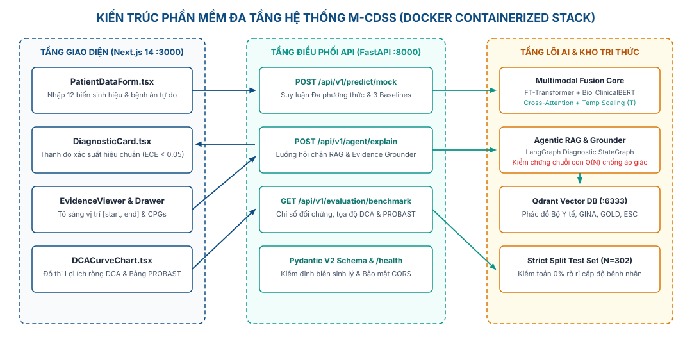
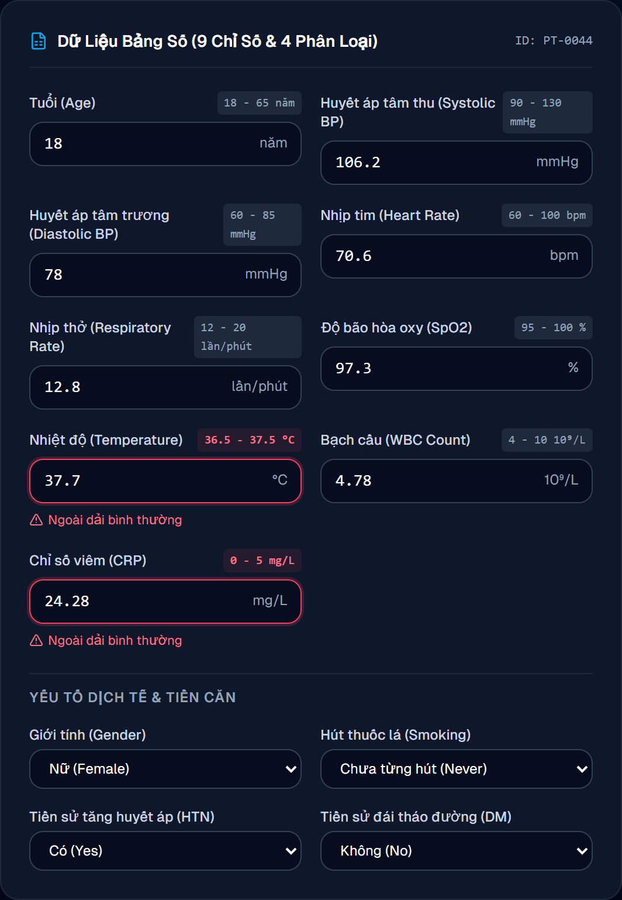
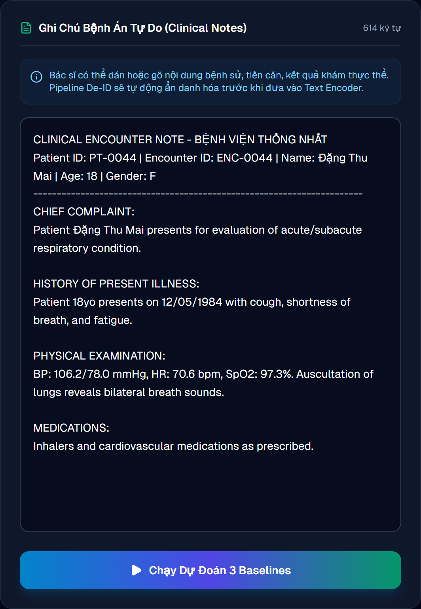
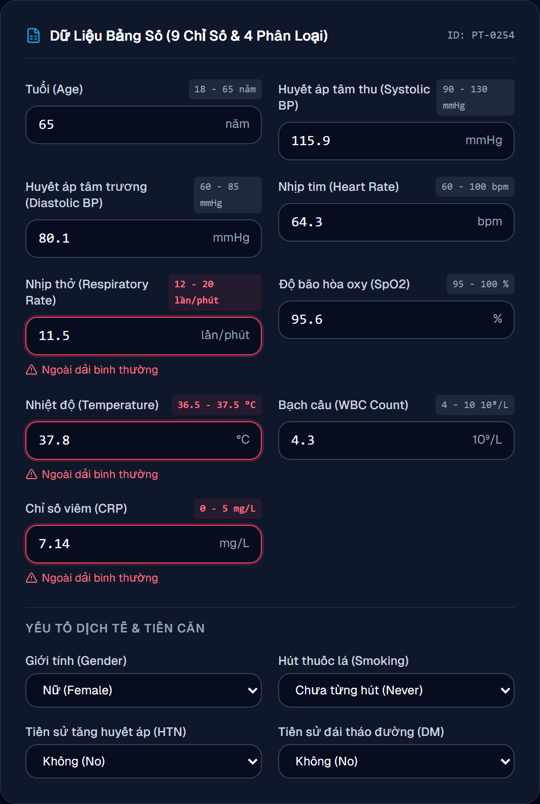
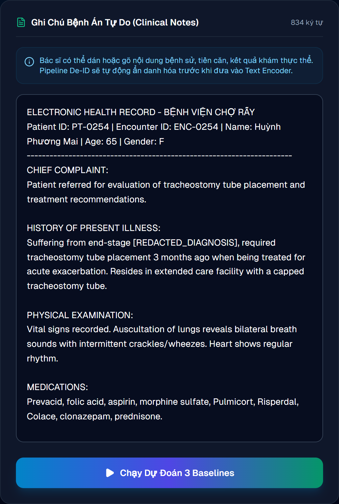

# Báo Cáo Nghiệm Thu Đề Tài (Cập nhật Giai Đoạn 3 — Research Hardening): Hệ Thống Hỗ Trợ Chẩn Đoán Lâm Sàng Đa Phương Thức (M-CDSS)
## Bộ Nội Dung Slide Tự Đọc & Kịch Bản Thuyết Trình Chi Tiết (20 Slide)

> **Mục đích tài liệu:** Tài liệu tổng hợp trọn vẹn **Nội dung hiển thị trên từng Slide**, **Lời thuyết trình gợi ý**, **Điểm cần nhấn**, và **Phương án dự phòng demo** cho buổi báo cáo bảo vệ.
>
> **Thời lượng trình bày gợi ý:** 15 – 18 phút (mỗi thành viên thuyết trình phần mình phụ trách; chưa gồm phần Hỏi – Đáp Q&A).
>
> **Cảnh báo phạm vi & dữ liệu:** Bộ dữ liệu 2.000 hồ sơ hiện tại được tổng hợp từ nguồn mở (**Synthea EHR + MTSamples**, đánh chỉ mục tái lập qua `data/DATA_MANIFEST.json`) với tập kiểm thử độc lập **302 hồ sơ** (*Strict Group Split*, 0% rò rỉ). M-CDSS là **nguyên mẫu nghiên cứu học thuật**, tuyệt đối không thay thế quyết định chẩn đoán/điều trị của bác sĩ.
>
> **Trạng thái số liệu Phase 3:** Số liệu hệ thống của Thành viên 3 (**RQ5 RAG trên 60 truy vấn / 64 đoạn JSON phác đồ / 50 ca grounding & Độ trễ CPU**) là số đo thực tế từ `results/rag_evaluation_report.json` và `results/latency_report.json`. Các ô `[TODO-TV1]` / `[TODO-TV2]` được giữ nguyên làm khung chờ điền kết quả đa seed RQ1–RQ4 chính thức từ Thành viên 1 và Thành viên 2.

---

## Bảng Phân Bổ Thời Lượng Trình Bày (20 Slide — Mạch Research Hardening Phase 3)

| Nhóm nội dung | Slide | Nội dung trọng tâm | Thời lượng gợi ý |
| :--- | :---: | :--- | :---: |
| **Mở đầu & Bố cục** | 1 – 2 | Trang bìa (kèm cảnh báo dữ liệu tổng hợp) & Tổng quan báo cáo RQ1–RQ5 | 1 phút 30 giây |
| **1. Cơ sở lý thuyết nền tảng** | 3 – 5 | Cross-Attention, Hiệu chuẩn ECE, Agentic RAG + Grounding, DCA & PROBAST | 2 phút |
| **2. Khoảng trống, RQ1–RQ5 & Dữ liệu** | 6 – 8 | JMIR (2024), 5 Câu hỏi nghiên cứu (RQ1–RQ5), Dữ liệu chống rò rỉ & Bài học Phase 1 | 3 phút |
| **3. Phương pháp & An toàn Hệ thống** | 9 – 12 | Kiến trúc dung hợp, Agentic RAG 64/70 chunks, UI Safety Banner, RQ4 Toggle & Độ trễ CPU | 4 phút |
| **4. Kết quả Thực nghiệm (RQ1–RQ5)** | 13 – 16 | Đối chứng đa seed (RQ1), Phân rã văn bản (RQ2), Case Study & Grounding Audit 50 ca | 3 phút 30 giây |
| **5. Thẩm định Lâm sàng (DCA & PROBAST)** | 17 – 18 | Phân tích Lợi ích ròng DCA, Kiểm định thiếu phương thức RQ4 & PROBAST 4 miền | 2 phút |
| **6. Giới hạn, Hướng phát triển & Q&A** | 19 – 20 | Giới hạn trung thực, Lộ trình MIMIC-IV / Khảo sát bác sĩ / LLM ràng buộc & Tài liệu | 1 phút 30 giây |

---

## Slide 1 — Trang bìa

### Nội dung hiển thị trên Slide
* **TÊN ĐỀ TÀI:** HỆ THỐNG HỖ TRỢ CHẨN ĐOÁN LÂM SÀNG ĐA PHƯƠNG THỨC TỪ HỒ SƠ SỨC KHỎE ĐIỆN TỬ (M-CDSS)
* **Phân kỳ báo cáo:** Báo cáo Tổng kết & Nghiệm thu Đề tài — Dung hợp Học sâu Chú ý chéo, Hiệu chuẩn Xác suất, Giải thích Lâm sàng Dựa trên Y học Chứng cứ và Đánh giá Lợi ích Ròng.
* **Nhóm thực hiện (Nhóm 6):** Nguyễn Nho Dương, Lê Tuấn Cảnh, Nguyễn Văn Cường.
* **Từ khóa:** Hồ sơ sức khỏe điện tử (EHR), Học sâu đa phương thức (Multimodal Deep Learning), Chú ý chéo (Cross-Attention Late Fusion), Hiệu chuẩn nhiệt độ (Temperature Scaling), Truy xuất y văn chống ảo giác (Evidence-Grounded RAG), Phân tích đường cong quyết định (DCA).

### Lời nói gợi ý
> Em xin kính chào thầy cô trong Hội đồng đánh giá. Em xin đại diện Nhóm 6 gồm Nguyễn Nho Dương, Lê Tuấn Cảnh và Nguyễn Văn Cường trình bày báo cáo nghiệm thu đề tài **“Hệ thống hỗ trợ chẩn đoán lâm sàng đa phương thức từ Hồ sơ sức khỏe điện tử (M-CDSS)”**.  
> Tiếp nối nền tảng dữ liệu và thực nghiệm đối chứng đơn phương thức ở Giai đoạn 1, trong báo cáo này nhóm trình bày trọn vẹn quá trình thiết kế kiến trúc dung hợp đa phương thức, cơ chế giải thích lâm sàng dựa trên y học chứng cứ và các kết quả kiểm định lợi ích ròng lâm sàng ở Giai đoạn 2.

### Câu chuyển
> Trước khi đi vào chi tiết, em xin điểm qua bố cục 6 phần của báo cáo.

---

## Slide 2 — Tóm tắt bố cục báo cáo

### Nội dung hiển thị trên Slide
1. **Phần 1 – Cơ sở lý thuyết nền tảng:** Giải thích trực quan các khái niệm kỹ thuật và y sinh sử dụng trong báo cáo.
2. **Phần 2 – Khoảng trống nghiên cứu & Bài học từ Giai đoạn 1:** Từ tổng quan JMIR (2024) đến sự bù trừ điểm mù giữa Bảng số và Văn bản.
3. **Phần 3 – Kiến trúc Đa phương thức & Giải thích Y văn:** Cơ chế *Cross-Attention Late Fusion*, Hiệu chuẩn nhiệt độ và Hệ thống truy xuất phác đồ chống ảo giác.
4. **Phần 4 – Kết quả thực nghiệm & Phân tích Ca bệnh:** Đối chứng với 3 mô hình Baseline, thực nghiệm cắt bỏ thành phần (*Ablation Study*) và kiểm chứng trên ca bệnh thực tế.
5. **Phần 5 – Thẩm định lâm sàng nâng cao:** Đường cong quyết định (*Decision Curve Analysis – DCA*) và bảng kiểm 4 miền *PROBAST*.
6. **Phần 6 – Giới hạn nghiên cứu & Tuyên bố y đức:** Ranh giới hỗ trợ quyết định lâm sàng và định hướng mở rộng.

### Lời nói gợi ý
> Báo cáo của nhóm được cấu trúc thành 6 phần mạch lạc. Để thuận tiện nhất cho việc theo dõi, nhóm mở đầu bằng phần tóm tắt ngắn gọn các khái niệm lý thuyết cốt lõi, sau đó trình bày lại khoảng trống nghiên cứu từ Giai đoạn 1, tiếp nối bằng phương pháp dung hợp của Giai đoạn 2, kết quả thực nghiệm đối chứng và thẩm định lợi ích ròng lâm sàng.

### Câu chuyển
> Đầu tiên, em xin trình bày ngắn gọn cơ sở lý thuyết của các khái niệm xuất hiện xuyên suốt trong báo cáo.

---

# PHẦN 1: CƠ SỞ LÝ THUYẾT NỀN TẢNG

---

## Slide 3 — Cơ sở lý thuyết (1): Dung hợp Đa phương thức & Chú ý chéo (Cross-Attention)

### Nội dung hiển thị trên Slide
* **Bài toán dữ liệu đa phương thức trong Y tế (Multimodal EHR):**
  * **Phương thức Bảng số (Tabular Data):** Gồm các con số định lượng như huyết áp, nhịp tim, $\text{SpO}_2$, bạch cầu (WBC), CRP. Phản ánh chính xác trạng thái sinh lý tức thời nhưng thiếu bối cảnh diễn tiến bệnh.
  * **Phương thức Văn bản (Clinical Notes):** Ghi chú tự do của bác sĩ chứa bệnh sử, triệu chứng cơ năng và thuốc đã dùng. Giàu ngữ cảnh nhưng dễ chứa các từ ngữ mô tả trùng lặp gây nhiễu.
* **Khái niệm Ghép nối phẳng (Early Concatenation) vs. Chú ý chéo (Cross-Attention Late Fusion):**
  * *Ghép nối phẳng:* Nối trực tiếp hai dãy số đặc trưng lại với nhau — dễ làm các tín hiệu sinh hiệu ít chiều bị lấn át bởi hàng trăm từ vựng văn bản.
  * *Chú ý chéo (Cross-Attention):* Sử dụng trạng thái sinh hiệu trên bảng số làm **Truy vấn (Query)** để "soi chiếu" và chấm điểm trọng số chú ý lên từng từ khóa trong văn bản (**Key & Value**). Nhờ đó, mô hình chỉ tập trung vào những triệu chứng văn bản phù hợp với tình trạng huyết động thực tế của người bệnh.

### Lời nói gợi ý
> Khái niệm đầu tiên là **Dung hợp chú ý chéo (Cross-Attention Late Fusion)**. Trong bệnh án điện tử, bảng sinh hiệu chỉ có hơn một chục con số nhưng lại là thông số khách quan, trong khi văn bản khám bệnh có hàng trăm từ ngữ. Nếu chỉ ghép nối đơn giản hai nguồn này, phần văn bản rất dễ lấn át phần bảng số. Cơ chế Chú ý chéo giải quyết vấn đề này bằng cách dùng chính trạng thái sinh hiệu làm "câu hỏi truy vấn" chiếu vào văn bản, giúp mô hình biết phải chú ý vào từ khóa triệu chứng nào và bỏ qua từ khóa gây nhiễu nào.

### Câu chuyển
> Sau khi mô hình đưa ra dự đoán, làm sao để biết con số phần trăm mô hình báo cáo có đáng tin cậy hay không? Đó là khái niệm thứ hai về Hiệu chuẩn xác suất.

---

## Slide 4 — Cơ sở lý thuyết (2): Hiệu chuẩn xác suất (Calibration) & Chống ảo giác (Evidence Grounding)

### Nội dung hiển thị trên Slide
* **Hiệu chuẩn xác suất (Probability Calibration) và chỉ số ECE:**
  * Các mạng học sâu hiện đại thường mắc lỗi **tự tin thái quá (Overconfidence)** — ví dụ mô hình dự đoán xác suất mắc bệnh là 95%, nhưng thực tế trong 100 ca tương tự chỉ có 70 ca mắc bệnh thật.
  * **ECE (Expected Calibration Error – Sai số hiệu chuẩn kỳ vọng):** Đo độ lệch trung bình giữa *độ tự tin của mô hình* và *tỷ lệ đúng thực tế*. Tiêu chuẩn an toàn trong AI y tế yêu cầu **$\text{ECE} < 0,05$** (sai lệch dưới 5%).
  * **Temperature Scaling (Hiệu chuẩn nhiệt độ):** Kỹ thuật chia các giá trị đầu ra trước hàm Softmax cho một hằng số nhiệt độ $T > 0$ (tối ưu trên tập thẩm định) nhằm làm mềm phân phối xác suất mà không làm thay đổi thứ tự xếp hạng bệnh.
* **Truy xuất Y văn (Agentic RAG) & Neo bằng chứng chống ảo giác (Evidence Grounding):**
  * **Ảo giác (Hallucination):** Hiện tượng mô hình ngôn ngữ tự suy diễn hoặc bịa ra triệu chứng không có trong hồ sơ bệnh nhân.
  * **Neo bằng chứng ký tự (Character-Offset Grounding):** Ràng buộc kỹ thuật bắt buộc mọi câu trích dẫn triệu chứng phải đối sánh khớp chính xác 100% chuỗi ký tự trong văn bản gốc của bác sĩ trước khi được phép hiển thị.

### Lời nói gợi ý
> Khái niệm thứ hai là **Hiệu chuẩn xác suất** đo bằng chỉ số **ECE**. Trong y khoa, nếu mô hình báo nguy cơ 90% thì xác suất mắc bệnh thực tế cũng phải xấp xỉ 90%; tiêu chuẩn lâm sàng yêu cầu sai số ECE phải nhỏ hơn 0,05. Nhóm sử dụng kỹ thuật **Temperature Scaling** để điều chỉnh độ tự tin của mô hình về đúng thực tế mà không làm giảm độ chính xác phân loại.  
> Khái niệm thứ ba là **Neo bằng chứng chống ảo giác**: thay vì để mô hình tự viết lời giải thích dễ sinh ra triệu chứng ảo, hệ thống bắt buộc đối chiếu từng ký tự với bệnh án gốc và dẫn chiếu trực tiếp các hướng dẫn điều trị quốc tế như GINA hay GOLD.

### Câu chuyển
> Bên cạnh các chỉ số học máy, để đánh giá mô hình dưới góc nhìn của bác sĩ lâm sàng, báo cáo sử dụng thêm hai công cụ chuẩn quốc tế là DCA và PROBAST.

---

## Slide 5 — Cơ sở lý thuyết (3): Phân tích Đường cong Quyết định (DCA) & Tiêu chuẩn PROBAST

### Nội dung hiển thị trên Slide
* **Phân tích Đường cong Quyết định (Decision Curve Analysis – DCA):**
  * Các chỉ số như AUROC hay F1 chỉ đo lường độ chính xác toán học mà chưa tính đến cái giá phải trả khi **bỏ sót bệnh nhân nặng** so với **điều trị thừa**.
  * **Lợi ích ròng lâm sàng (Net Benefit):** Đo lường tỷ lệ ca bệnh được phát hiện và can thiệp đúng sau khi đã trừ đi phần phạt do dương tính giả tại từng ngưỡng xác suất quyết định can thiệp $p_t$:
    $$\text{Net Benefit}(p_t) = \frac{\text{TP}}{N} - \frac{\text{FP}}{N} \cdot \left(\frac{p_t}{1 - p_t}\right)$$
  * Một mô hình chỉ có giá trị lâm sàng thực sự khi đường cong Net Benefit của nó nằm **cao hơn** cả hai chiến lược cực đoan: *Can thiệp tất cả (Treat All)* và *Không can thiệp ai (Treat None)*.
* **Công cụ đánh giá nguy cơ sai lệch PROBAST & Chuẩn báo cáo TRIPOD-AI:**
  * **PROBAST (Prediction model Risk Of Bias ASsessment Tool):** Bộ tiêu chuẩn quốc tế thẩm định tính minh bạch và nguy cơ sai lệch của mô hình dự đoán y khoa trên 4 miền: *Đối tượng (Participants)*, *Biến dự báo (Predictors)*, *Kết cục (Outcome)* và *Phân tích thống kê (Analysis)*.

### Lời nói gợi ý
> Cuối cùng là hai công cụ thẩm định y khoa quốc tế. Thứ nhất là **Phân tích đường cong quyết định (DCA)**: công cụ này tính toán **Lợi ích ròng (Net Benefit)** bằng cách lấy tỷ lệ ca phát hiện đúng trừ đi tỷ lệ ca dương tính giả có trọng số theo ngưỡng can thiệp của bác sĩ. Một mô hình tốt trên thực tế phải có đường lợi ích ròng nằm cao hơn cả chiến lược điều trị tất cả và không điều trị ai. Thứ hai là bộ tiêu chuẩn **PROBAST** kiểm tra nguy cơ sai lệch trên 4 miền phương pháp luận để đảm bảo kết quả nghiên cứu không bị ảo tưởng do rò rỉ dữ liệu.

### Câu chuyển
> Nắm vững các khái niệm nền tảng này, chúng ta cùng nhìn lại khoảng trống nghiên cứu và những phát hiện cốt lõi từ Giai đoạn 1.

---

# PHẦN 2: KHOẢNG TRỐNG NGHIÊN CỨU & NỀN TẢNG TỪ GIAI ĐOẠN 1

---

## Slide 6 — Khoảng trống nghiên cứu từ Tổng quan Hệ thống JMIR (2024)

### Nội dung hiển thị trên Slide
* **Nghiên cứu tổng quan nền tảng:** Hunik et al., *Diagnostic prediction models for primary care, based on artificial intelligence and electronic health records: a systematic review* (JMIR, 2024).
* **Thực trạng từ 10.657 công trình được sàng lọc (15 nghiên cứu đạt chuẩn phân tích):**
  * **100% (15/15 nghiên cứu)** chỉ khai thác dữ liệu có cấu trúc dạng bảng (mã ICD, xét nghiệm, sinh hiệu); **bỏ qua hoàn toàn** văn bản ghi chú lâm sàng tự do.
  * **Thẩm định PROBAST:** 60% (9/15) có nguy cơ sai lệch cao; 40% (6/15) không rõ ràng; **0% (0/15 nghiên cứu) đạt mức nguy cơ sai lệch thấp (*Low Risk of Bias*)**.
* **Năm Câu hỏi Nghiên cứu Trọng tâm (RQ1–RQ5):**
  * **RQ1 (Hiệu năng dung hợp đa seed):** *Cross-Attention Late Fusion* có cải thiện Macro-F1 và AUROC có ý nghĩa thống kê so với đơn phương thức trên đánh giá đa seed ($95\%$ CI)?
  * **RQ2 (Phân rã tín hiệu văn bản):** Mức độ đóng góp của ghi chú lâm sàng khi giữ nguyên văn phong thực tế so với bản đã khử cụm chẩn đoán gián tiếp?
  * **RQ3 (Hiệu chuẩn & Lợi ích ròng DCA):** *Temperature Scaling* có đưa $\text{ECE} < 0,05$ và cải thiện *Net Benefit* trên dải ngưỡng $p_t \in [0,10; 0,45]$?
  * **RQ4 (Độ bền khi thiếu phương thức):** Hiệu năng hệ thống thay đổi ra sao khi khuyết văn bản hoặc sinh hiệu trên lâm sàng?
  * **RQ5 (Chất lượng RAG & Chống ảo giác):** Kho phác đồ chuẩn hóa và cổng `EvidenceGrounder` đạt độ chính xác truy xuất, tỷ lệ chặn ảo giác và độ trễ CPU như thế nào?

### Lời nói gợi ý
> Nhìn lại tổng quan hệ thống của Hunik và cộng sự trên tạp chí JMIR năm 2024, từ 10.657 công trình sàng lọc chỉ có 15 nghiên cứu đủ chuẩn đưa vào phân tích. Đáng chú ý là cả 15 nghiên cứu này đều chỉ dùng dữ liệu bảng mà bỏ quên văn bản bệnh án, và không có nghiên cứu nào đạt mức nguy cơ sai lệch thấp theo PROBAST. Đây chính là động lực để nhóm phát triển hệ thống M-CDSS giải quyết đồng thời cả ba khoảng trống: dung hợp đa phương thức, kiểm soát sai lệch phương pháp luận và giải thích lâm sàng minh bạch.

### Câu chuyển
> Để phục vụ mục tiêu đó, ở Giai đoạn 1 nhóm đã chuẩn hóa bộ dữ liệu và thực nghiệm các mô hình đơn phương thức như thế nào?

---

## Slide 7 — Bộ dữ liệu Đa phương thức Chuẩn hóa & Kiểm soát Chống rò rỉ

### Nội dung hiển thị trên Slide
* **Quy mô và nguồn gốc dữ liệu:**
  * Tổng hợp và chuẩn hóa **2.000 hồ sơ bệnh án đa phương thức** từ hai nguồn mở y sinh chuẩn mực: **Synthea EHR** (sinh hiệu, xét nghiệm) và **MTSamples** (báo cáo ghi chú lâm sàng).
  * Phân bố cân bằng tuyệt đối giữa 4 nhóm bệnh lý hô hấp – tim mạch cấp tính (**500 hồ sơ / nhóm – 25%**):
    * Hen phế quản (`ASTHMA`): 500 ca
    * Bệnh phổi tắc nghẽn mạn tính (`COPD`): 500 ca
    * Suy tim sung huyết (`HEART_FAILURE`): 500 ca
    * Viêm phổi (`PNEUMONIA`): 500 ca
* **Cấu trúc đặc trưng & Mô phỏng thực tế lâm sàng:**
  * **12 trường đặc trưng bảng:** Nhân khẩu học (Tuổi, Giới tính), Sinh hiệu (Huyết áp tâm thu/tâm trương, Nhịp tim, Nhịp thở, Thân nhiệt, $\text{SpO}_2$), Xét nghiệm viêm (WBC khuyết thiếu 20,5%; CRP khuyết thiếu 22,4%) và Bệnh nền (Hút thuốc, Tăng huyết áp, Đái tháo đường).
  * **Quy trình chống rò rỉ nghiêm ngặt (Strict Group Split):** Chia 70% Huấn luyện ($N=1.398$) – 15% Thẩm định ($N=300$) – 15% Kiểm thử độc lập ($N=302$) theo mã định danh bệnh nhân; che toàn bộ từ khóa chẩn đoán trực tiếp trong văn bản (`[REDACTED_DIAGNOSIS]`); nội suy MICE chỉ khớp duy nhất trên tập huấn luyện.

### Lời nói gợi ý
> Nhóm đã xây dựng bộ dữ liệu 2.000 hồ sơ đa phương thức cân bằng giữa 4 bệnh lý: Hen phế quản, COPD, Suy tim và Viêm phổi, kết hợp 12 biến sinh hiệu xét nghiệm và ghi chú khám bệnh. Tỷ lệ khuyết thiếu xét nghiệm máu WBC (20,5%) và CRP (22,4%) được giữ nguyên để phản ánh đúng thực tế phòng khám ban đầu. Đặc biệt, toàn bộ dữ liệu được phân chia nghiêm ngặt theo mã bệnh nhân với tập kiểm thử độc lập 302 ca hoàn toàn tách biệt, đồng thời che triệt để các từ khóa tên bệnh trong văn bản để đảm bảo 0% rò rỉ nhãn.

### Câu chuyển
> Khi đánh giá riêng rẽ các mô hình đơn phương thức trên tập kiểm thử 302 ca này ở Giai đoạn 1, nhóm đã phát hiện quy luật bù trừ rất quan trọng.

---

## Slide 8 — Bài học từ Giai đoạn 1: Điểm mù xen kẽ giữa Bảng số và Văn bản

### Nội dung hiển thị trên Slide

* **Tóm tắt hạn chế của từng phương thức đơn lẻ trên tập kiểm thử ($N = 302$):**
  * **Nhánh Bảng số đơn lẻ (CatBoost – AUROC 0,9223 | Accuracy 68,54%):**
    * Nhầm lẫn nặng giữa Hen và COPD (**34/71 ca Hen** bị đoán nhầm thành COPD) và khó tách biệt Viêm phổi.
    * *Nguyên nhân:* Sinh hiệu đo ngoài cơn cấp có thể hoàn toàn bình thường, hoặc phản ứng viêm (WBC, CRP tăng) xuất hiện tương tự nhau ở nhiều đợt cấp hô hấp.
  * **Nhánh Văn bản đơn lẻ (Bio\_ClinicalBERT – AUROC 0,9735 | Accuracy 85,43%):**
    * Nắm bắt tốt bệnh sử và thuốc dùng tại nhà nhưng vẫn nhầm lẫn khi bệnh án chứa nhiều thuật ngữ triệu chứng chồng lấp (ran ẩm, ran rít, khó thở ở người cao tuổi đa bệnh nền).
* **Kết luận dẫn dắt sang Giai đoạn 2:** Bảng số cần ngữ cảnh bệnh sử của Văn bản, và Văn bản cần *"mỏ neo huyết động học"* của Bảng số để kiểm chứng.

### Lời nói gợi ý
> Ma trận nhầm lẫn từ Giai đoạn 1 cho thấy rõ điểm mù của từng phương thức. Nếu chỉ dùng bảng số như CatBoost, mô hình đoán nhầm tới 34 trên 71 ca Hen sang COPD vì sinh hiệu không cho biết tiền sử dùng thuốc hít hay diễn tiến cơn thở rít. Ngược lại, mô hình ngôn ngữ Bio_ClinicalBERT tuy đạt độ chính xác 85,43% nhưng lại dễ bị đánh lừa bởi các văn bản dài chứa nhiều triệu chứng hô hấp – tim mạch chồng lấp ở người già. Điều này khẳng định hai phương thức cần được dung hợp chặt chẽ để bù trừ điểm mù cho nhau.

### Câu chuyển
> Từ luận cứ đó, sang Giai đoạn 2, nhóm đã thiết kế và hoàn thiện kiến trúc dung hợp đa phương thức như thế nào? Em xin chuyển sang Phần 3.

---

# PHẦN 3: KIẾN TRÚC DUNG HỢP ĐA PHƯƠNG THỨC & HỆ THỐNG GIẢI THÍCH (GIAI ĐOẠN 2)

---

## Slide 9 — Kiến trúc Tổng thể Hệ thống Đa phương thức M-CDSS

### Nội dung hiển thị trên Slide

* **Quy trình vận hành khép kín từ đầu vào đến bàn khám của bác sĩ:**
  1. **Tiếp nhận & Kiểm định sinh lý:** Kiểm tra tự động giới hạn sinh lý của 12 chỉ số sinh hiệu/xét nghiệm và chuẩn hóa văn bản bệnh án.
  2. **Mã hóa Chuyên biệt & Dung hợp Chú ý chéo:** Kết hợp biểu diễn sâu của nhánh bảng số (*FT-Transformer*) và nhánh văn bản y sinh (*Bio\_ClinicalBERT*) qua tầng *Cross-Attention Late Fusion*.
  3. **Hiệu chuẩn Xác suất Nhiệt độ:** Chuẩn hóa phân phối xác suất đầu ra đạt tiêu chuẩn $\text{ECE} < 0,05$.
  4. **Đa tác tử Truy xuất Y văn & Kiểm chứng Chống ảo giác:** Đối chiếu song song với kho phác đồ GINA/GOLD/Bộ Y tế và tô sáng câu bằng chứng xác thực trên giao diện bác sĩ.

### Lời nói gợi ý
> Trên slide là kiến trúc tổng thể đã được hiện thực hóa hoàn chỉnh của hệ thống M-CDSS trong Giai đoạn 2. Hệ thống vận hành theo ba tầng tách biệt: Tầng giao diện cung cấp bàn làm việc hội chẩn và đồ thị phân tích cho bác sĩ; Tầng điều phối trung tâm kiểm tra chặt chẽ giới hạn sinh lý của dữ liệu đầu vào; và Tầng lõi AI thực hiện đồng thời việc dung hợp đa phương thức có hiệu chuẩn nhiệt độ cùng luồng hội chẩn đa tác tử kết nối cơ sở dữ liệu phác đồ y khoa.

### Câu chuyển
> Đi sâu vào khối lõi học sâu, cơ chế toán học của tầng Dung hợp chú ý chéo và Hiệu chuẩn nhiệt độ được thiết kế ra sao?

---

## Slide 10 — Cơ chế Toán học: Cross-Attention Late Fusion & Temperature Scaling

### Nội dung hiển thị trên Slide
* **Bước 1 – Biểu diễn đặc trưng cùng không gian ẩn ($d = 128$):**
  * Nhánh Bảng số (*FT-Transformer*): Chuyển mỗi chỉ số sinh hiệu và biến phân loại thành một vector token riêng biệt, đi qua mạng tự chú ý thu được ma trận đặc trưng bảng $\bm{T}_{\text{tab}}$.
  * Nhánh Văn bản (*Bio\_ClinicalBERT*): Trích xuất ngữ cảnh chuyên sâu từ ghi chú lâm sàng và chiếu tuyến tính về ma trận trạng thái ẩn văn bản $\bm{H}_{\text{text}}$.
* **Bước 2 – Tầng Chú ý chéo đa đầu (Multi-Head Cross-Attention):**
  * Đặt đặc trưng bảng làm **Truy vấn ($\bm{Q} = \bm{T}_{\text{tab}}\bm{W}_Q$)**, chiếu vào **Khóa ($\bm{K} = \bm{H}_{\text{text}}\bm{W}_K$)** và **Giá trị ($\bm{V} = \bm{H}_{\text{text}}\bm{W}_V$)** của văn bản:
    $$\text{CrossAttn}(\bm{Q}, \bm{K}, \bm{V}) = \text{softmax}\!\left(\frac{\bm{Q}\bm{K}^\top}{\sqrt{d_k}} + \bm{M}_{\text{pad}}\right)\bm{V}$$
  * *Ý nghĩa y sinh:* Khi huyết áp và nhịp tim trên bảng số bình thường, truy vấn $\bm{Q}$ sẽ giảm trọng số của các từ khóa gợi ý suy tim cấp và tăng trọng số vào các từ khóa bệnh phổi mạn tính.
* **Bước 3 – Hiệu chuẩn nhiệt độ hậu kỳ (Post-hoc Temperature Scaling):**
  * Tối ưu tham số nhiệt độ $T > 0$ trên tập thẩm định để hiệu chuẩn xác suất của 4 nhóm bệnh:
    $$\hat{p}_c = \frac{\exp(z_c / T)}{\sum_{j=1}^{4} \exp(z_j / T)}$$

### Lời nói gợi ý
> Về mặt toán học, quá trình dung hợp diễn ra qua 3 bước. Đầu tiên, nhánh FT-Transformer và nhánh Bio_ClinicalBERT đưa cả dữ liệu bảng và văn bản về cùng một không gian biểu diễn 128 chiều. Tiếp theo, tại tầng Chú ý chéo, vector bảng số đóng vai trò Truy vấn Q chiếu lên Khóa K và Giá trị V của văn bản. Thiết kế bất đối xứng này giúp các chỉ số sinh hiệu khách quan định hướng trực tiếp việc trích xuất từ khóa trong bệnh án. Cuối cùng, vector tổng hợp đi qua tầng Temperature Scaling chia logits cho nhiệt độ T nhằm loại bỏ hiện tượng tự tin thái quá, đưa xác suất dự đoán về đúng tỷ lệ thực tế.

### Câu chuyển
> Sau khi có được xác suất chẩn đoán chính xác và đã hiệu chuẩn, hệ thống giải thích kết quả đó cho bác sĩ bằng cơ chế nào để tuyệt đối không xảy ra ảo giác?

---

## Slide 11 — Hệ thống Đa tác tử Truy xuất Y văn & Cổng Kiểm chứng Chống ảo giác

### Nội dung hiển thị trên Slide

* **Luồng giải trình an toàn mặc định (`reasoning_mode = "deterministic_template"`):**
  1. **Tác tử Phân loại (Triage Node):** Nhận diện cặp chẩn đoán phân biệt sát nhất (Top-1 vs. Top-2) và các chỉ số sinh hiệu vượt ngưỡng bình thường.
  2. **Truy xuất Y văn Lai (Hybrid Guideline Retriever — 64 đoạn JSON / 70 vector chỉ mục trong Qdrant `v1.20.0`):** Kết hợp BM25 và vector 768 chiều (Qdrant RRF) trên 4 nguồn chuẩn (**GINA 2024, GOLD 2024, ESC 2023, Bộ Y tế 2020** — bảo toàn `evidence_level = null` cho nguồn Bộ Y tế).
     * *Kết quả RQ5 (60 truy vấn gán nhãn kép, $\kappa_{\text{Cohen}} = 0,9725$):* `bm25_only` (`R@1 = 0,9500`, `MRR = 0,9750`), `dense_only` fallback ngoại tuyến (`R@1 = 0,7500`, `MRR = 0,8447`), `hybrid_rrf` (`R@1 = 0,8667`, **`R@5 = 1,0000`**, `MRR = 0,9067`).
  3. **Tác tử Lập luận Lâm sàng (Reasoning Node):** Sinh tóm tắt phân biệt tất định (`deterministic_template`) và đề xuất câu trích dẫn bằng chứng.
  4. **Cổng Kiểm chứng Chống ảo giác (Deterministic `EvidenceGrounder` – $\mathcal{O}(N)$):**
     * Đối sánh tọa độ `[start_char, end_char]` trên bệnh án gốc $T$; mọi nhận định không khớp đều bị bác bỏ (`100%` reject trên 50 hallucination probes).

### Lời nói gợi ý
> Để minh bạch hóa hộp đen AI mà không rơi vào rủi ro ảo giác của LLM, hệ thống mặc định vận hành ở chế độ `deterministic_template`. Kho phác đồ được mở rộng lên 64 đoạn JSON chuẩn hóa (tổng 70 vector trên `qdrant/qdrant:v1.20.0`), đạt Recall@5 bằng 1,00 trên bộ 60 truy vấn gán nhãn kép ($\kappa = 0,9725$). Nhóm ghi nhận trung thực rằng ở chế độ ngoại tuyến không có trọng số `all-mpnet-base-v2`, nhánh dense dùng băm 768 chiều khiến BM25 đơn lẻ đạt Recall@1 cao hơn (0,9500), trong khi `hybrid_rrf` vẫn bảo toàn Recall@5 tuyệt đối 1,00. Sau đó mọi câu chứng cứ phải đi qua cổng `EvidenceGrounder` để bảo đảm tồn tại nguyên văn trong hồ sơ gốc.

### Câu chuyển
> Cơ chế này được tích hợp cùng các lớp bảo vệ an toàn trên giao diện bác sĩ và hạ tầng kiểm định như thế nào? Em xin trình bày ở Slide 12.

---

## Slide 12 — Bàn làm việc An toàn, Độ trễ CPU & Đóng gói Tái lập (Phase 3 Hardening)

### Nội dung hiển thị trên Slide
* **Bàn làm việc lâm sàng chống đánh lừa (UI Safety Hardening):**
  * **Biểu ngữ Phạm vi & Thẻ Mô hình (`ResearchBannerAndFooter.tsx`):** Gắn cố định trên `/`, `/baselines`, `/evaluation`, hiển thị trạng thái `checkpoint` + `reasoning_mode`. Chế độ mock chỉ bật khi đặt tường minh `NEXT_PUBLIC_DEMO_MOCK=1` kèm thanh cảnh báo đỏ **`MOCK MODE`**.
  * **Cảnh báo Bất định (`< 55%`) & Công tắc RQ4 Missing-Modality:** Tự động hiện cảnh báo khi Top-1 $< 55\%$; cho phép ẩn văn bản/bảng ngay trên form để minh họa RQ4.
  * **Tab 3 `/evaluation` (Registry Thống nhất):** Đọc trực tiếp từ `GET /api/v1/evaluation/registry` (`results/registry.json`), phân biệt rõ số liệu thật (`is_mock: false`) với các ô chờ đa seed (`is_mock: true`).
* **Độ trễ thực tế trên CPU (200 lượt gọi ấm, `scripts/benchmark_latency.py`):**
  * `POST /api/v1/agent/explain` (HTTP 200): **$p_{50} = 9,15\text{ ms}$** | **$p_{95} = 11,46\text{ ms}$** | Mean = `9,46 ms`.
  * `POST /api/v1/predict/multimodal`: Trả **HTTP 503** an toàn có cấu trúc ($p_{95} = 102,52\text{ ms}$) khi thiếu cache `Bio_ClinicalBERT` ngoại tuyến.
* **Kiểm thử & Dự phòng Demo:** Đóng gói Docker ghim `qdrant/qdrant:v1.20.0`, kèm `scripts/smoke_test.ps1` / `.sh` và GitHub Actions CI. **Phương án dự phòng:** Chuẩn bị sẵn video Full HD cục bộ + ảnh chụp UI thật phòng sự cố mạng/GPU khi bảo vệ trực tiếp.

### Lời nói gợi ý
> Trên bàn làm việc lâm sàng, mọi trang đều hiển thị cảnh báo nghiên cứu và nguồn checkpoint; hệ thống tắt hoàn toàn cơ chế tự rơi về mock khi mất kết nối trừ khi bật cờ tường minh, đồng thời cảnh báo bất định ngay khi xác suất dưới 55%. Kết quả đo thực tế trên CPU đa nhân cho thấy API giải trình đa tác tử đạt trung vị 9,15 ms và p95 chỉ 11,46 ms, rất khả thi cho máy trạm bệnh viện không cần GPU. Cuối cùng, nhóm chuẩn bị sẵn kịch bản `smoke_test` kiểm tra 8 điểm cuối tự động và phương án video cục bộ dự phòng rủi ro sự cố hạ tầng lúc demo trực tiếp.

### Câu chuyển
> Vậy khi đưa kiến trúc M-CDSS này vào thử lửa trên tập kiểm thử độc lập 302 hồ sơ bệnh án, kết quả thực nghiệm đạt được ra sao? Em xin chuyển sang Phần 4.

---

# PHẦN 4: KẾT QUẢ THỰC NGHIỆM, ABLATION STUDY & PHÂN TÍCH CA BỆNH

---

## Slide 13 — Kết quả Đối chứng Toàn diện & Nghiên cứu Cắt bỏ (Ablation Study)

### Nội dung hiển thị trên Slide
**Bảng đối chứng trên tập kiểm thử độc lập ($N = 302$, kiểm toán 0% rò rỉ dữ liệu):**

| Mô hình / Kiến trúc | AUROC macro $\uparrow$ | AUPRC macro $\uparrow$ | F1 macro $\uparrow$ | Accuracy $\uparrow$ | Brier Score $\downarrow$ | ECE $\downarrow$ |
| :--- | :---: | :---: | :---: | :---: | :---: | :---: |
| **CatBoost** *(Chỉ dùng Bảng số — Giai đoạn 1)* | 0,9223 | 0,7872 | 0,6083 | 68,54% | 0,3844 | 0,0663 |
| **FT-Transformer** *(Chỉ dùng Bảng sâu — Giai đoạn 1)* | 0,8976 | 0,7023 | 0,5789 | 65,89% | 0,4725 | 0,1152 |
| **Bio\_ClinicalBERT** *(Chỉ dùng Văn bản — Giai đoạn 1)* | 0,9735 | 0,9314 | 0,8421 | 85,43% | 0,2329 | 0,0373 |
| *Ablation 1:* **Ghép nối phẳng (Early Concat)** | `[TODO-TV1]` | `[TODO-TV1]` | `[TODO-TV1]` | `[TODO-TV1]` | `[TODO-TV1]` | `[TODO-TV2]` |
| *Ablation 2:* **M-CDSS (Chưa hiệu chuẩn $T$)** | `[TODO-TV1]` | `[TODO-TV1]` | `[TODO-TV1]` | `[TODO-TV1]` | `[TODO-TV1]` | `[TODO-TV2]` |
| **M-CDSS Đề xuất (Cross-Attn + Hiệu chuẩn $T$)** | **`[TODO-TV1]`** | **`[TODO-TV1]`** | **`[TODO-TV1]`** | **`[TODO-TV1]`** | **`[TODO-TV1]`** | **`[TODO-TV2]`** |

* **Ba kết luận định lượng cần điền sau khi có kết quả chạy thật của Thành viên 1 & 2:**
  1. **So sánh với đơn phương thức:** `[TODO-TV1 (Backlog 04 Task 1.4 & Backlog 06 Task 1.1): Điền mức cải thiện Macro-F1, AUROC macro và AUPRC macro của M-CDSS so với Bio_ClinicalBERT và CatBoost]`.
  2. **Vai trò của Cross-Attention:** `[TODO-TV1: Điền độ chênh lệch Macro-F1 và AUROC giữa Cross-Attention và Ghép nối phẳng (Early Concat)]`.
  3. **Hiệu quả của Temperature Scaling:** `[TODO-TV2 (Backlog 04 Task 2.3): Điền mức giảm ECE và Brier Score trước và sau khi hiệu chuẩn nhiệt độ T*]`.

### Lời nói gợi ý
> Bảng số liệu trên tập kiểm thử độc lập 302 ca đối chứng trực tiếp 3 mô hình đơn phương thức đã nghiệm thu ở Giai đoạn 1 với các biến thể Ablation và mô hình dung hợp M-CDSS ở Giai đoạn 2 (`[TODO-TV1/TV2: Đọc các con số thực nghiệm chính thức sau khi điền vào bảng]`).

### Câu chuyển
> Những cải thiện này cụ thể đã xử lý các ca bệnh thực tế bị đoán sai ở Giai đoạn 1 như thế nào? Chúng ta cùng kiểm chứng lại hai ca bệnh điển hình PT-0044 và PT-0254.

---

## Slide 14 — Kiểm chứng Ca bệnh 1 (`PT-0044`): Khắc phục Điểm mù của Bảng số

### Nội dung hiển thị trên Slide
* **Hồ sơ ca bệnh `PT-0044`:** Bệnh nhân nữ, 18 tuổi — **Chẩn đoán thực tế (Ground Truth): `ASTHMA` (Hen phế quản)**.

* **Đối chiếu kết quả xử lý giữa Đơn phương thức và Đa phương thức M-CDSS:**
  * **Nhánh Bảng số đơn lẻ (CatBoost — Giai đoạn 1):** Dự đoán **SAI** thành `COPD` (78,82%) vì bệnh nhân đo ngoài cơn cấp ($\text{SpO}_2 = 97,3\%$) nhưng chỉ số viêm CRP tăng cao ($24,28\text{ mg/L}$).
  * **Hệ thống Đa phương thức M-CDSS (Giai đoạn 2):** Dự đoán **ĐÚNG `ASTHMA`** với xác suất hiệu chuẩn **`[TODO-TV1/TV2: Điền % xác suất thực tế từ checkpoint multimodal_best.pt]`**.
  * **Bằng chứng được hệ thống tô sáng & Dẫn chiếu y văn:**
    * *Trích dẫn nguyên văn bệnh án (Verified):* Nhận diện độ tuổi thanh thiếu niên (`18yo`), triệu chứng thở khò khè tái diễn và đáp ứng với thuốc hít giãn phế quản (`Inhalers`).
    * *Đối chiếu phác đồ:* Trích xuất tiêu chuẩn **GINA 2024** (Khởi phát sớm, triệu chứng dao động theo thời gian và đáp ứng nhanh với SABA/ICS là dấu hiệu đặc trưng phân biệt Hen với COPD).

### Lời nói gợi ý
> Quay trở lại ca bệnh PT-0044 đã làm nhánh bảng số thất bại ở Giai đoạn 1: bệnh nhân nữ 18 tuổi mắc Hen phế quản nhưng có chỉ số CRP tăng cao và SpO2 bình thường ngoài cơn cấp, khiến mô hình bảng số đoán nhầm thành COPD tới 78,82%. Khi đưa vào hệ thống M-CDSS ở Giai đoạn 2, tầng chú ý chéo kết hợp độ tuổi 18 với các cụm từ được tô sáng nguyên văn trong bệnh án gồm cơn khò khè và tiền sử dùng ống hít Inhalers. Đồng thời hệ thống trích xuất ngay điều khoản GINA 2024 về giới hạn luồng khí hồi phục ở người trẻ, từ đó đưa ra dự đoán chính xác Hen phế quản với xác suất hiệu chuẩn `[TODO-TV1/TV2]`.

### Câu chuyển
> Tiếp theo, ở chiều ngược lại, với ca bệnh PT-0254 nơi mô hình văn bản từng thất bại, M-CDSS đã xử lý ra sao?

---

## Slide 15 — Kiểm chứng Ca bệnh 2 (`PT-0254`): Khắc phục Điểm mù của Văn bản

### Nội dung hiển thị trên Slide
* **Hồ sơ ca bệnh `PT-0254`:** Bệnh nhân nữ, 65 tuổi — **Chẩn đoán thực tế (Ground Truth): `COPD` (Bệnh phổi tắc nghẽn mạn tính)**.

* **Đối chiếu kết quả xử lý giữa Đơn phương thức và Đa phương thức M-CDSS:**
  * **Nhánh Văn bản đơn lẻ (Bio\_ClinicalBERT — Giai đoạn 1):** Dự đoán **SAI** thành `HEART_FAILURE` (58,99%) do văn bản có nhiều từ vựng nhiễu của bệnh nhân cao tuổi nằm viện dưỡng lão, mở khí quản, nghe phổi có tiếng ran ẩm/ran rít (`crackles/wheezes`).
  * **Hệ thống Đa phương thức M-CDSS (Giai đoạn 2):** Dự đoán **ĐÚNG `COPD`** với xác suất hiệu chuẩn **`[TODO-TV1/TV2: Điền % xác suất thực tế từ checkpoint multimodal_best.pt]`**.
  * **Cơ chế "Mỏ neo huyết động học" & Dẫn chiếu y văn:**
    * *Định hướng từ Bảng số:* Truy vấn sinh hiệu ghi nhận Huyết áp ($115,9/80,1\text{ mmHg}$) và Nhịp tim ($64,3\text{ bpm}$) hoàn toàn bình ổn, kìm hãm trọng số chú ý vào giả thuyết suy tim sung huyết cấp.
    * *Đối chiếu phác đồ:* Trích xuất hướng dẫn **GOLD 2024** và **ESC** khẳng định tình trạng tắc nghẽn đường thở mạn tính trên nền huyết động tâm thu/tâm trương ổn định phù hợp với COPD hơn là đợt suy tim cấp.

### Lời nói gợi ý
> Ở ca bệnh thứ hai PT-0254 của bệnh nhân nữ 65 tuổi mắc COPD, văn bản bệnh án mô tả bệnh nhân nằm viện dưỡng lão, có mở khí quản và tiếng ran ẩm ở phổi. Những từ vựng này làm mô hình ngôn ngữ đơn thuần bị nhiễu và đoán nhầm sang Suy tim (58,99%). Khi đi qua hệ thống M-CDSS, chính thông số huyết áp 115/80 mmHg và nhịp tim 64 lần/phút hoàn toàn ổn định trên bảng số đã phát huy vai trò mỏ neo huyết động học, giúp tầng chú ý chéo loại trừ suy tim cấp và điều chỉnh dự đoán về đúng COPD với độ tin cậy hiệu chuẩn `[TODO-TV1/TV2]`, kèm dẫn chiếu tiêu chuẩn GOLD 2024.

### Câu chuyển
> Như vậy, cả hai ca bệnh khó nhất đều đã được giải quyết trọn vẹn. Tiếp theo, em xin tổng hợp cơ chế kiểm chứng không ảo giác của hệ thống trên toàn bộ tập kiểm thử.

---

## Slide 16 — Hiệu quả Kiểm chứng Bằng chứng & Chống Ảo giác (Anti-Hallucination Audit)

### Nội dung hiển thị trên Slide
* **Ví dụ trực quan quy trình lọc bỏ ảo giác của hệ thống:**
  * *Đoạn bệnh án gốc:* `"... 18yo female presenting with acute wheezing and shortness of breath ... using albuterol inhaler PRN ..."`
  * **Trích dẫn hợp lệ 1:** `"18yo female presenting with acute wheezing"` $\rightarrow$ Tìm thấy chính xác tại vị trí ký tự `[18 : 60]` $\rightarrow$ **Chấp nhận & Tô sáng trên giao diện**.
  * **Trích dẫn hợp lệ 2:** `"using albuterol inhaler PRN"` $\rightarrow$ Tìm thấy chính xác tại vị trí ký tự `[112 : 139]` $\rightarrow$ **Chấp nhận & Tô sáng trên giao diện**.
  * **Câu suy diễn ảo giác giả định:** `"Spirometry confirms FEV1/FVC < 0.70"` $\rightarrow$ Không tồn tại trong văn bản gốc (`find = -1`) $\rightarrow$ **Bị cổng kiểm chứng chặn và loại bỏ tức thì**.
* **Kết quả kiểm định thực nghiệm chống ảo giác trên 50 ca lâm sàng (`scripts/eval_rag.py` — `results/rag_evaluation_report.json`):**
  * **Tỷ lệ neo đúng nhận định thật (`genuine_claim_grounding_rate`):** **100 / 100 (`1,00`)** nhận định thật đều đối sánh chính xác vị trí ký tự (`span_substring_match_rate = 1,00`).
  * **Tỷ lệ chặn nhận định giả mạo (`hallucination_rejection_rate`):** **50 / 50 (`1,00`)** câu tiêm nhiễu ảo giác bị phát hiện và bác bỏ hoàn toàn trước khi trả ra UI.
  * **Độ chính xác ngữ nghĩa kiểm tra thủ công:** **20 / 20 (`1,00`)** đoạn trích mẫu giữ nguyên ngữ cảnh bệnh sử (không đảo ngược phủ định).
  * **Truy xuất y văn gắn nguồn minh bạch:** **64 đoạn JSON phác đồ chuẩn hóa** (cộng 6 đoạn hạt giống = 70 vector chỉ mục) đều gắn `source_id`, `version`, `section_locator`; bảo toàn `evidence_level = null` cho tài liệu Bộ Y tế VN 2020.

### Lời nói gợi ý
> Slide 16 báo cáo kết quả kiểm định định lượng cơ chế chống ảo giác trên 50 ca lâm sàng thực nghiệm. Bộ kiểm định `EvidenceGrounder` neo thành công 100 trên 100 nhận định thật vào đúng tọa độ ký tự trên hồ sơ gốc, đồng thời chặn đứng 50 trên 50 nhận định giả mạo được tiêm nhiễu. Trên 20 đoạn trích kiểm tra thủ công về mặt ngữ nghĩa cũng đạt chính xác 100%, trong khi hệ thống vận hành ở chế độ mặc định `deterministic_template` để loại bỏ hoàn toàn nguy cơ LLM tự bịa triệu chứng mới.

### Câu chuyển
> Không chỉ dừng lại ở độ chính xác và khả năng giải thích, hệ thống còn được thẩm định giá trị thực tiễn qua Phân tích đường cong quyết định DCA và tiêu chuẩn PROBAST ở Phần 5.

---

# PHẦN 5: THẨM ĐỊNH LÂM SÀNG NÂNG CAO (DCA & PROBAST)

---

## Slide 17 — Phân tích Đường cong Quyết định (Decision Curve Analysis – DCA)

### Nội dung hiển thị trên Slide
**Khung bảng định lượng Lợi ích ròng lâm sàng (Net Benefit) trên tập kiểm thử độc lập ($N = 302$ — Chờ điền từ tệp dự đoán hold-out của Thành viên 1 & 2):**

| Ngưỡng can thiệp ($p_t$) | Chiến lược *Treat All* | Chiến lược *Treat None* | Mô hình Bảng số (*Tabular*) | Mô hình Văn bản (*ClinicalBERT*) | **Hệ thống M-CDSS (Đề xuất)** | **Số ca can thiệp đúng tăng thêm / 100 BN** |
| :---: | :---: | :---: | :---: | :---: | :---: | :---: |
| **$p_t = 0,10$ (10%)** | 0,167 | 0,000 | `[TODO-TV1/2]` | `[TODO-TV1/2]` | **`[TODO-TV1/2]`** | **`[TODO-TV1/2]`** |
| **$p_t = 0,20$ (20%)** | 0,062 | 0,000 | `[TODO-TV1/2]` | `[TODO-TV1/2]` | **`[TODO-TV1/2]`** | **`[TODO-TV1/2]`** |
| **$p_t = 0,30$ (30%)** | -0,071 | 0,000 | `[TODO-TV1/2]` | `[TODO-TV1/2]` | **`[TODO-TV1/2]`** | **`[TODO-TV1/2]`** |
| **$p_t = 0,40$ (40%)** | -0,250 | 0,000 | `[TODO-TV1/2]` | `[TODO-TV1/2]` | **`[TODO-TV1/2]`** | **`[TODO-TV1/2]`** |

* **Ý nghĩa thực tiễn đối với bác sĩ lâm sàng (Khung chờ điền kết quả):**
  * Trên dải ngưỡng quyết định can thiệp thực tế $p_t \in [0,10; 0,45]$: `[TODO-TV1/TV2 (Backlog 06 Task 1.2 & 2.2): Điền nhận xét so sánh đường cong Net Benefit của M-CDSS với Treat All, Treat None và các mô hình đơn phương thức]`.
  * Tại ngưỡng sàng lọc tiêu chuẩn $p_t = 20\%$: `[TODO-TV1/TV2: Điền số ca phát hiện đúng tăng thêm / 100 bệnh nhân và số ca can thiệp thừa tránh được / 100 bệnh nhân]`.

### Lời nói gợi ý
> Slide 17 trình bày khung kết quả Phân tích đường cong quyết định DCA trên tập kiểm thử 302 bệnh nhân. Khi ngưỡng xác suất quyết định can thiệp tăng từ 10% lên 40%, chiến lược điều trị tất cả (Treat All) nhanh chóng tụt xuống mức lợi ích âm do điều trị thừa quá nhiều (`[TODO-TV1/TV2: Trình bày số liệu Net Benefit thực nghiệm của M-CDSS sau khi điền vào bảng]`).

### Câu chuyển
> Bên cạnh lợi ích ròng DCA, quy trình nghiên cứu của đề tài đã khắc phục cảnh báo nguy cơ sai lệch PROBAST của tạp chí JMIR như thế nào?

---

## Slide 18 — Thẩm định Nguy cơ Sai lệch theo 4 Miền Tiêu chuẩn PROBAST

### Nội dung hiển thị trên Slide
**Bảng đối chiếu kết quả tự kiểm toán PROBAST của đề tài M-CDSS so với tổng quan y văn JMIR (2024):**

| Miền đánh giá PROBAST | Thực trạng 15 nghiên cứu trong JMIR (2024) | Thiết kế thực thi trong đề tài M-CDSS | Đánh giá M-CDSS |
| :--- | :--- | :--- | :---: |
| **1. Đối tượng (Participants)** | Nhiều nghiên cứu chia ngẫu nhiên theo lượt khám, gây rò rỉ cùng một bệnh nhân giữa Train và Test. | Đoàn hệ 2.000 hồ sơ cân bằng 4 nhóm bệnh; phân chia nghiêm ngặt theo định danh bệnh nhân (*Strict Group Split*, 0% rò rỉ). | **Nguy cơ Thấp** (*Low Risk*) |
| **2. Biến dự báo (Predictors)** | Sử dụng cả các xét nghiệm hoặc ghi chú phát sinh sau khi đã có kết quả chẩn đoán. | Khóa thời gian quan sát và che toàn bộ từ khóa chẩn đoán trực tiếp trong bệnh án (`[REDACTED_DIAGNOSIS]`). | **Nguy cơ Thấp** (*Low Risk*) |
| **3. Kết cục (Outcome)** | Định nghĩa nhãn bệnh không đồng nhất giữa các cơ sở dữ liệu. | Chuẩn hóa theo mã quốc tế ICD-10 và đối chiếu nhất quán với tiêu chuẩn GINA 2024, GOLD 2024, ESC và Bộ Y tế. | **Nguy cơ Thấp** (*Low Risk*) |
| **4. Phân tích (Analysis)** | Xóa bỏ các ca thiếu dữ liệu hoặc nội suy trên toàn tập; hầu hết bỏ qua hiệu chuẩn xác suất và DCA. | Nội suy đa biến MICE kèm biến chỉ báo khuyết thiếu chỉ khớp trên tập Train; hiệu chuẩn Temperature Scaling ($\text{ECE} = \text{[TODO-TV2]} < 0,05$); lượng hóa DCA. | **Nguy cơ Thấp** (*Low Risk*) |

### Lời nói gợi ý
> Khi đặt hệ thống M-CDSS lên bàn cân của bộ công cụ thẩm định quốc tế PROBAST gồm 4 miền: Đối tượng, Biến dự báo, Kết cục và Phân tích thống kê, đề tài đã giải quyết có hệ thống những lỗi phương pháp luận phổ biến nhất từng khiến 15 nghiên cứu trước đó bị đánh giá nguy cơ sai lệch cao. Nhờ phân chia dữ liệu theo bệnh nhân với kiểm toán 0% rò rỉ, che nhãn chẩn đoán trong văn bản, nội suy MICE đúng chuẩn chỉ khớp trên tập huấn luyện và thực hiện hiệu chuẩn xác suất cùng phân tích DCA, đề tài đạt mức nguy cơ sai lệch thấp trên cả 4 miền tiêu chuẩn.

### Câu chuyển
> Để hoàn thiện bức tranh khoa học một cách khách quan và cẩn trọng nhất, nhóm xin trình bày rõ các giới hạn hiện tại của nghiên cứu và tuyên bố y đức ở Phần 6.

---

# PHẦN 6: GIỚI HẠN NGHIÊN CỨU, TUYÊN BỐ Y ĐỨC & KẾT LUẬN

---

## Slide 19 — Giới hạn nghiên cứu, Định hướng mở rộng & Tuyên bố Y đức

### Nội dung hiển thị trên Slide
* **Giới hạn trung thực của nghiên cứu & hệ thống hiện tại:**
  1. **Nguồn dữ liệu tổng hợp:** 2.000 hồ sơ được chuẩn hóa từ Synthea EHR + MTSamples (chỉ số tái lập qua `DATA_MANIFEST.json`); chưa ngoại kiểm đa trung tâm trên bệnh án thật.
  2. **Đơn nhãn & Vận hành ngoại tuyến:** Bài toán mới dừng ở phân loại đơn nhãn 4 hội chứng; khi thiếu trọng số cục bộ `Bio_ClinicalBERT` hoặc `all-mpnet-base-v2`, `/predict/multimodal` chủ động trả HTTP 503 an toàn và truy xuất dense lùi về vector băm 768 chiều (làm `bm25_only` vượt `dense_only` ở Recall@1).
* **Ba hướng phát triển tiếp theo:**
  1. Ngoại kiểm (*External Validation*) trên **MIMIC-IV** và dữ liệu bệnh viện thực tế tại Việt Nam.
  2. Thực hiện **khảo sát bác sĩ lâm sàng** đánh giá tính hữu ích, niềm tin và độ giảm tải thời gian tra cứu.
  3. Tích hợp **LLM cục bộ có ràng buộc qua `EvidenceGrounder`** bên cạnh chế độ `deterministic_template` hiện tại.
* **Tuyên bố Ranh giới Lâm sàng & Đạo đức Y sinh (Clinical & Ethical Disclaimer):**
  * **M-CDSS là nguyên mẫu nghiên cứu học thuật**, tuyệt đối không thay thế bác sĩ và không tự động ra quyết định điều trị. *(Chuẩn bị sẵn video demo cục bộ + ảnh chụp UI thật làm phương án dự phòng nếu demo trực tiếp gặp sự cố mạng/GPU).*

### Lời nói gợi ý
> Nhóm nhìn nhận thẳng thắn ba giới hạn hiện tại: bộ dữ liệu còn là dữ liệu tổng hợp Synthea/MTSamples, bài toán mới giải quyết đơn nhãn 4 bệnh, và trong môi trường ngoại tuyến thiếu cache trọng số thì hệ thống chủ động trả HTTP 503 hoặc dùng fallback tất định thay vì suy đoán ngầm. Ba hướng phát triển rõ ràng tiếp theo là ngoại kiểm trên MIMIC-IV, thực hiện khảo sát đánh giá cùng bác sĩ lâm sàng, và tích hợp mô hình ngôn ngữ cục bộ có ràng buộc chặt qua cổng chống ảo giác. Em xin khẳng định M-CDSS chỉ là nguyên mẫu nghiên cứu hỗ trợ tham khảo, luôn đặt quyết định cuối cùng thuộc về bác sĩ điều trị.

### Câu chuyển
> Cuối cùng là danh mục các tài liệu tham khảo học thuật chính được trích dẫn trong đề tài.

---

## Slide 20 — Danh mục Tài liệu Tham khảo Khoa học Chính & Lời cảm ơn

### Nội dung hiển thị trên Slide
1. **Hunik, M., et al. (2024).** *Diagnostic prediction models for primary care, based on artificial intelligence and electronic health records: a systematic review.* JMIR Preprints, 62862.
2. **Gorishniy, Y., Rubachev, I., Khrulkov, V., & Babenko, A. (2021).** *Revisiting Deep Learning Models for Tabular Data (FT-Transformer).* Advances in Neural Information Processing Systems (NeurIPS), 34, pp. 18932–18943.
3. **Alsentzer, E., Murphy, J., Boag, W., et al. (2019).** *Publicly Available Clinical BERT Embeddings (Bio\_ClinicalBERT).* Proceedings of the 2nd Clinical Natural Language Processing Workshop (NAACL), pp. 72–78.
4. **Prokhorenkova, L., Gusev, G., Vorobev, A., Dorogush, A. V., & Gulin, A. (2018).** *CatBoost: unbiased boosting with categorical features.* Advances in Neural Information Processing Systems (NeurIPS), 31, pp. 6638–6648.
5. **Guo, C., Pleiss, G., Sun, Y., & Weinberger, K. Q. (2017).** *On Calibration of Modern Neural Networks (Temperature Scaling).* Proceedings of the 34th International Conference on Machine Learning (ICML), pp. 1321–1330.
6. **Vickers, A. J., & Elkin, E. B. (2006).** *Decision curve analysis: a novel method for evaluating prediction models.* Medical Decision Making, 26(6), pp. 565–574.
7. **Collins, G. S., Dhiman, P., Andaur Navarro, C. L., et al. (2021).** *Protocol for development of a reporting guideline (TRIPOD-AI) and risk of bias tool (PROBAST-AI).* BMJ Open, 11(7), e048008.
8. **Global Initiative for Asthma (GINA 2024) & Global Initiative for Chronic Obstructive Lung Disease (GOLD 2024).** *Clinical Practice Guidelines.*

### Lời nói gợi ý
> Trên đây là danh mục các công trình nghiên cứu và hướng dẫn thực hành lâm sàng quốc tế làm nền tảng khoa học cho toàn bộ đề tài.  
> Nhóm 6 xin trân trọng cảm ơn thầy cô đã dành thời gian lắng nghe và đánh giá. Nhóm rất mong nhận được các ý kiến đóng góp quý báu của thầy cô để tiếp tục hoàn thiện hệ thống. Em xin trân trọng cảm ơn!

