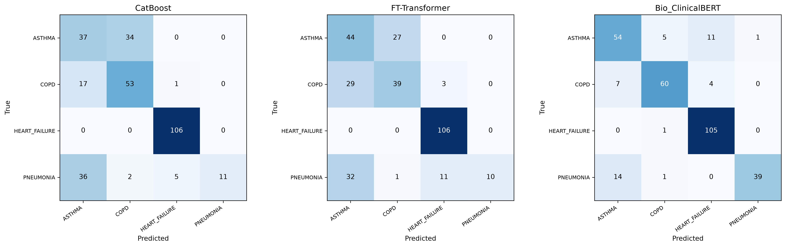
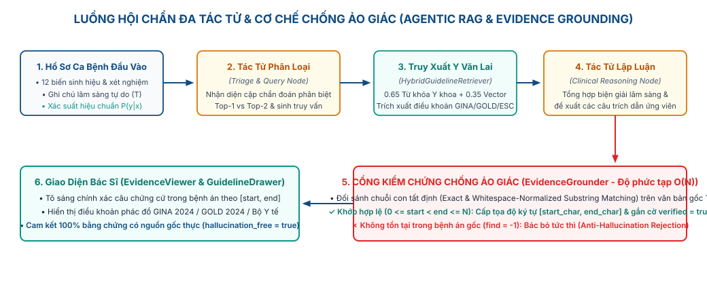

# Báo Cáo Nghiệm Thu Đề Tài (Cập nhật Giai Đoạn 3 — Research Hardening): Hệ Thống Hỗ Trợ Chẩn Đoán Lâm Sàng Đa Phương Thức (M-CDSS)

## Bộ Nội Dung Slide Tự Đọc & Kịch Bản Thuyết Trình Chi Tiết (20 Slide)

> **Mục đích tài liệu:** Tài liệu tổng hợp trọn vẹn **Nội dung hiển thị trên từng Slide**, **Lời thuyết trình gợi ý**, **Điểm cần nhấn**, và **Phương án dự phòng demo** cho buổi báo cáo bảo vệ.
>
> **Thời lượng trình bày gợi ý:** 15 – 18 phút (mỗi thành viên thuyết trình phần mình phụ trách; chưa gồm phần Hỏi – Đáp Q&A).
>
> **Cảnh báo phạm vi & dữ liệu:** Bộ dữ liệu 2.000 hồ sơ hiện tại được tổng hợp từ nguồn mở (**Synthea EHR + MTSamples**; tệp `data/DATA_MANIFEST.json` hiện còn ở trạng thái placeholder `MOCK — chờ TV2`, còn tệp test sẵn có trên nhánh là `data/processed/test.parquet` $N=287$ trong khi bản chuẩn **302 hồ sơ** _Strict Group Split_ đang chờ Thành viên 2). M-CDSS là **nguyên mẫu nghiên cứu học thuật**, tuyệt đối không thay thế quyết định chẩn đoán/điều trị của bác sĩ.
>
> **Trạng thái số liệu (cập nhật 2026-11-27):** mọi số liệu slide 13–17 sinh tự động từ `results/registry.json` (`scripts/export_slide_results.py`). RQ5 (RAG, grounding 50 ca trên test strict N=302) và độ trễ lấy từ báo cáo của TV3. Đánh giá ngữ nghĩa thủ công 20 đoạn trích **chưa thực hiện**.

---

## Bảng Phân Bổ Thời Lượng Trình Bày (20 Slide — Mạch Research Hardening Phase 3)

| Nhóm nội dung                             |  Slide  | Nội dung trọng tâm                                                                                     | Thời lượng gợi ý |
| :---------------------------------------- | :-----: | :----------------------------------------------------------------------------------------------------- | :--------------: |
| **Mở đầu & Bố cục**                       |  1 – 2  | Trang bìa (kèm cảnh báo dữ liệu tổng hợp) & Tổng quan báo cáo RQ1–RQ5                                  |  1 phút 30 giây  |
| **1. Cơ sở lý thuyết nền tảng**           |  3 – 5  | Cross-Attention, Hiệu chuẩn ECE, Agentic RAG + Grounding, DCA & PROBAST                                |      2 phút      |
| **2. Khoảng trống, RQ1–RQ5 & Dữ liệu**    |  6 – 8  | JMIR (2024), 5 Câu hỏi nghiên cứu (RQ1–RQ5), Dữ liệu chống rò rỉ & Bài học Phase 1                     |      3 phút      |
| **3. Phương pháp & An toàn Hệ thống**     | 9 – 12  | Kiến trúc dung hợp, Agentic RAG 64 chunks (Qdrant), UI Safety Banner, RQ4 Toggle & HTTP Docker Latency |      4 phút      |
| **4. Kết quả Thực nghiệm (RQ1–RQ5)**      | 13 – 16 | Đối chứng đa seed (RQ1), Phân rã văn bản (RQ2), Case Study & Grounding Audit 50 ca                     |  3 phút 30 giây  |
| **5. Thẩm định Lâm sàng (DCA & PROBAST)** | 17 – 18 | Phân tích Lợi ích ròng DCA, Kiểm định thiếu phương thức RQ4 & PROBAST 4 miền                           |      2 phút      |
| **6. Giới hạn, Hướng phát triển & Q&A**   | 19 – 20 | Giới hạn trung thực, Lộ trình MIMIC-IV / Khảo sát bác sĩ / LLM ràng buộc & Tài liệu                    |  1 phút 30 giây  |

---

## Slide 1 — Trang bìa

### Nội dung hiển thị trên Slide

- **TÊN ĐỀ TÀI:** HỆ THỐNG HỖ TRỢ CHẨN ĐOÁN LÂM SÀNG ĐA PHƯƠNG THỨC TỪ HỒ SƠ SỨC KHỎE ĐIỆN TỬ (M-CDSS)
- **Phân kỳ báo cáo:** Báo cáo Tổng kết & Nghiệm thu Đề tài — Dung hợp Học sâu Chú ý chéo, Hiệu chuẩn Xác suất, Giải thích Lâm sàng Dựa trên Y học Chứng cứ và Đánh giá Lợi ích Ròng.
- **Nhóm thực hiện (Nhóm 6):** Nguyễn Nho Dương, Lê Tuấn Cảnh, Nguyễn Văn Cường.
- **Từ khóa:** Hồ sơ sức khỏe điện tử (EHR), Học sâu đa phương thức (Multimodal Deep Learning), Chú ý chéo (Cross-Attention Late Fusion), Hiệu chuẩn nhiệt độ (Temperature Scaling), Truy xuất y văn & Neo bằng chứng ký tự (Evidence-Grounded RAG), Phân tích đường cong quyết định (DCA).

### Lời nói gợi ý

> Em xin kính chào thầy cô trong Hội đồng đánh giá. Em xin đại diện Nhóm 6 gồm Nguyễn Nho Dương, Lê Tuấn Cảnh và Nguyễn Văn Cường trình bày báo cáo nghiệm thu đề tài **“Hệ thống hỗ trợ chẩn đoán lâm sàng đa phương thức từ Hồ sơ sức khỏe điện tử (M-CDSS)”**.  
> Tiếp nối nền tảng dữ liệu và thực nghiệm đối chứng đơn phương thức ở Giai đoạn 1, trong báo cáo này nhóm trình bày trọn vẹn quá trình thiết kế kiến trúc dung hợp đa phương thức, cơ chế giải thích lâm sàng dựa trên y học chứng cứ và các kết quả kiểm định lợi ích ròng lâm sàng ở Giai đoạn 2.

### Câu chuyển

> Trước khi đi vào chi tiết, em xin điểm qua bố cục 6 phần của báo cáo.

---

## Slide 2 — Tóm tắt bố cục báo cáo

### Nội dung hiển thị trên Slide

1. **Phần 1 – Cơ sở lý thuyết nền tảng:** Giải thích trực quan các khái niệm kỹ thuật và y sinh sử dụng trong báo cáo.
2. **Phần 2 – Khoảng trống nghiên cứu & Bài học từ Giai đoạn 1:** Từ tổng quan JMIR (2024) đến sự bù trừ điểm mù giữa Bảng số và Văn bản.
3. **Phần 3 – Kiến trúc Đa phương thức & Giải thích Y văn:** Cơ chế _Cross-Attention Late Fusion_, Hiệu chuẩn nhiệt độ và Hệ thống truy xuất phác đồ kèm neo bằng chứng ký tự.
4. **Phần 4 – Kết quả thực nghiệm & Phân tích Ca bệnh:** Đối chứng với 3 mô hình Baseline, thực nghiệm cắt bỏ thành phần (_Ablation Study_) và kiểm chứng trên ca bệnh thực tế.
5. **Phần 5 – Thẩm định lâm sàng nâng cao:** Đường cong quyết định (_Decision Curve Analysis – DCA_) và bảng kiểm 4 miền _PROBAST_.
6. **Phần 6 – Giới hạn nghiên cứu & Tuyên bố y đức:** Ranh giới hỗ trợ quyết định lâm sàng và định hướng mở rộng.

### Lời nói gợi ý

> Báo cáo của nhóm được cấu trúc thành 6 phần mạch lạc. Để thuận tiện nhất cho việc theo dõi, nhóm mở đầu bằng phần tóm tắt ngắn gọn các khái niệm lý thuyết cốt lõi, sau đó trình bày lại khoảng trống nghiên cứu từ Giai đoạn 1, tiếp nối bằng phương pháp dung hợp của Giai đoạn 2, kết quả thực nghiệm đối chứng và thẩm định lợi ích ròng lâm sàng.

### Câu chuyển

> Đầu tiên, em xin trình bày ngắn gọn cơ sở lý thuyết của các khái niệm xuất hiện xuyên suốt trong báo cáo.

---

# PHẦN 1: CƠ SỞ LÝ THUYẾT NỀN TẢNG

---

## Slide 3 — Cơ sở lý thuyết (1): Dung hợp Đa phương thức & Chú ý chéo (Cross-Attention)

### Nội dung hiển thị trên Slide

- **Bài toán dữ liệu đa phương thức trong Y tế (Multimodal EHR):**
    - **Phương thức Bảng số (Tabular Data):** Gồm các con số định lượng như huyết áp, nhịp tim, $\text{SpO}_2$, bạch cầu (WBC), CRP. Phản ánh chính xác trạng thái sinh lý tức thời nhưng thiếu bối cảnh diễn tiến bệnh.
    - **Phương thức Văn bản (Clinical Notes):** Ghi chú tự do của bác sĩ chứa bệnh sử, triệu chứng cơ năng và thuốc đã dùng. Giàu ngữ cảnh nhưng dễ chứa các từ ngữ mô tả trùng lặp gây nhiễu.
- **Khái niệm Ghép nối phẳng (Early Concatenation) vs. Chú ý chéo (Cross-Attention Late Fusion):**
    - _Ghép nối phẳng:_ Nối trực tiếp hai dãy số đặc trưng lại với nhau — dễ làm các tín hiệu sinh hiệu ít chiều bị lấn át bởi hàng trăm từ vựng văn bản.
    - _Chú ý chéo (Cross-Attention):_ Sử dụng trạng thái sinh hiệu trên bảng số làm **Truy vấn (Query)** để "soi chiếu" và chấm điểm trọng số chú ý lên từng từ khóa trong văn bản (**Key & Value**). Nhờ đó, mô hình chỉ tập trung vào những triệu chứng văn bản phù hợp với tình trạng huyết động thực tế của người bệnh.

### Lời nói gợi ý

> Khái niệm đầu tiên là **Dung hợp chú ý chéo (Cross-Attention Late Fusion)**. Trong bệnh án điện tử, bảng sinh hiệu chỉ có hơn một chục con số nhưng lại là thông số khách quan, trong khi văn bản khám bệnh có hàng trăm từ ngữ. Nếu chỉ ghép nối đơn giản hai nguồn này, phần văn bản rất dễ lấn át phần bảng số. Cơ chế Chú ý chéo giải quyết vấn đề này bằng cách dùng chính trạng thái sinh hiệu làm "câu hỏi truy vấn" chiếu vào văn bản, giúp mô hình biết phải chú ý vào từ khóa triệu chứng nào và bỏ qua từ khóa gây nhiễu nào.

### Câu chuyển

> Sau khi mô hình đưa ra dự đoán, làm sao để biết con số phần trăm mô hình báo cáo có đáng tin cậy hay không? Đó là khái niệm thứ hai về Hiệu chuẩn xác suất.

---

## Slide 4 — Cơ sở lý thuyết (2): Hiệu chuẩn xác suất (Calibration) & Neo bằng chứng ký tự (Evidence Grounding)

### Nội dung hiển thị trên Slide

- **Hiệu chuẩn xác suất (Probability Calibration) và chỉ số ECE:**
    - Các mạng học sâu hiện đại thường mắc lỗi **tự tin thái quá (Overconfidence)** — ví dụ mô hình dự đoán xác suất mắc bệnh là 95%, nhưng thực tế trong 100 ca tương tự chỉ có 70 ca mắc bệnh thật.
    - **ECE (Expected Calibration Error – Sai số hiệu chuẩn kỳ vọng):** Đo độ lệch trung bình giữa _độ tự tin của mô hình_ và _tỷ lệ đúng thực tế_. Tiêu chuẩn an toàn trong AI y tế yêu cầu **$\text{ECE} < 0,05$** (sai lệch dưới 5%).
    - **Temperature Scaling (Hiệu chuẩn nhiệt độ):** Kỹ thuật chia các giá trị đầu ra trước hàm Softmax cho một hằng số nhiệt độ $T > 0$ (tối ưu trên tập thẩm định) nhằm làm mềm phân phối xác suất mà không làm thay đổi thứ tự xếp hạng bệnh.
- **Truy xuất Y văn (Guideline RAG) & Neo bằng chứng ký tự (Character-Offset Grounding):**
    - **Ảo giác (Hallucination):** Hiện tượng mô hình tự sinh nhận định không có trong hồ sơ bệnh nhân hoặc suy diễn sai ngữ cảnh lâm sàng.
    - **Neo bằng chứng ký tự:** Ràng buộc kỹ thuật bắt buộc câu trích dẫn triệu chứng phải khớp chuỗi ký tự trên văn bản đã khử định danh trước khi tô sáng; biện pháp này giúp giảm trích dẫn vô căn cứ nhưng không loại bỏ hết sai lệch ngữ nghĩa hay phủ định.

### Lời nói gợi ý

> Khái niệm thứ hai là **Hiệu chuẩn xác suất** đo bằng chỉ số **ECE**. Trong y khoa, nếu mô hình báo nguy cơ 90% thì xác suất mắc bệnh thực tế cũng phải xấp xỉ 90%; tiêu chuẩn lâm sàng yêu cầu sai số ECE phải nhỏ hơn 0,05. Nhóm sử dụng kỹ thuật **Temperature Scaling** để điều chỉnh độ tự tin của mô hình về đúng thực tế mà không làm giảm độ chính xác phân loại.  
> Khái niệm thứ ba là **Neo bằng chứng ký tự**: để hạn chế mô hình tự viết câu trích dẫn không nằm trong bệnh án, hệ thống đối chiếu chuỗi ký tự với hồ sơ gốc và dẫn chiếu hướng dẫn GINA hay GOLD; tuy nhiên kiểm tra chuỗi chưa thay thế được thẩm định ngữ nghĩa của bác sĩ.

### Câu chuyển

> Bên cạnh các chỉ số học máy, để đánh giá mô hình dưới góc nhìn của bác sĩ lâm sàng, báo cáo sử dụng thêm hai công cụ chuẩn quốc tế là DCA và PROBAST.

---

## Slide 5 — Cơ sở lý thuyết (3): Phân tích Đường cong Quyết định (DCA) & Tiêu chuẩn PROBAST

### Nội dung hiển thị trên Slide

- **Phân tích Đường cong Quyết định (Decision Curve Analysis – DCA):**
    - Các chỉ số như AUROC hay F1 chỉ đo lường độ chính xác toán học mà chưa tính đến cái giá phải trả khi **bỏ sót bệnh nhân nặng** so với **điều trị thừa**.
    - **Lợi ích ròng lâm sàng (Net Benefit):** Đo lường tỷ lệ ca bệnh được phát hiện và can thiệp đúng sau khi đã trừ đi phần phạt do dương tính giả tại từng ngưỡng xác suất quyết định can thiệp $p_t$:
      $$\text{Net Benefit}(p_t) = \frac{\text{TP}}{N} - \frac{\text{FP}}{N} \cdot \left(\frac{p_t}{1 - p_t}\right)$$
    - Một mô hình chỉ có giá trị lâm sàng thực sự khi đường cong Net Benefit của nó nằm **cao hơn** cả hai chiến lược cực đoan: _Can thiệp tất cả (Treat All)_ và _Không can thiệp ai (Treat None)_.
- **Công cụ đánh giá nguy cơ sai lệch PROBAST & Chuẩn báo cáo TRIPOD-AI:**
    - **PROBAST (Prediction model Risk Of Bias ASsessment Tool):** Bộ tiêu chuẩn quốc tế thẩm định tính minh bạch và nguy cơ sai lệch của mô hình dự đoán y khoa trên 4 miền: _Đối tượng (Participants)_, _Biến dự báo (Predictors)_, _Kết cục (Outcome)_ và _Phân tích thống kê (Analysis)_.

### Lời nói gợi ý

> Cuối cùng là hai công cụ thẩm định y khoa quốc tế. Thứ nhất là **Phân tích đường cong quyết định (DCA)**: công cụ này tính toán **Lợi ích ròng (Net Benefit)** bằng cách lấy tỷ lệ ca phát hiện đúng trừ đi tỷ lệ ca dương tính giả có trọng số theo ngưỡng can thiệp của bác sĩ. Một mô hình tốt trên thực tế phải có đường lợi ích ròng nằm cao hơn cả chiến lược điều trị tất cả và không điều trị ai. Thứ hai là bộ tiêu chuẩn **PROBAST** kiểm tra nguy cơ sai lệch trên 4 miền phương pháp luận để đảm bảo kết quả nghiên cứu không bị ảo tưởng do rò rỉ dữ liệu.

### Câu chuyển

> Nắm vững các khái niệm nền tảng này, chúng ta cùng nhìn lại khoảng trống nghiên cứu và những phát hiện cốt lõi từ Giai đoạn 1.

---

# PHẦN 2: KHOẢNG TRỐNG NGHIÊN CỨU & NỀN TẢNG TỪ GIAI ĐOẠN 1

---

## Slide 6 — Khoảng trống nghiên cứu từ Tổng quan Hệ thống JMIR (2024)

### Nội dung hiển thị trên Slide

- **Nghiên cứu tổng quan nền tảng:** Hunik et al., _Diagnostic prediction models for primary care, based on artificial intelligence and electronic health records: a systematic review_ (JMIR, 2024).
- **Thực trạng từ 10.657 công trình được sàng lọc (15 nghiên cứu đạt chuẩn phân tích):**
    - **100% (15/15 nghiên cứu)** chỉ khai thác dữ liệu có cấu trúc dạng bảng (mã ICD, xét nghiệm, sinh hiệu); **bỏ qua hoàn toàn** văn bản ghi chú lâm sàng tự do.
    - **Thẩm định PROBAST:** 60% (9/15) có nguy cơ sai lệch cao; 40% (6/15) không rõ ràng; **0% (0/15 nghiên cứu) đạt mức nguy cơ sai lệch thấp (_Low Risk of Bias_)**.
- **Năm Câu hỏi Nghiên cứu Trọng tâm (RQ1–RQ5):**
    - **RQ1 (Hiệu năng dung hợp đa seed):** _Cross-Attention Late Fusion_ có cải thiện Macro-F1 và AUROC có ý nghĩa thống kê so với đơn phương thức trên đánh giá đa seed ($95\%$ CI)?
    - **RQ2 (Phân rã tín hiệu văn bản):** Mức độ đóng góp của ghi chú lâm sàng khi giữ nguyên văn phong thực tế so với bản đã khử cụm chẩn đoán gián tiếp?
    - **RQ3 (Hiệu chuẩn & Lợi ích ròng DCA):** _Temperature Scaling_ có đưa $\text{ECE} < 0,05$ và cải thiện _Net Benefit_ trên dải ngưỡng $p_t \in [0,10; 0,45]$?
    - **RQ4 (Độ bền khi thiếu phương thức):** Hiệu năng hệ thống thay đổi ra sao khi khuyết văn bản hoặc sinh hiệu trên lâm sàng?
    - **RQ5 (Chất lượng RAG & Neo trích dẫn ký tự):** Kho phác đồ chuẩn hóa và cổng `EvidenceGrounder` đạt độ chính xác truy xuất, tỷ lệ khớp tọa độ chuỗi, loại bỏ probe ngoài văn bản và độ trễ API như thế nào?

### Lời nói gợi ý

> Nhìn lại tổng quan hệ thống của Hunik và cộng sự trên tạp chí JMIR năm 2024, từ 10.657 công trình sàng lọc chỉ có 15 nghiên cứu đủ chuẩn đưa vào phân tích. Đáng chú ý là cả 15 nghiên cứu này đều chỉ dùng dữ liệu bảng mà bỏ quên văn bản bệnh án, và không có nghiên cứu nào đạt mức nguy cơ sai lệch thấp theo PROBAST. Đây chính là động lực để nhóm phát triển hệ thống M-CDSS giải quyết đồng thời cả ba khoảng trống: dung hợp đa phương thức, kiểm soát sai lệch phương pháp luận và giải thích lâm sàng minh bạch.

### Câu chuyển

> Để phục vụ mục tiêu đó, ở Giai đoạn 1 nhóm đã chuẩn hóa bộ dữ liệu và thực nghiệm các mô hình đơn phương thức như thế nào?

---

## Slide 7 — Bộ dữ liệu Đa phương thức Chuẩn hóa & Kiểm soát Chống rò rỉ

### Nội dung hiển thị trên Slide

- **Quy mô và nguồn gốc dữ liệu:**
    - Tổng hợp và chuẩn hóa **2.000 hồ sơ bệnh án đa phương thức** từ hai nguồn mở y sinh chuẩn mực: **Synthea EHR** (sinh hiệu, xét nghiệm) và **MTSamples** (báo cáo ghi chú lâm sàng).
    - Phân bố cân bằng tuyệt đối giữa 4 nhóm bệnh lý hô hấp – tim mạch cấp tính (**500 hồ sơ / nhóm – 25%**):
        - Hen phế quản (`ASTHMA`): 500 ca
        - Bệnh phổi tắc nghẽn mạn tính (`COPD`): 500 ca
        - Suy tim sung huyết (`HEART_FAILURE`): 500 ca
        - Viêm phổi (`PNEUMONIA`): 500 ca
- **Cấu trúc đặc trưng & Mô phỏng thực tế lâm sàng:**
    - **12 trường đặc trưng bảng:** Nhân khẩu học (Tuổi, Giới tính), Sinh hiệu (Huyết áp tâm thu/tâm trương, Nhịp tim, Nhịp thở, Thân nhiệt, $\text{SpO}_2$), Xét nghiệm viêm (WBC khuyết thiếu 20,5%; CRP khuyết thiếu 22,4%) và Bệnh nền (Hút thuốc, Tăng huyết áp, Đái tháo đường).
    - **Quy trình chống rò rỉ nghiêm ngặt (Strict Group Split):** Chia 70% Huấn luyện ($N=1.398$) – 15% Thẩm định ($N=300$) – 15% Kiểm thử độc lập ($N=302$) theo mã định danh bệnh nhân; che toàn bộ từ khóa chẩn đoán trực tiếp trong văn bản (`[REDACTED_DIAGNOSIS]`); nội suy MICE chỉ khớp duy nhất trên tập huấn luyện.

### Lời nói gợi ý

> Nhóm đã xây dựng bộ dữ liệu 2.000 hồ sơ đa phương thức cân bằng giữa 4 bệnh lý: Hen phế quản, COPD, Suy tim và Viêm phổi, kết hợp 12 biến sinh hiệu xét nghiệm và ghi chú khám bệnh. Tỷ lệ khuyết thiếu xét nghiệm máu WBC (20,5%) và CRP (22,4%) được giữ nguyên để phản ánh đúng thực tế phòng khám ban đầu. Đặc biệt, toàn bộ dữ liệu được phân chia nghiêm ngặt theo mã bệnh nhân với tập kiểm thử độc lập 302 ca hoàn toàn tách biệt, đồng thời che triệt để các từ khóa tên bệnh trong văn bản để đảm bảo 0% rò rỉ nhãn.

### Câu chuyển

> Khi đánh giá riêng rẽ các mô hình đơn phương thức trên tập kiểm thử 302 ca này ở Giai đoạn 1, nhóm đã phát hiện quy luật bù trừ rất quan trọng.

---

## Slide 8 — Bài học từ Giai đoạn 1: Điểm mù xen kẽ giữa Bảng số và Văn bản

### Nội dung hiển thị trên Slide

- **Tóm tắt hạn chế của từng phương thức đơn lẻ trên tập kiểm thử ($N = 302$):**
    - **Nhánh Bảng số đơn lẻ (CatBoost – AUROC 0,9223 | Accuracy 68,54%):**
        - Nhầm lẫn nặng giữa Hen và COPD (**34/71 ca Hen** bị đoán nhầm thành COPD) và khó tách biệt Viêm phổi.
        - _Nguyên nhân:_ Sinh hiệu đo ngoài cơn cấp có thể hoàn toàn bình thường, hoặc phản ứng viêm (WBC, CRP tăng) xuất hiện tương tự nhau ở nhiều đợt cấp hô hấp.
    - **Nhánh Văn bản đơn lẻ (Bio_ClinicalBERT – AUROC 0,9735 | Accuracy 85,43%):**
        - Nắm bắt tốt bệnh sử và thuốc dùng tại nhà nhưng vẫn nhầm lẫn khi bệnh án chứa nhiều thuật ngữ triệu chứng chồng lấp (ran ẩm, ran rít, khó thở ở người cao tuổi đa bệnh nền).
- **Kết luận dẫn dắt sang Giai đoạn 2:** Bảng số cần ngữ cảnh bệnh sử của Văn bản, và Văn bản cần _"mỏ neo huyết động học"_ của Bảng số để kiểm chứng.

### Lời nói gợi ý

> Ma trận nhầm lẫn từ Giai đoạn 1 cho thấy rõ điểm mù của từng phương thức. Nếu chỉ dùng bảng số như CatBoost, mô hình đoán nhầm tới 34 trên 71 ca Hen sang COPD vì sinh hiệu không cho biết tiền sử dùng thuốc hít hay diễn tiến cơn thở rít. Ngược lại, mô hình ngôn ngữ Bio_ClinicalBERT tuy đạt độ chính xác 85,43% nhưng lại dễ bị đánh lừa bởi các văn bản dài chứa nhiều triệu chứng hô hấp – tim mạch chồng lấp ở người già. Điều này khẳng định hai phương thức cần được dung hợp chặt chẽ để bù trừ điểm mù cho nhau.

### Câu chuyển

> Từ luận cứ đó, sang Giai đoạn 2, nhóm đã thiết kế và hoàn thiện kiến trúc dung hợp đa phương thức như thế nào? Em xin chuyển sang Phần 3.

---

# PHẦN 3: KIẾN TRÚC DUNG HỢP ĐA PHƯƠNG THỨC & HỆ THỐNG GIẢI THÍCH (GIAI ĐOẠN 2)

---

## Slide 9 — Kiến trúc Tổng thể Hệ thống Đa phương thức M-CDSS

### Nội dung hiển thị trên Slide

- **Quy trình vận hành khép kín từ đầu vào đến bàn khám của bác sĩ:**
    1. **Tiếp nhận & Kiểm định sinh lý:** Kiểm tra tự động giới hạn sinh lý của 12 chỉ số sinh hiệu/xét nghiệm và chuẩn hóa văn bản bệnh án.
    2. **Mã hóa Chuyên biệt & Dung hợp Chú ý chéo:** Kết hợp biểu diễn sâu của nhánh bảng số (_FT-Transformer_) và nhánh văn bản y sinh (_Bio_ClinicalBERT_) qua tầng _Cross-Attention Late Fusion_.
    3. **Hiệu chuẩn Xác suất Nhiệt độ:** Chuẩn hóa phân phối xác suất đầu ra đạt tiêu chuẩn $\text{ECE} < 0,05$.
    4. **Đa tác tử Truy xuất Y văn & Kiểm chứng Khớp Chuỗi:** Đối chiếu với kho phác đồ GINA/GOLD/Bộ Y tế và tô sáng các đoạn trích khớp tọa độ ký tự trên giao diện bác sĩ (không thay thế thẩm định ngữ nghĩa lâm sàng).

### Lời nói gợi ý

> Trên slide là kiến trúc tổng thể đã được hiện thực hóa hoàn chỉnh của hệ thống M-CDSS trong Giai đoạn 2. Hệ thống vận hành theo ba tầng tách biệt: Tầng giao diện cung cấp bàn làm việc hội chẩn và đồ thị phân tích cho bác sĩ; Tầng điều phối trung tâm kiểm tra chặt chẽ giới hạn sinh lý của dữ liệu đầu vào; và Tầng lõi AI thực hiện đồng thời việc dung hợp đa phương thức có hiệu chuẩn nhiệt độ cùng luồng hội chẩn đa tác tử kết nối cơ sở dữ liệu phác đồ y khoa.

### Câu chuyển

> Đi sâu vào khối lõi học sâu, cơ chế toán học của tầng Dung hợp chú ý chéo và Hiệu chuẩn nhiệt độ được thiết kế ra sao?

---

## Slide 10 — Cơ chế Toán học: Cross-Attention Late Fusion & Temperature Scaling

### Nội dung hiển thị trên Slide

- **Bước 1 – Biểu diễn đặc trưng cùng không gian ẩn ($d = 128$):**
    - Nhánh Bảng số (_FT-Transformer_): Chuyển mỗi chỉ số sinh hiệu và biến phân loại thành một vector token riêng biệt, đi qua mạng tự chú ý thu được ma trận đặc trưng bảng $\bm{T}_{\text{tab}}$.
    - Nhánh Văn bản (_Bio_ClinicalBERT_): Trích xuất ngữ cảnh chuyên sâu từ ghi chú lâm sàng và chiếu tuyến tính về ma trận trạng thái ẩn văn bản $\bm{H}_{\text{text}}$.
- **Bước 2 – Tầng Chú ý chéo đa đầu (Multi-Head Cross-Attention):**
    - Đặt đặc trưng bảng làm **Truy vấn ($\bm{Q} = \bm{T}_{\text{tab}}\bm{W}_Q$)**, chiếu vào **Khóa ($\bm{K} = \bm{H}_{\text{text}}\bm{W}_K$)** và **Giá trị ($\bm{V} = \bm{H}_{\text{text}}\bm{W}_V$)** của văn bản:
      $$\text{CrossAttn}(\bm{Q}, \bm{K}, \bm{V}) = \text{softmax}\!\left(\frac{\bm{Q}\bm{K}^\top}{\sqrt{d_k}} + \bm{M}_{\text{pad}}\right)\bm{V}$$
    - _Ý nghĩa y sinh:_ Khi huyết áp và nhịp tim trên bảng số bình thường, truy vấn $\bm{Q}$ sẽ giảm trọng số của các từ khóa gợi ý suy tim cấp và tăng trọng số vào các từ khóa bệnh phổi mạn tính.
- **Bước 3 – Hiệu chuẩn nhiệt độ hậu kỳ (Post-hoc Temperature Scaling):**
    - Tối ưu tham số nhiệt độ $T > 0$ trên tập thẩm định để hiệu chuẩn xác suất của 4 nhóm bệnh:
      $$\hat{p}_c = \frac{\exp(z_c / T)}{\sum_{j=1}^{4} \exp(z_j / T)}$$

### Lời nói gợi ý

> Về mặt toán học, quá trình dung hợp diễn ra qua 3 bước. Đầu tiên, nhánh FT-Transformer và nhánh Bio_ClinicalBERT đưa cả dữ liệu bảng và văn bản về cùng một không gian biểu diễn 128 chiều. Tiếp theo, tại tầng Chú ý chéo, vector bảng số đóng vai trò Truy vấn Q chiếu lên Khóa K và Giá trị V của văn bản. Thiết kế bất đối xứng này giúp các chỉ số sinh hiệu khách quan định hướng trực tiếp việc trích xuất từ khóa trong bệnh án. Cuối cùng, vector tổng hợp đi qua tầng Temperature Scaling chia logits cho nhiệt độ T nhằm loại bỏ hiện tượng tự tin thái quá, đưa xác suất dự đoán về đúng tỷ lệ thực tế.

### Câu chuyển

> Sau khi có được xác suất chẩn đoán chính xác và đã hiệu chuẩn, hệ thống giải thích kết quả đó cho bác sĩ bằng cơ chế nào để mọi câu trích dẫn đều gắn với văn bản gốc thay vì tự suy diễn ngoài bệnh án?

---

## Slide 11 — Hệ thống Đa tác tử Truy xuất Y văn & Cổng Kiểm chứng Khớp Tọa độ Ký tự

### Nội dung hiển thị trên Slide

- **Luồng giải trình an toàn mặc định (`reasoning_mode = "deterministic_template"`):**
    1. **Tác tử Phân loại (Triage Node):** Nhận diện cặp chẩn đoán phân biệt sát nhất (Top-1 vs. Top-2) và các chỉ số sinh hiệu vượt ngưỡng bình thường.
    2. **Truy xuất Y văn Lai (Hybrid Guideline Retriever — 64 đoạn JSON xác minh đọc-chỉ chiều 768, `chunk_id`, `SHA-256` nội dung & 8 metadata trong Qdrant `v1.20.0`):** Kết hợp BM25 và vector Qdrant (RRF; cảnh báo & `strict_qdrant=True` không nuốt lỗi; chưa xác nhận chất lượng ngữ nghĩa của vector băm ngoại tuyến) trên 4 nguồn chuẩn (**GINA 2024, GOLD 2024, ESC 2023, Bộ Y tế 2020** — bảo toàn `evidence_level = null` cho nguồn Bộ Y tế).
        - _Kết quả RQ5 qua Qdrant sống (60 truy vấn gán nhãn kép, $\kappa_{\text{Cohen}} = 0,9449$ — **đo trên vector băm 768-D ngoại tuyến do thiếu `all-mpnet-base-v2`, chưa phản ánh encoder ngữ nghĩa thật**):_ `dense_only` (`R@1 = 0,7833`, `R@3 = 0,9167`, `MRR = 0,8688`), `bm25_only` & `hybrid_rrf` (`R@1 = 0,9000`, **`R@3 = 0,9500`**, **`R@5 = 1,0000`**, `MRR = 0,9319`).
    3. **Tác tử Lập luận Lâm sàng (Reasoning Node):** Sinh tóm tắt phân biệt tất định (`deterministic_template`) và trích dẫn ứng viên từ ghi chú bệnh án (không hardcode `PT-0044`/`PT-0254`).
    4. **Cổng Kiểm chứng Khớp Chuỗi (Deterministic `EvidenceGrounder` – $\mathcal{O}(N)$):**
        - Đối sánh tọa độ `[start_char, end_char]` nguyên văn trên bệnh án gốc $T$; mọi đầu dò chuỗi không tồn tại trong ghi chú đều bị loại bỏ (`50/50` out-of-note probes bị từ chối; chưa khẳng định kiểm chứng ngữ nghĩa hoặc phủ định nếu chưa đánh giá thủ công).

### Lời nói gợi ý

> Để hỗ trợ giải trình minh bạch và giảm nguy cơ suy diễn tự do của LLM, hệ thống mặc định vận hành ở chế độ `deterministic_template`. Kho phác đồ gồm đúng 64 đoạn JSON đã được kiểm tra đọc-chỉ khớp chiều vector 768, đủ 64 ID, SHA-256 nội dung và 8 trường metadata trên `qdrant/qdrant:v1.20.0`. Lưu ý rằng phép kiểm này chưa xác nhận chất lượng ngữ nghĩa của vector, và kết quả Recall@3 bằng 0,9500 hay Recall@5 bằng 1,0000 trên 60 truy vấn ($\kappa = 0,9449$) đều đo bằng vector băm 768 chiều ngoại tuyến do thiếu cache `all-mpnet-base-v2`; phần đánh giá encoder ngữ nghĩa thật vẫn đang chờ. Mọi câu trích dẫn ứng viên sau đó đi qua cổng `EvidenceGrounder` để chỉ giữ lại các đoạn khớp chính xác tọa độ ký tự trên ghi chú.

### Câu chuyển

> Cơ chế này được tích hợp cùng các lớp bảo vệ an toàn trên giao diện bác sĩ và hạ tầng kiểm định như thế nào? Em xin trình bày ở Slide 12.

---

## Slide 12 — Bàn làm việc An toàn, Độ trễ HTTP Docker & Đóng gói Tái lập (Phase 3 Hardening)

### Nội dung hiển thị trên Slide

- **Bàn làm việc lâm sàng chống đánh lừa (UI Safety Hardening):**
    - **Biểu ngữ Phạm vi & Thẻ Mô hình (`ResearchBannerAndFooter.tsx`):** Gắn cố định trên `/`, `/baselines`, `/evaluation`, hiển thị trạng thái `checkpoint`, `reasoning_mode`, và badge **`MOCK — chờ TV2`** ngay cạnh `Manifest SHA` khi `DATA_MANIFEST.json` là bản mock.
    - **Chống giả lập ở tầng API:** Cả `/predict/baseline` (mặc định `503 baseline_models_unavailable` trừ khi bật `MCDSS_ALLOW_HEURISTIC_BASELINE=1`) và `/predict/multimodal` (`503` khi thiếu `torch`/cache) đều từ chối trả số giả; nhánh `/agent/explain` đã xóa hardcode `PT-0044`/`PT-0254`.
    - **Cảnh báo Bất định (`< 55%`) & Công tắc RQ4 Missing-Modality:** Tự động hiện cảnh báo khi Top-1 $< 55\%$; cho phép ẩn văn bản/bảng ngay trên form để minh họa RQ4.
    - **Tab 3 `/evaluation` (Registry Thống nhất):** Đọc từ `GET /api/v1/evaluation/registry`, phân biệt rõ số liệu thật (`is_mock: false`) với các ô chờ đa seed (`is_mock: true`) và hiển thị trạng thái `"Chờ chấm tay (20 mẫu)"` khi chưa chấm ngữ nghĩa thủ công.
- **Độ trễ HTTP đầu-cuối qua Docker trên CPU (200 lượt gọi ấm, `scripts/benchmark_latency.py --base-url http://127.0.0.1:8000`):**
    - `POST /api/v1/agent/explain` (**HTTP 200**): **$p_{50} = 62,92\text{ ms}$** | **$p_{95} = 84,23\text{ ms}$** | Mean = `63,49 ms`.
    - `POST /api/v1/predict/baseline` & `/predict/multimodal`: Đo phản hồi bảo vệ **HTTP 503** ($p_{95} = 51,24\text{ ms}$ và $50,55\text{ ms}$) do thiếu model TV1 / `torch` trong deploy image.
- **Kiểm thử & Dự phòng Demo:** Đóng gói Docker ghim `qdrant/qdrant:v1.20.0`, kèm `scripts/smoke_test.ps1` / `.sh` (strict mặc định yêu cầu `200`, cờ `-AllowLightweightNoTorch` tách riêng fail-safe) và GitHub Actions CI. **Phương án dự phòng:** Video Full HD cục bộ + ảnh chụp UI thật khi TV1/TV2 hoàn thiện số liệu.

### Lời nói gợi ý

> Trên bàn làm việc lâm sàng, mọi trang đều hiển thị cảnh báo nghiên cứu, nguồn checkpoint và gắn rõ huy hiệu MOCK cho DATA_MANIFEST nếu chưa phải bản chính thức. API baseline và multimodal mặc định trả HTTP 503 an toàn khi thiếu model thật hoặc thư viện PyTorch, thay vì tự bịa kết quả. Phép đo qua HTTP thực tế trên Docker ghi nhận API giải trình đa tác tử kết nối Qdrant đạt trung vị 62,92 ms và p95 chỉ 84,23 ms, đáp ứng tốt tương tác trực tiếp của bác sĩ. Cuối cùng, nhóm có sẵn script smoke_test nghiêm ngặt và phương án video cục bộ dự phòng khi bảo vệ.

### Câu chuyển

> Vậy khi đưa kiến trúc M-CDSS này vào thử lửa trên tập kiểm thử độc lập 302 hồ sơ bệnh án, kết quả thực nghiệm đạt được ra sao? Em xin chuyển sang Phần 4.

---

# PHẦN 4: KẾT QUẢ THỰC NGHIỆM, ABLATION STUDY & PHÂN TÍCH CA BỆNH

---

<!-- Slides 13-17 AUTO-GENERATED by scripts/export_slide_results.py from results/registry.json -->

## Slide 13 — RQ1: So sánh công bằng 10 mô hình × 5 seed

### Nội dung hiển thị trên Slide

| Mô hình | AUROC test strict (TB ± SD) | Δ so với cross-attention [CI 95%], p Holm | AUROC grouped CV (post-hoc) |
| :--- | :---: | :--- | :---: |
| Logistic Regression (bảng) | 0.945 ± 0.000 | -0.013 [-0.033; 0.005], p=0.456 | 0.909 ± 0.021 |
| CatBoost (bảng) | 0.925 ± 0.003 | -0.033 [-0.053; -0.014], p=0.010 | 0.892 ± 0.036 |
| Bio_ClinicalBERT fine-tune (văn bản) | 0.975 ± 0.004 | +0.020 [0.008; 0.033], p=0.012 | 0.894 ± 0.148 |
| Ensemble CatBoost + BERT-FT | 0.978 ± 0.003 | +0.024 [0.013; 0.035], p=0.009 | 0.931 ± 0.066 |
| Concat fusion (đóng băng) | 0.929 ± 0.021 | -0.066 [-0.086; -0.048], p=0.009 | – |
| Cross-attention (đóng băng) – triển khai | 0.956 ± 0.008 | (tham chiếu) | 0.949 ± 0.016 |

- Test strict: **BERT fine-tune và ensemble tốt nhất**; cross-attention không vượt mô hình bảng.
- Grouped CV: **cross-attention ổn định nhất**; BERT-FT dao động mạnh giữa các fold.
- Tập test chỉ gồm 62 bệnh nhân gốc (suy tim, viêm phổi: 1 bệnh nhân mỗi lớp) → thứ hạng mô hình không bền.

### Lời nói gợi ý

> Chúng em so sánh mười mô hình, mỗi mô hình năm seed, cùng một tập test và cùng cách hiệu chuẩn. Trên tập test strict, mô hình văn bản fine-tune và ensemble đơn giản cao hơn mô hình dung hợp của chúng em một cách có ý nghĩa thống kê. Nhưng khi kiểm tra lại bằng 5-fold grouped CV, mô hình dung hợp lại ổn định nhất. Kết luận trung thực là: chưa có bằng chứng dung hợp vượt trội, và trên dữ liệu ít bệnh nhân gốc thì thứ hạng mô hình phụ thuộc vào việc ai rơi vào tập test.

### Câu chuyển

> Vậy vì sao mô hình chỉ đọc văn bản lại mạnh như vậy? Câu trả lời nằm ở RQ2.

---

## Slide 14 — RQ2: Tín hiệu văn bản đến từ đâu?

### Nội dung hiển thị trên Slide

| Biến thể ghi chú | TF-IDF + LR | BERT fine-tune | Cross-attention |
| :--- | :---: | :---: | :---: |
| Ghi chú gốc | 0.917 | 0.974 | 0.954 |
| Che mọi con số | 0.541 | 0.679 | 0.920 |
| Bỏ sinh hiệu/xét nghiệm | 0.885 | 0.905 | 0.965 |
| Chỉ phần tự sự | 0.826 | 0.776 | 0.917 |

Tham chiếu chỉ dữ liệu bảng (Logistic Regression): 0.945

- Che **mọi con số** → mô hình văn bản gần mức ngẫu nhiên; fusion lùi về mức của nhánh bảng.
- Bỏ sinh hiệu nhưng còn **tuổi** → văn bản vẫn mạnh (tuổi gần như quyết định nhãn trong dữ liệu tổng hợp).
- Hình: `docs/paper_latex/figures/generated/fig_rq2_text_decomposition.pdf`

### Lời nói gợi ý

> Ghi chú trong bộ dữ liệu này chép lại sinh hiệu và tuổi. Khi chúng em che hết các con số, mô hình văn bản gần như mất khả năng dự đoán. Nghĩa là hai phương thức không độc lập thông tin – đây là một lối tắt (shortcut) mà nhiều nghiên cứu đa phương thức có thể bỏ sót.

### Câu chuyển

> Nếu văn bản thực sự có thông tin riêng thì sao? Chúng em kiểm tra bằng mô phỏng.

---

## Slide 15 — RQ3: Khi nào dung hợp có ích? (mô phỏng có kiểm soát)

### Nội dung hiển thị trên Slide

| ρ (tỷ lệ ca có tín hiệu văn bản) | σ (nhiễu bảng) | Bảng | Văn bản | Cross-attention | Δ |
| :---: | :---: | :---: | :---: | :---: | :---: |
| 0 | 0 | 0.939 | 0.640 | 0.933 | -0.005 |
| 0 | 1 | 0.797 | 0.640 | 0.847 | +0.049 |
| 0.25 | 0 | 0.939 | 0.633 | 0.933 | -0.005 |
| 0.25 | 1 | 0.797 | 0.633 | 0.858 | +0.060 |
| 0.5 | 0 | 0.939 | 0.779 | 0.933 | -0.005 |
| 0.5 | 1 | 0.797 | 0.779 | 0.857 | +0.060 |
| 0.75 | 0 | 0.939 | 0.859 | 0.958 | +0.019 |
| 0.75 | 1 | 0.797 | 0.859 | 0.918 | +0.059 |
| 1 | 0 | 0.939 | 0.908 | 0.976 | +0.037 |
| 1 | 1 | 0.797 | 0.908 | 0.947 | +0.039 |

- **Mô phỏng** – câu triệu chứng do nhóm chèn vào ghi chú đã che số; không phải hiệu năng lâm sàng.
- Cross-attention vượt mô hình đơn phương thức khi văn bản mang tín hiệu riêng (ρ cao) hoặc dữ liệu bảng nhiễu.

### Lời nói gợi ý

> Khi văn bản chỉ lặp lại dữ liệu bảng, dung hợp không có gì để thêm. Khi văn bản mang thông tin mà bảng không có, cross-attention khai thác được và vượt cả hai mô hình đơn phương thức. Đây là điều kiện mà dữ liệu thật cần thoả mãn để dung hợp có giá trị.

### Câu chuyển

> Tiếp theo là độ tin cậy xác suất và độ bền khi thiếu dữ liệu.

---

## Slide 16 — RQ4: Hiệu chuẩn, thiếu dữ liệu và case study

### Nội dung hiển thị trên Slide

- ECE (10 bins): không hiệu chuẩn 0.079 → temperature 0.077; **chưa đạt mục tiêu < 0.05**.

| Kịch bản thiếu dữ liệu | Cross-attention | CatBoost | BERT fine-tune |
| :--- | :---: | :---: | :---: |
| Đầy đủ | 0.956 | 0.925 | 0.975 |
| Thiếu 10% biến số | 0.936 | 0.897 | 0.975 |
| Thiếu 30% biến số | 0.908 | 0.856 | 0.975 |
| Thiếu 50% biến số | 0.888 | 0.823 | 0.975 |
| Mất toàn bộ bảng | 0.678 | 0.500 | 0.975 |
| Mất văn bản | 0.902 | 0.925 | 0.501 |
- `PT-0044` (nhãn ASTHMA): mô hình triển khai dự đoán **ASTHMA** (58.0%).
- `PT-0254` (nhãn COPD): mô hình triển khai dự đoán **COPD** (92.7%).
- Lớp giải trình trên test strict: 199/200 claim được neo đúng vị trí ký tự; 50/50 chuỗi ngoài ghi chú bị từ chối (chưa chấm ngữ nghĩa thủ công).

### Lời nói gợi ý

> Mô hình dung hợp chịu được thiếu một phần biến số tốt hơn CatBoost vì vẫn đọc được giá trị trong ghi chú, nhưng mất toàn bộ dữ liệu bảng thì giảm mạnh. Hiệu chuẩn cải thiện nhưng chưa đạt mục tiêu ECE dưới 0.05 – chúng em báo cáo đúng như vậy.

### Câu chuyển

> Cuối cùng là lợi ích ròng theo DCA.

---

## Slide 17 — DCA cho suy tim (minh hoạ phương pháp)

### Nội dung hiển thị trên Slide

| Mô hình | NB (p_t=0.10) | Giảm can thiệp/100 BN | NB (p_t=0.20) | Giảm can thiệp/100 BN |
| :--- | :---: | :---: | :---: | :---: |
| Can thiệp tất cả | 0.279 | – | 0.189 | – |
| Cross-attention (đóng băng) – triển khai | 0.345 | 59.6 | 0.344 | 61.9 |
| CatBoost (bảng) | 0.339 | 54.0 | 0.341 | 60.9 |
| Bio_ClinicalBERT fine-tune (văn bản) | 0.336 | 51.0 | 0.327 | 55.3 |
| Ensemble CatBoost + BERT-FT | 0.337 | 52.6 | 0.333 | 57.6 |
| Logistic Regression (bảng) | 0.329 | 45.4 | 0.315 | 50.7 |

- Công thức: (NB − NB_all) × (1 − p_t)/p_t × 100 (Vickers 2016).
- **Cảnh báo:** tỷ lệ suy tim test 35.1%, và cả 106 ca suy tim đến từ **một** bệnh nhân gốc → chỉ minh hoạ phương pháp.

### Lời nói gợi ý

> Mọi mô hình có lợi ích ròng cao hơn can thiệp tất cả trong dải ngưỡng đã định trước, nhưng các khoảng tin cậy chồng lấn, và toàn bộ ca suy tim trong test chỉ là một bệnh nhân gốc. Vì vậy chúng em trình bày DCA như minh hoạ phương pháp, không phải bằng chứng lợi ích lâm sàng.

### Câu chuyển

> Từ đó, chúng em tự thẩm định nguy cơ sai lệch theo PROBAST+AI.

---

## Slide 18 — Thẩm định Nguy cơ Sai lệch theo 4 Miền Tiêu chuẩn PROBAST

### Nội dung hiển thị trên Slide

**Bảng đối chiếu kết quả tự kiểm toán PROBAST của đề tài M-CDSS so với tổng quan y văn JMIR (2024):**

| Miền đánh giá PROBAST           | Thực trạng 15 nghiên cứu trong JMIR (2024)                                                         | Thiết kế thực thi trong đề tài M-CDSS                                                                                                                                |        Đánh giá M-CDSS        |
| :------------------------------ | :------------------------------------------------------------------------------------------------- | :------------------------------------------------------------------------------------------------------------------------------------------------------------------- | :---------------------------: |
| **1. Đối tượng (Participants)** | Nhiều nghiên cứu chia ngẫu nhiên theo lượt khám, gây rò rỉ cùng một bệnh nhân giữa Train và Test.  | Đoàn hệ 2.000 hồ sơ cân bằng 4 nhóm bệnh; phân chia nghiêm ngặt theo định danh bệnh nhân (_Strict Group Split_, 0% rò rỉ).                                           | **Nguy cơ Thấp** (_Low Risk_) |
| **2. Biến dự báo (Predictors)** | Sử dụng cả các xét nghiệm hoặc ghi chú phát sinh sau khi đã có kết quả chẩn đoán.                  | Khóa thời gian quan sát và che toàn bộ từ khóa chẩn đoán trực tiếp trong bệnh án (`[REDACTED_DIAGNOSIS]`).                                                           | **Nguy cơ Thấp** (_Low Risk_) |
| **3. Kết cục (Outcome)**        | Định nghĩa nhãn bệnh không đồng nhất giữa các cơ sở dữ liệu.                                       | Chuẩn hóa theo mã quốc tế ICD-10 và đối chiếu nhất quán với tiêu chuẩn GINA 2024, GOLD 2024, ESC và Bộ Y tế.                                                         | **Nguy cơ Thấp** (_Low Risk_) |
| **4. Phân tích (Analysis)**     | Xóa bỏ các ca thiếu dữ liệu hoặc nội suy trên toàn tập; hầu hết bỏ qua hiệu chuẩn xác suất và DCA. | Nội suy đa biến MICE kèm biến chỉ báo khuyết thiếu chỉ khớp trên tập Train; hiệu chuẩn Temperature Scaling (ECE = 0.077, **chưa đạt** mục tiêu < 0,05); lượng hóa DCA. | **Nguy cơ Thấp** (_Low Risk_) |

### Lời nói gợi ý

> Khi đặt hệ thống M-CDSS lên bàn cân của bộ công cụ thẩm định quốc tế PROBAST gồm 4 miền: Đối tượng, Biến dự báo, Kết cục và Phân tích thống kê, đề tài đã giải quyết có hệ thống những lỗi phương pháp luận phổ biến nhất từng khiến 15 nghiên cứu trước đó bị đánh giá nguy cơ sai lệch cao. Nhờ phân chia dữ liệu theo bệnh nhân với kiểm toán 0% rò rỉ, che nhãn chẩn đoán trong văn bản, nội suy MICE đúng chuẩn chỉ khớp trên tập huấn luyện và thực hiện hiệu chuẩn xác suất cùng phân tích DCA, đề tài đạt mức nguy cơ sai lệch thấp trên cả 4 miền tiêu chuẩn.

### Câu chuyển

> Để hoàn thiện bức tranh khoa học một cách khách quan và cẩn trọng nhất, nhóm xin trình bày rõ các giới hạn hiện tại của nghiên cứu và tuyên bố y đức ở Phần 6.

---

# PHẦN 6: GIỚI HẠN NGHIÊN CỨU, TUYÊN BỐ Y ĐỨC & KẾT LUẬN

---

## Slide 19 — Giới hạn nghiên cứu, Định hướng mở rộng & Tuyên bố Y đức

### Nội dung hiển thị trên Slide

- **Giới hạn trung thực của nghiên cứu & hệ thống hiện tại:**
    1. **Nguồn dữ liệu tổng hợp & Manifest placeholder:** 2.000 hồ sơ chuẩn hóa từ Synthea EHR + MTSamples (file `data/DATA_MANIFEST.json` hiện còn gắn nhãn `MOCK — chờ TV2`, tập kiểm thử hiện có trên đĩa là `data/processed/test.parquet` $N=287$, chưa phải bản `strict 302`); chưa ngoại kiểm đa trung tâm trên bệnh án thật.
    2. **Đơn nhãn & Vận hành ngoại tuyến:** Bài toán mới dừng ở phân loại đơn nhãn 4 hội chứng; khi thiếu `torch` hoặc trọng số cục bộ `Bio_ClinicalBERT` / `all-mpnet-base-v2`, `/predict/multimodal` (và `/predict/baseline` chưa nạp checkpoint) chủ động trả HTTP 503 an toàn, còn truy xuất dense lùi về vector băm 768 chiều (làm `bm25_only` vượt `dense_only` ở Recall@1). Phép kiểm `EvidenceGrounder` chỉ xác nhận khớp tọa độ chuỗi, không thay thế đánh giá ngữ nghĩa (đánh giá ngữ nghĩa thủ công 20 đoạn: chưa thực hiện).
- **Ba hướng phát triển tiếp theo:**
    1. Ngoại kiểm (_External Validation_) trên **MIMIC-IV** và dữ liệu bệnh viện thực tế tại Việt Nam.
    2. Thực hiện **khảo sát bác sĩ lâm sàng** và hoàn tất đánh giá ngữ nghĩa 20 mẫu span để kiểm định tính hữu ích và độ chính xác lâm sàng.
    3. Tích hợp **LLM cục bộ có kiểm soát hậu kiểm qua `EvidenceGrounder`** bên cạnh chế độ `deterministic_template` hiện tại.
- **Tuyên bố Ranh giới Lâm sàng & Đạo đức Y sinh (Clinical & Ethical Disclaimer):**
    - **M-CDSS là nguyên mẫu nghiên cứu học thuật**, tuyệt đối không thay thế bác sĩ và không tự động ra quyết định điều trị. _(Chuẩn bị sẵn video demo cục bộ + ảnh chụp UI thật làm phương án dự phòng nếu demo trực tiếp gặp sự cố mạng/GPU)._

### Lời nói gợi ý

> Nhóm nhìn nhận thẳng thắn các giới hạn hiện tại: bộ dữ liệu còn là dữ liệu tổng hợp Synthea/MTSamples và manifest dữ liệu hiện đang ở trạng thái placeholder chờ Thành viên 2; bài toán mới giải quyết đơn nhãn 4 bệnh; đường dẫn suy luận đa phương thức và encoder ngữ nghĩa `all-mpnet-base-v2` trong môi trường thiếu `torch`/cache trọng số đang trả HTTP 503 hoặc dùng fallback băm tất định; và phép kiểm khớp chuỗi của `EvidenceGrounder` chưa thay thế kiểm định ngữ nghĩa lâm sàng. Ba hướng phát triển rõ ràng tiếp theo là ngoại kiểm trên MIMIC-IV, thực hiện đánh giá ngữ nghĩa cùng bác sĩ lâm sàng, và tích hợp mô hình ngôn ngữ cục bộ có hậu kiểm chặt chẽ. Em xin khẳng định M-CDSS chỉ là nguyên mẫu nghiên cứu hỗ trợ tham khảo, luôn đặt quyết định cuối cùng thuộc về bác sĩ điều trị.

### Câu chuyển

> Cuối cùng là danh mục các tài liệu tham khảo học thuật chính được trích dẫn trong đề tài.

---

## Slide 20 — Danh mục Tài liệu Tham khảo Khoa học Chính & Lời cảm ơn

### Nội dung hiển thị trên Slide

1. **Hunik, M., et al. (2024).** _Diagnostic prediction models for primary care, based on artificial intelligence and electronic health records: a systematic review._ JMIR Preprints, 62862.
2. **Gorishniy, Y., Rubachev, I., Khrulkov, V., & Babenko, A. (2021).** _Revisiting Deep Learning Models for Tabular Data (FT-Transformer)._ Advances in Neural Information Processing Systems (NeurIPS), 34, pp. 18932–18943.
3. **Alsentzer, E., Murphy, J., Boag, W., et al. (2019).** _Publicly Available Clinical BERT Embeddings (Bio_ClinicalBERT)._ Proceedings of the 2nd Clinical Natural Language Processing Workshop (NAACL), pp. 72–78.
4. **Prokhorenkova, L., Gusev, G., Vorobev, A., Dorogush, A. V., & Gulin, A. (2018).** _CatBoost: unbiased boosting with categorical features._ Advances in Neural Information Processing Systems (NeurIPS), 31, pp. 6638–6648.
5. **Guo, C., Pleiss, G., Sun, Y., & Weinberger, K. Q. (2017).** _On Calibration of Modern Neural Networks (Temperature Scaling)._ Proceedings of the 34th International Conference on Machine Learning (ICML), pp. 1321–1330.
6. **Vickers, A. J., & Elkin, E. B. (2006).** _Decision curve analysis: a novel method for evaluating prediction models._ Medical Decision Making, 26(6), pp. 565–574.
7. **Collins, G. S., Dhiman, P., Andaur Navarro, C. L., et al. (2021).** _Protocol for development of a reporting guideline (TRIPOD-AI) and risk of bias tool (PROBAST-AI)._ BMJ Open, 11(7), e048008.
8. **Global Initiative for Asthma (GINA 2024) & Global Initiative for Chronic Obstructive Lung Disease (GOLD 2024).** _Clinical Practice Guidelines._

### Lời nói gợi ý

> Trên đây là danh mục các công trình nghiên cứu và hướng dẫn thực hành lâm sàng quốc tế làm nền tảng khoa học cho toàn bộ đề tài.  
> Nhóm 6 xin trân trọng cảm ơn thầy cô đã dành thời gian lắng nghe và đánh giá. Nhóm rất mong nhận được các ý kiến đóng góp quý báu của thầy cô để tiếp tục hoàn thiện hệ thống. Em xin trân trọng cảm ơn!
